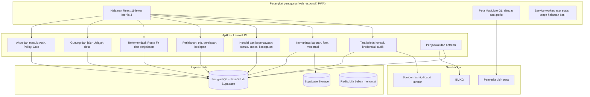

# PRD Memount: Personalized Mountain Planning & Readiness Platform

**Versi:** PRD v3.0 (konsolidasi), 25 September 2026
**Status:** Draf konsolidasi, di-commit atas izin pemilik 26 September 2026 ("lanjut, commit"); persetujuan isinya masih ditunggu (spec konsolidasi, verifikasi V8). Keputusan yang dikutip di dalamnya (DK-01 sampai DK-29) sudah diambil; susunan gabungan ini yang belum disetujui.
**Platform:** aplikasi web responsif, PWA-ready
**Merek:** Memount (DK-13), satu sumber `config('app.name')`
**Pengguna utama:** pendaki gunung di Indonesia, pemula sampai berpengalaman
**Tim:** lima anggota (§127)
**Jenis MVP:** MVP akademik/portofolio setara produksi

**Sumber yang digabung:**

| Sumber | Keadaan | Nasibnya |
|---|---|---|
| PRD v2.0 FINAL (`git show 4c7b68e:PRD.md`, 3.670 baris, §1 sampai §146, BR-01 sampai BR-16) | Kanonis, tertimpa di salinan kerja tanpa governance record (temuan F4) | Seluruh ID dipertahankan; tabel paritas di Lampiran B |
| PRD NgodingPakeAI (415 baris) dan delapan `features/*.md` (140 task) | Dihasilkan `ngodingpakeai plan get` | Tujuan, alur, NFR, dan kriteria yang tidak bertentangan dengan aturan kanonis dilebur; kriteria per fitur pindah ke `docs/fitur/`; jejaknya di Lampiran E |
| `ourplan.md` (riset strategi, 861 baris) | Tidak dilacak git | Diarsipkan utuh di `docs/arsip/2026-09-22-strategi-platform.md`; tesis, tujuh dampak perilaku, L0 sampai L4, dan peta jalan dilebur ke §160, §161, dan §128 |
| `PRODUCT.md` (240 baris) | Kanonis untuk produk dan pertumbuhan | Isinya dilebur ke PRD (DK-02); berkasnya tetap sebagai ringkasan untuk alat desain dan menunjuk ke sini; paritas di Lampiran C |

Desain konsolidasi: `docs/superpowers/specs/2026-09-23-konsolidasi-dokumen-design.md`. Arahan dan keputusan 25 September 2026: `docs/superpowers/specs/2026-09-25-memount-v2-design.md`. Rencana: `docs/superpowers/plans/2026-09-23-konsolidasi-dokumen.md`.

---

## Cara membaca

1. **Nomor § adalah ID permanen, bukan halaman.** Setiap bagian membawa ID-nya di judul. Urutan baca disusun untuk manusia yang membaca dari atas, sehingga boleh berbeda dari urutan nomor. Untuk mencari §N, buka Lampiran A.
2. **Tidak ada ID yang dihapus atau dipakai ulang.** Bagian yang dipadatkan ke bagian lain tetap tercatat sebagai alias di Lampiran A, misalnya §137 dipadatkan ke §1. ID baru: bagian mulai §147 (kini terpakai sampai §161), fitur mulai FR-22 (terpakai sampai FR-27), aturan bisnis baru memakai nomor setelah BR-16 (belum ada), governance record berikutnya GR-05.
3. **Rujukan di kode tidak disentuh.** Karena ID tetap, ratusan rujukan `§N`, `BR-N`, dan `FR-N` di kode, test, dan dokumen tetap menunjuk isi yang sama. `tests/Feature/PrdReferenceIntegrityTest.php` menjaganya: setiap ID yang dirujuk harus punya heading atau alias di sini, indeks tidak boleh melompat, tidak ada ID yang dipakai dua kali, PRD hanya ada di `docs/PRD.md`, dan setiap berkas `.md` yang disebut dokumen hidup benar-benar ada.
4. **Konvensi rujukan.** Di dokumen ini, "§N" selalu berarti ID PRD. Bagian dokumen lain ditulis "bagian N" beserta nama berkasnya, misalnya "HANDOVER.md bagian 3". Aturan R-001 sampai R-024 tidak disalin ke sini; PRD hanya merujuk pemiliknya (peta di bawah).
5. **Istilah.** Teks untuk pengguna memakai pos (bukan checkpoint), jalur, kawasan, dan pengelola. Istilah domain di dokumen ini: Mountain, Trail, Route Fit. Nilai enum ditulis kapital, misalnya OPEN atau COCOK.
6. **Tingkat bukti (R-023).** Klaim dipisahkan menjadi FACT (dengan bukti: berkas, test, keluaran perintah), DECISION (dengan ID keputusan), INFERENCE, HYPOTHESIS, RECOMMENDATION, OPEN ISSUE, dan PERLU KLARIFIKASI. Angka target di dokumen ini adalah target, bukan hasil, sampai studinya dijalankan.
7. **Rincian per fitur** (kriteria penerimaan, data, state, status implementasi, task NgodingPakeAI) ada di `docs/fitur/`. PRD memuat ringkasan dan aturan yang mengikatnya.

### Peta kepemilikan

Setiap jenis isi punya satu pemilik. Bila dua berkas berbeda, pemiliknya yang berlaku.

| Jenis isi | Pemilik |
|---|---|
| Pintu masuk tim, cara menjalankan | `README.md` |
| Indeks dokumen tim | `docs/README.md` |
| Kesepakatan kerja tim: izin, alur riset lebih dulu, cara audit, definisi selesai, format rekap, urutan wewenang skill (merangkum dan menunjuk pemilik aturan) | `docs/AGENTS.md` |
| Cara berkontribusi | `CONTRIBUTING.md` |
| Kebijakan keamanan dan pelaporan kerentanan | `SECURITY.md` |
| Kontrak operasi agen, R-018 sampai R-021, R-023, R-024 | `CLAUDE.md` |
| Pintu masuk agen selain Claude: blok Laravel Boost dan penunjuk ke kesepakatan kerja | `AGENTS.md` |
| Aturan domain R-001 sampai R-014 dan R-022 | `.claude/rules/mountain-core.md` |
| Arah desain, R-015 sampai R-017 | `DESIGN.md` di root; `docs/DESIGN.md` hanya penunjuk |
| Visi, misi, north star, ekspektasi pemilik, posisi, persona, prinsip, aturan bisnis BR-01 sampai BR-16, cakupan dan fase, arsitektur informasi, NFR, model domain, metrik, risiko, kesepakatan bersama, tata kelola dan log keputusan | `docs/PRD.md` (dokumen ini) |
| Spesifikasi per fitur, 01 sampai 08 | `docs/fitur/` |
| Arsitektur kode, kontrak SEO teknis, struktur repo | `docs/ARCHITECTURE.md` |
| Skema basis data per domain dan kebijakan migrasi | `database/README.md` |
| Kebijakan data pribadi dan penghapusan akun | `docs/KEBIJAKAN-DATA-PRIBADI.md` |
| Klasifikasi skill dan urutan wewenangnya | `docs/MATRIKS-SKILL.md` |
| Keadaan terkini dan serah terima antarsesi | `HANDOVER.md` |
| Riset asal dan catatan bersumber | `docs/riset/` |
| Dokumen yang tidak lagi hidup, disimpan utuh | `docs/arsip/` |
| Prototype pemilik dan gambar acuannya | `docs/desain/prototype/` |
| Ringkasan produk untuk alat desain impeccable (bukan sumber kebenaran) | `PRODUCT.md` di root; `docs/PRODUCT.md` hanya penunjuk |
| Desain dan rencana kerja bertanggal | `docs/superpowers/` |

---

## §135 Baseline teknis

Diamandemen: header PRD v2.0 menulis Laravel 13.32.0, sedangkan yang terpasang 13.31.0 (diskrepansi D-A). PRD mencatat versi yang terpasang; upgrade atau downgrade adalah keputusan pemilik (R-020). Frontend kini React lewat Inertia atas keputusan pemilik 24 September 2026 (jalur C).

FACT, diperiksa 25 September 2026 dengan `php -v`, `composer -V`, `php artisan --version`, `composer show --direct`, dan versi paket di `node_modules`:

| Lapisan | Yang terpasang | Catatan |
|---|---|---|
| Runtime | PHP 8.5.10; Composer 2.10.3 | Target runtime PHP 8.5 |
| Kerangka | Laravel Framework 13.31.0 | Membutuhkan PHP 8.3 ke atas; dukungan keamanan sampai Q1 2028 ([Laravel 13](https://laravel.com/docs/13.x/releases)) |
| Presentasi | React 19.3.0, `inertiajs/inertia-laravel` 3.3.4, `@inertiajs/react` 3.7.1, TypeScript 5.9.3, Vite 8.3.0, `laravel/wayfinder` 0.1.21 | Laravel memegang routing, otorisasi, dan data; React memegang interaksi. SSR mati sampai diputuskan (`config/inertia.php`) |
| Presentasi lama | Livewire 3.8.9, Volt 1.11.2, Breeze 2.4.2 | Masih terpasang selama pensiun; melepas paketnya butuh izin pemilik |
| Gaya | Tailwind CSS 3.4.19 | Token warna di `resources/css/app.css` satu-satunya sumber palet |
| Data | PostgreSQL di Supabase dengan PostGIS; Supabase Storage lewat disk `supabase` (S3) | Skema kanonis adalah migrasi di `database/migrations/` (51 berkas) |
| Peta | MapLibre GL 4.7.1; basemap OpenTopoMap lewat `MAP_TILE_URL` | Kebijakan peta §55 |
| Sumber luar | BMKG (prakiraan cuaca); status resmi dari pengelola kawasan dan badan resmi, dicatat kurator | Tidak ada API status resmi yang dapat dipanggil saat ini |
| Test | PHPUnit 12.5.35 (suite Unit, Feature, Spatial); Pint 1.32.0 | Suite Spatial butuh PostgreSQL (`SPATIAL_TEST_DSN`) |
| Target deploy | Vercel (DK-12) | Rincian §154 |
| Aksesibilitas | WCAG 2.2 AA | §87 |

Komponen produk yang berjalan di atas baseline ini: aplikasi web responsif dengan manifest dan service worker (PWA-ready), peta kompatibel MapLibre, prakiraan BMKG, dan sumber status resmi. Perubahan versi kerangka, penambahan dependensi, dan perubahan semantik penyedia luar butuh persetujuan pemilik (R-020, R-021, DK-24).

---

# Bagian I: Produk

## §1 Ringkasan eksekutif produk

**Pernyataan merek pemilik** (verbatim, 25 September 2026; kalimat pertama sudah berlaku sejak 23 September 2026):

> "MEMOUNT adalah platform perjalanan gunung yang dipersonalisasi, yang menghubungkan discovery, Route Fit, preparation, readiness, field experience, trust, community, dan progression dalam satu perjalanan utuh. MEMOUNT membantu saya menemukan perjalanan gunung yang cocok untuk saya."

Pernyataan ini adalah arah, bukan teks publik. Teks yang dibaca pengguna mengikuti kontrak merek di §156.

**Definisi produk.** Memount adalah aplikasi web yang membantu pendaki menentukan:

> jalur mana yang paling sesuai dengan profil dan rencana pendakiannya, apa tantangan jalur tersebut, apa yang perlu dipersiapkan, bagaimana kondisi terbaru, dan apa yang dapat dipelajari dari pengalaman pendakian sebelumnya.

Produk ini **bukan** sekadar katalog gunung, aplikasi GPS, aplikasi checklist, aplikasi cuaca, media sosial, atau marketplace pendakian. Produk ini adalah **platform pendukung keputusan pendakian yang dipersonalisasi** (personalized hiking decision-support platform).

**Alur dalam bahasa pengguna** (dari PRD NgodingPakeAI; padanan loop §7):

```text
Jelajah → Pilih → Rencanakan → Siapkan → Cek → Mendaki → Laporkan → Berkembang
```

**Deskripsi produk** (dipadatkan dari §137): aplikasi web yang membantu pendaki memilih jalur gunung berdasarkan kecocokan antara profil pendaki, karakteristik jalur, dan rencana perjalanan; memahami alasan rekomendasi dan tantangan jalur; mempersiapkan kebutuhan pendakian secara personal; memeriksa status resmi, cuaca, dan kondisi terbaru; memakai informasi penting saat berada di jalur; serta berkontribusi lewat laporan kondisi.

**Pernyataan solusi** (dipadatkan dari §139): sistem menyediakan alur pendukung keputusan yang menggabungkan profil pendaki, karakteristik jalur, konteks trip, status resmi, cuaca, dan laporan kondisi komunitas untuk menghasilkan rekomendasi jalur yang dapat dijelaskan serta rencana persiapan yang relevan.

**Ukuran berhasil** tidak diubah: bagian rencana yang sampai ke pre-departure check, bukan jumlah pengguna terdaftar (§63).

## §2 Masalah inti

Informasi pendakian tersedia di banyak sumber, tetapi tersebar. Pendaki harus menggabungkan sendiri: profil pengalaman pribadi, informasi gunung, informasi jalur, jarak, elevation gain, durasi, medan, tingkat teknis, navigasi, cuaca, status resmi, kondisi lapangan, perlengkapan, dan pengalaman pendaki lain.

Di Indonesia, sumber itu terpencar di grup media sosial (kondisi jalur), aplikasi peta (rute), situs cuaca (prakiraan), dan akun komunitas (laporan terkini). Keputusan mendaki akhirnya sering diambil dengan informasi yang tidak lengkap, tidak jelas sumbernya, atau sudah kedaluwarsa.

Masalah utamanya **bukan** "pendaki tidak dapat menemukan informasi gunung", melainkan:

> Pendaki kesulitan mengubah berbagai informasi tersebut menjadi keputusan yang relevan dengan dirinya dan rencana pendakiannya.

**Pernyataan masalah** (dipadatkan dari §138): pendaki menghadapi informasi yang tersebar dan tidak selalu kontekstual terhadap kemampuan, pengalaman, rencana perjalanan, dan kondisi terbaru. Proses memilih jalur dan bersiap karena itu menuntut penggabungan informasi dari berbagai sumber dan keputusan manual yang membingungkan, terutama bagi pendaki berpengalaman terbatas.

**Keadaan data yang ikut menjadi masalah** (FACT, `docs/ARCHITECTURE.md` "Yang belum ada", per 20 September 2026): jalur yang tercatat belum punya geometri dan pos belum punya koordinat, sehingga peta, jarak, dan mode pendakian belum dapat diandalkan sebelum kurasi data (§108, §159).

## §3 Peluang produk

Produk mengubah proses:

```text
Cari gunung → Baca informasi → Cari ulasan → Cari cuaca → Cari checklist → Putuskan sendiri
```

menjadi:

```text
Profil pendaki → Rencana pendakian → Route Fit → Alasan dan tantangan → Rencana persiapan
→ Status resmi, cuaca, kondisi → Pre-departure check → Mendaki → Laporan
```

## §4 Visi produk

> Membantu pendaki mengambil keputusan pendakian yang lebih terinformasi dengan menghubungkan profil pendaki, karakteristik jalur, rencana perjalanan, dan kondisi terbaru dalam satu alur yang dapat dijelaskan.

Visi ini dan pernyataan merek pemilik (§1) menunjuk hal yang sama dari dua arah: visi menyebut keputusan yang lebih terinformasi, pernyataan merek menyebut perjalanan utuh yang terasa milik pendakinya.

## §5 Misi produk

1. Mempermudah pemilihan jalur berdasarkan konteks pengguna.
2. Memberikan rekomendasi yang dapat dijelaskan.
3. Mengubah rekomendasi menjadi rencana persiapan.
4. Membedakan informasi resmi, terverifikasi, komunitas, dan interpretasi sistem.
5. Menyediakan informasi penting menjelang dan selama pendakian.
6. Membentuk lingkaran umpan balik lewat laporan kondisi jalur.

## §6 North star produk

> Membantu pengguna berpindah dari "ingin mendaki" menjadi "memahami jalur yang dipilih, persiapan yang dibutuhkan, kondisi yang perlu diperiksa, dan hasil perjalanan."

## §63 North star metric

> Persentase trip terencana yang menyelesaikan alur perencanaan inti dari pemilihan rute sampai pre-departure check.

Bukan jumlah pengguna terdaftar. Peristiwa penyusunnya adalah funnel FR-20 (§62), dibaca di halaman analitik admin. Angka ini hanya bermakna setelah ada pengguna sungguhan; selama belum ada, yang tersedia adalah instrumennya, bukan hasilnya.

## §160 Ekspektasi pemilik

Bagian baru (GR-02, arahan pemilik 25 September 2026: dokumen yang bertumpuk dijadikan "satu visi, misi, ekspektasi, dan kesepakatan bersama"). Visi, misi, dan north star ada di §4 sampai §6; bagian ini menyatukan apa yang pemilik harapkan dari produk dan dari cara membangunnya. Kesepakatan kerja ada di §161.

**Kata-kata pemilik** (verbatim, dikutip dari HANDOVER.md bagian 2 dan spec v2 bagian 1):

> "aplikasi web gunung yang memadukan antara aplikasi web atau aplikasi yang popular dan sudah banyak user nya dengan strava dan traveloka, bagaimana user riset di masing-masing aplikasi nya dengan itu saya ingin mengcompare ke 3 itu di padukan dan menerapkan pada aplikasi gunung."

> "saya mengutamakan untuk pertama imk dan ui/ux"

> "impact dari interaksi manusia komputer, ui, dan ux di semua refrensi yang saya cantumkan dari hasil riset, tujuan, dan kesepakatan diatas itu sama dengan aplikasi web yang akan kita bangun."

> "yang saya lihat masih sama Penilaian "masih CRUD sederhana". yang saya rasakan hanya update fitur crud itupun sedikit dan tidak semua fitur nya tidak dapat berfungsi dengan baik."

Artinya: bukan menyerupai rupa rujukan, melainkan mencapai dampak IMK, UI, dan UX yang setara dengan mereka.

**Tesis: bukan sekadar direktori CRUD** (dari `ourplan.md`, bagian "Product Vision & Thesis"). Produk menjawab lima pertanyaan pendaki dalam satu alur: jalur mana yang sebaiknya saya daki, mengapa jalur itu cocok untuk saya, bagaimana saya merencanakan dan bersiap, apa status jalur terkini, dan bagaimana saya melihat perkembangan saya. Halaman yang hanya menampilkan dan mengubah baris data tanpa menjawab salah satu pertanyaan itu belum memenuhi ekspektasi ini.

**Tujuh dampak perilaku yang dituju** (dari `ourplan.md`, "Behavioral Goals"). Semuanya hipotesis sampai divalidasi (§113):

| Dampak | Kalimat yang diharapkan dari pengguna | Rujukan asal |
|---|---|---|
| Confidence | "Aplikasi ini memuat informasi yang saya perlukan untuk memercayai pilihan saya." | AllTrails |
| Efficiency | "Saya dapat menyaring dan memutuskan dengan cepat." | Traveloka |
| Continuity | "Setiap pendakian melanjutkan riwayat saya." | Strava |
| Clarity | "Saya tahu mengapa jalur ini cocok dengan tujuan saya." | Route Fit, gaya penjelasan Komoot |
| Context | "Saya melihat peringatan resmi dan kondisi nyata." | Outdooractive, AllTrails |
| Exploration | "Saya dapat berpindah antara peta dan daftar tanpa kehilangan konteks." | AllTrails, Komoot |
| Focus | "Layar hanya menampilkan yang saya perlukan sekarang." | Progressive disclosure (§89) |

**Urutan prioritas yang mengikat** (dari PRODUCT.md, "Prioritas dan peran"). Ketika dua kebutuhan bertabrakan, yang lebih atas menang:

1. IMK/HCI;
2. UI/UX;
3. logika produk dan arsitektur informasi;
4. arsitektur dan skalabilitas;
5. keamanan, privasi, kepatuhan;
6. keandalan dan penanganan kegagalan;
7. kesiapan operasional dan observability;
8. manajemen dan konsistensi data;
9. pemasaran, SEO, pertumbuhan.

Urutan ini mengatur prioritas kerja, bukan izin melanggar aturan: aturan kanonis R-001 sampai R-024 dan BR-01 sampai BR-16 tetap berlaku pada setiap tingkat.

**Lima prinsip rekayasa** (arahan pemilik 24 September 2026, verbatim: "selalu menerapkan dan menambahkan prinsip proper architecture, scalable system, secure by design, stable, and reliable"). Setiap perubahan dijawab dengan lima pertanyaan ini sebelum dilaporkan, dan jawabannya masuk rekap:

| Prinsip | Pertanyaan yang dijawab |
|---|---|
| Proper architecture | Apakah setiap konsep punya satu sumber kebenaran? Contoh: nama produk hanya di `config('app.name')`, palet hanya di token `app.css`. |
| Scalable system | Apakah jumlah query dan ukuran respons tetap datar saat data bertambah, dan state tidak menempel pada satu proses? |
| Secure by design | Apakah input tidak dipercaya, daftar putih dipakai alih-alih daftar hitam, otorisasi di server, endpoint tanpa autentikasi dibatasi laju, dan tidak ada secret di kode? |
| Stable | Apakah kegagalan terkendali (peta gagal, cuaca tidak tersedia, JavaScript belum jalan) dan halaman pertama benar tanpa skrip? |
| Reliable | Apakah klaimnya dibuktikan test yang menghitung, runtime yang dipotret, dan paritas PostgreSQL bila skema tersentuh (R-023, R-024)? |

**Aspek sistem yang dituntut di luar UI/UX** (HANDOVER.md bagian 2): arsitektur dan skalabilitas, keamanan dan kepatuhan, keandalan dan manajemen kegagalan, operasional dan observability, pengelolaan data dan konsistensi, serta pemasaran (§155). Mutu akhir diukur dari pengalaman, sistem, dan produk sekaligus, bukan dari halaman yang render atau test yang hijau (CLAUDE.md bagian 8).

## §8 Diferensiator produk

**Explainable Mountain-Hiker Fit Engine.** Pembedanya bukan "memiliki banyak gunung", bukan "memiliki GPS", bukan "memiliki ulasan", dan bukan "memiliki checklist", melainkan:

> menghubungkan karakteristik pendaki dengan karakteristik jalur dan konteks perjalanan, kemudian menjelaskan alasan kecocokan tersebut.

Dipadatkan dari §140: bukan "kami punya basis data gunung", tetapi "kami membantu pengguna memahami mengapa suatu jalur relevan untuk profil dan rencana pendakiannya, apa yang perlu dipersiapkan, dan informasi apa yang masih perlu diperiksa".

## §9 Posisi produk dan rujukan

Produk **bukan** "aplikasi daftar gunung Indonesia", **bukan** "Strava untuk pendaki", dan **bukan** "aplikasi keselamatan pendakian". Produk **adalah** platform perencanaan, persiapan, dan pendukung keputusan pendakian yang dipersonalisasi.

**Yang tidak dapat disalin produk lain** (dari PRODUCT.md, "Positioning") adalah model kepercayaan datanya, bukan daftar fiturnya: setiap keterangan membawa sumber, jenis sumber, waktu, keadaan verifikasi, dan cakupan (§60); keterangan resmi tidak pernah tercampur dengan laporan pendaki (§92); ketiadaan data dinyatakan UNKNOWN dan tidak pernah dianggap OPEN (§95); penilaian kecocokan dijelaskan per faktor tanpa angka skor (BR-09).

**Pesaing konsep terdekat** (INFERENCE dari riset nama internasional, dicek ulang 23 September 2026): muncak.id, yang juga membandingkan jalur dan mencocokkan jalur dengan profil. Pembeda Memount karena itu harus terlihat lewat penjelasan alasan per faktor, hierarki sumber resmi, dan UNKNOWN yang jujur, bukan lewat klaim fitur.

### ATM: amati, tiru, modifikasi

Sasarannya dampak IMK, UI, dan UX serta dukungan keputusan yang setara atau lebih baik, bukan kemiripan rupa.

- **Amati** masalah yang dipecahkan, konteks pemakaian, model mental pengguna, pola interaksi, hierarki informasi, mekanisme keputusan, umpan balik, mekanisme kepercayaan, mekanisme retensi, batasan operasional, dan efek UX yang terukur.
- **Tiru** hanya mekanisme atau prinsipnya. Jangan menyalin merek, warna dan identitas visual, tata letak per piksel, teks milik orang lain, kode sumber, atau asumsi yang hanya berlaku di domain lain.
- **Modifikasi** untuk pendakian gunung Indonesia: pengguna lokal, Mountain ≠ Trail, konsep via dan basecamp, status resmi, kenyataan data cuaca, konteks luar ruang dan seluler, koneksi lemah, sensitivitas lokasi, laporan kondisi komunitas, persiapan, dan masalah produk yang sebenarnya.

Fitur pesaing tidak ditambahkan semata-mata karena pesaing memilikinya.

### Rujukan dan yang diambil

| Rujukan | Efek yang dituju | Mekanisme yang diambil | Yang dihindari |
|---|---|---|---|
| AllTrails: kepercayaan lewat konteks | "Saya memahami ongkos dan konteks jalur sebelum berangkat." | Penemuan dan penyaringan jalur, karakteristik rute, kondisi, ulasan sebagai intel komunitas, rute tersimpan | Menyalin tema visual |
| Traveloka: kemudahan memutuskan | "Saya dapat mempersempit pilihan, menyimpan kandidat, membandingkan, lalu memutuskan." | Pencarian, saringan kaya, simpanan, perbandingan, menunda komitmen tanpa kehilangan kandidat; banding maksimal 3 (DK-05) dan berbagi read-only | Alur pemesanan dan pembayaran |
| Strava: kesinambungan dan kemajuan pribadi | "Pengalaman sebelumnya berharga dan saya dapat melihat perkembangan diri saya." | Siklus aktivitas, riwayat, perbandingan dengan diri sendiri, alasan untuk kembali | Papan peringkat dan kompetisi antarpendaki (R-015) |
| Komoot: kecerdasan rute | "Saya memahami profil jalur sebelum berangkat." | Profil elevasi, ringkasan rute yang menjelaskan | Optimasi rute A ke B yang mengabaikan konteks |
| Wikiloc: pengetahuan komunitas | "Saya mendapat pengetahuan lapangan dari sesama pendaki." | Laporan dan foto komunitas yang termoderasi | Data komunitas yang menimpa data resmi (R-010) |
| Gaia GPS: kedalaman spasial | "Peta adalah permukaan keputusan, bukan hiasan." | Peta interaktif, lapisan peta, offline masa depan lewat PMTiles (§55) | Data peta yang membengkak |
| Outdooractive: konteks resmi | "Saya memercayai lapisan data resmi." | Status, penutupan, dan peringatan resmi yang terlihat | Konten komersial yang terlepas dari keputusan |
| PeakVisor: visualisasi gunung | "Saya dapat membayangkan bentuk gunungnya." | Profil elevasi, halaman gunung | AR dan 3D di luar cakupan |

Tiga rujukan pertama adalah rujukan utama pemilik; lima lainnya rujukan sekunder dari `ourplan.md`. Sintesis riset rujukan (HANDOVER.md bagian 5): ketiga rujukan utama sebenarnya mesin pembanding, dan diferensiator §8 juga sebuah perbandingan antara pendaki dan jalur.

**Temuan terkini** (diakses 23 September 2026): AllTrails Peak (Mei 2025) menambah rute kustom dengan smart routing, kondisi jalur prediktif dari 15 faktor lingkungan, area offline, dan heatmap keramaian ([TechCrunch](https://techcrunch.com/2025/05/12/alltrails-debuts-a-80-year-membership-that-includes-ai-powered-smart-routes), [AllTrails Press](https://www.alltrails.com/press/alltrails-expands-membership-offering-with-alltrails-peak)). Strava 2025 sampai 2026 menambah Route Saves dari berbagai permukaan, Off-Route Alerts, fitur hiking Juni 2026 dengan Live Elevation, dan kontrol Map Visibility yang menyembunyikan titik awal dan akhir ([Strava Press](https://press.strava.com/articles/strava-adds-new-features-for-hiking-making-the-outdoor-experience-more-discoverable-navigable-and-social), [Strava Help](https://support.strava.com/hc/en-us/articles/115000173384-Edit-Map-Visibility)). Simpulannya: menyimpan banyak kandidat lalu membandingkan sedikit adalah pola rujukan, dasar DK-05.

## §156 Merek

Bagian baru (GR-03; DK-13 sampai DK-16).

| Unsur | Isi | Keputusan |
|---|---|---|
| Nama | **Memount**, ditetapkan pemilik 24 September 2026 (verbatim: "tetapkan Memount sebagai nama brand app web ini"). Ditulis Memount di teks dan aria; wordmark boleh menampilkannya kapital lewat CSS. Satu sumber: `APP_NAME` dibaca lewat `config('app.name')` | DK-13 |
| Nama yang ditolak | VELORA (D1), VERTIKA, GOURVA, EMOUNT, MENDAKI; bukti di `docs/riset/2026-09-23-konsolidasi/` | DK-13 |
| Pernyataan pemilik | Tetap verbatim sebagai arah (§1, `DESIGN.md` bagian "Arah"), tidak dipakai mentah sebagai teks publik | DK-14 |
| Tiga kata kerja dan satu fondasi | *Memilih*, *Bersiap*, *Mendaki dan bertumbuh*; fondasi *sumber yang jujur* | DK-14 |
| Proposisi satu baris | "Jalur yang sesuai dengan pengalaman Anda, dengan alasan dan sumber yang jelas." | DK-14 |
| Tagline | "Pilih jalur yang sesuai. Pahami alasannya." (`config('brand.tagline')`) | DK-14 |
| Suara | "Anda"; mengakui batas pengetahuannya; tidak menjanjikan keselamatan | DK-14, R-012, R-014 |
| Perbaikan teks | "layak berangkat" diganti "apa yang masih kurang sebelum berangkat" (temuan F9, sudah diterapkan di `config('brand.description')`) | DK-14, R-014 |
| Arsitektur merek | Branded house: Route Fit adalah fitur bermerek di bawah nama Memount, bukan sub-merek. Nama publiknya dipilih lewat uji kegunaan dari "Route Fit", "Kecocokan Jalur", "Cek Kecocokan"; sampai uji selesai istilah yang tampil tidak diubah. Label keputusan tetap tiga (R-004) | DK-15 |
| Logo | Konsep A "Jalur Berpos": garis rute zig-zag berujung cincin pos, lockup horizontal dengan wordmark. Sketsa sudah dipakai (`resources/js/components/brand/Mark.tsx` dan `Lockup.tsx`); aset final baru setelah uji 16 px, audit kemiripan, penelusuran PDKI tanda gambar, uji pemahaman 5 sampai 8 pendaki, dan persetujuan pemilik | DK-16 |

**Syarat yang masih terbuka** (tindakan pemilik, dicatat supaya tidak hilang): uji dengar-lalu-eja K1b sebelum aset logo final; mengamankan `memount.com`, `memount.id`, dan handle `@memount` atau `@memount.id`; permohonan merek DJKI kelas 9 dan 42. Arah "go internasional" diperlakukan sebagai kriteria nama; perluasan cakupan produk ke luar Indonesia belum diputuskan (R-021).

### Komitmen merek

Dari PRODUCT.md, "Brand Commitments", dengan amandemen bahasa oleh DK-20:

- **Bahasa Indonesia adalah bahasa utama dan sumber kebenaran**, termasuk pesan galat dan validasi. Bahasa Inggris menjadi bahasa tambahan pertama (§158). Komitmen lama "seluruh antarmuka berbahasa Indonesia" diubah lewat GR-03.
- **Nadanya mengakui batas pengetahuannya.** Kekosongan data disajikan sebagai tahapan dengan menyebut siapa yang ditunggu, bukan sebagai permintaan maaf atau kotak kosong.
- **Tidak pernah menghukum keputusan yang benar.** Pendakian yang dibatalkan karena cuaca tetap tercatat sebagai pendakian.
- **Tidak ada perbandingan kecepatan antarpendaki.** Mengejar waktu di gunung membahayakan orang; energi kompetitif diarahkan ke kontribusi data yang terverifikasi, bukan ke jumlah kiriman (§145, R-015).

## §10 Pengguna sasaran

Pendaki gunung di Indonesia, dengan pemula sebagai pengguna utama. Mereka merencanakan pendakian dari ponsel, sering di jaringan lambat, dan sebagian besar keputusan diambil berhari-hari sebelum berangkat, bukan saat di jalur.

| Persona | Ciri | Kebutuhan utama |
|---|---|---|
| 1. Pemula | Pengalaman terbatas; sulit membaca karakteristik jalur; cenderung mengandalkan rekomendasi; belum tahu kebutuhan persiapan; butuh informasi sederhana dan terstruktur | "Jalur mana yang realistis untuk saya?" |
| 2. Menengah | Sudah beberapa kali mendaki; memahami data dasar jalur; mulai punya preferensi; ingin membandingkan rute | "Jalur mana yang paling sesuai dengan target saya?" |
| 3. Berpengalaman | Memahami medan dan navigasi; punya riwayat; butuh data kondisi yang aktual | "Apa kondisi terbaru dari jalur yang ingin saya ambil?" |
| 4. Admin kurator data | Memasukkan gunung, jalur, status resmi, dan perizinan | "Bagaimana menjaga informasi jalur, status, sumber, dan laporan komunitas tetap akurat dan terkontrol?" |
| 5. Ahli bersertifikat wilayah | Pemandu bersertifikat jenjang Ahli (skema BNSP, LSP, APGI, SKKNI; jenjang Muda, Madya, Ahli; berlaku tiga tahun) yang menyumbang geometri jalur dan koordinat pos untuk kawasan yang disahkan baginya; haknya gugur saat sertifikat kedaluwarsa | "Bagaimana saya menyumbang data jalur di kawasan saya dengan cepat dan tercatat?" |

Peran moderator (menilai laporan kondisi sebelum terbit) nyata dan berjalan di sistem, tetapi tidak dijadikan persona produk tersendiri. Istilah pengguna untuk persona 5 adalah "Ahli bersertifikat" (label `SourceType::ACCREDITED_EXPERT`), bukan "Pakar" seperti di PRD NgodingPakeAI (K6, DK-09).

### Konteks operasi

Dari PRODUCT.md, "Operating Context". Konteks ini menentukan rancangan, bukan sekadar kasus tepi:

- **Tidak ada sinyal di hampir seluruh gunung Indonesia.** Jejak direkam di perangkat dan dikirim setelah turun. Service worker menolak menyajikan halaman dari cache, karena status "OPEN" yang basi lebih berbahaya daripada halaman yang gagal terbuka.
- **Tiga zona waktu** (WIB, WITA, WIT). Waktu ditampilkan menurut zona gunungnya, bukan zona pembacanya, dan penandanya selalu disebut (§93).
- **Izin pendakian punya jendela pemesanan** yang bergerak relatif terhadap tanggal rencana, misalnya Semeru dibuka H-30 dan ditutup H-2 (§153).
- **Prakiraan cuaca dari BMKG** diambil terjadwal dua kali sehari dan tidak pernah dipanggil langsung dari peramban (§45).
- **Status jalur berubah tanpa pemberitahuan**: penutupan karena kebakaran, aktivitas vulkanik, atau pemulihan jalur diumumkan sepihak oleh pengelola kawasan.

## §11 Jobs to be done

- **JTBD-01.** Ketika saya ingin mendaki, saya ingin menemukan jalur yang sesuai dengan pengalaman dan rencana saya.
- **JTBD-02.** Ketika saya memilih jalur, saya ingin memahami tantangan spesifik jalur tersebut.
- **JTBD-03.** Ketika saya mendekati hari pendakian, saya ingin memeriksa status resmi, cuaca, dan kondisi terbaru.
- **JTBD-04.** Ketika saya selesai mendaki, saya ingin melaporkan kondisi jalur agar pengguna berikutnya mendapat informasi tambahan.

## §12 Tujuan produk

| Tujuan | Isi |
|---|---|
| G1 Route selection | Membantu pengguna menemukan jalur yang relevan |
| G2 Preparation | Membantu pengguna mengetahui kebutuhan persiapan |
| G3 Information trust | Menampilkan sumber dan kesegaran informasi |
| G4 Continuity | Menyimpan riwayat trip dan memperlihatkan perkembangan |
| G5 Data feedback | Memakai laporan jalur sebagai informasi tambahan |

Enam tujuan PRD NgodingPakeAI dipetakan ke G1 sampai G5, dengan penyelarasan kanonis (DK-10) di tempat yang bertabrakan:

| Tujuan NgodingPakeAI | Masuk ke | Penyelarasan |
|---|---|---|
| Keyakinan (Confidence): sumber, status resmi, waktu pembaruan jelas | G3 | Tidak ada |
| Kemudahan memilih (Decision Convenience): cari, saring, simpan, banding tanpa kehilangan konteks | G1 | Banding maksimal 3 (DK-05) |
| Kecocokan personal (Route Fit): "nilai kecocokan" dengan alasan | G1 | Ditampilkan sebagai label COCOK, PERLU PERSIAPAN, KURANG COCOK beserta alasan per faktor; tanpa nilai angka (R-004, R-005, BR-09) |
| Kesiapan (Readiness): tanggal, perlengkapan, kondisi fisik | G2 | "Kondisi fisik" menjadi butir persiapan fisik umum, bukan penilaian medis (R-014, §36) |
| Kesinambungan (Continuity): riwayat dan grafik progres | G4 | Pembandingnya diri sendiri (R-015) |
| Data yang dapat dipercaya (Provenance): jalur tanpa geometri belum terbit dan tidak direkomendasikan | G3 | Sejalan dengan R-008, R-022, dan §110 |

## §13 Non-goals

MVP tidak bertujuan menjadi: pusat komando darurat; aplikasi medis; marketplace; platform open trip; pemesanan porter; tiruan media sosial; platform navigasi lanjutan; platform navigasi offline; platform wearable; sistem keselamatan AI otonom; CRUD gunung; direktori wisata generik; aplikasi GPS semata; aplikasi ulasan semata; tiruan AllTrails, Traveloka, atau Strava.

Tambahan: **pemesanan izin pendakian tidak direplikasi**; produk menautkan sistem resmi pengelola (§153). Monetisasi dan kompetisi sosial tidak ditambahkan tanpa keputusan pemilik (R-021).

## §144 Prinsip produk

Semua keputusan pengembangan mempertahankan satu prinsip:

> Produk tidak berusaha menjadi aplikasi pendakian dengan fitur sebanyak mungkin. Produk berusaha menjadi sistem yang membantu pendaki mengambil keputusan perjalanan yang lebih terstruktur, dapat dijelaskan, dan berbasis sumber informasi yang jelas.

Satu filter untuk setiap fitur:

> "Apakah fitur ini meningkatkan FIT, PREPARE, CHECK, HIKE, atau REPORT?"

Bila tidak, fitur itu berada di luar MVP (lihat juga feature gate §131).

**Prinsip produk** (dari PRODUCT.md, "Product Principles"):

1. **Yang tidak diketahui dinyatakan, bukan ditebak.** Nol bukan pengganti null, dan diamnya sistem tidak boleh terbaca sebagai kabar baik (R-006, R-007).
2. **Resmi dan komunitas tidak pernah tertukar**, termasuk secara visual (§92, R-010).
3. **Menjelaskan, bukan menilai.** Pendaki harus dapat menyebut sendiri alasan sebuah jalur tidak direkomendasikan (§90).
4. **Keselamatan mengalahkan keterlibatan.** Setiap mekanisme yang menaikkan penggunaan diuji dulu terhadap kemungkinan ia mendorong pengambilan risiko.
5. **Catatan tetap jujur terhadap waktunya.** Hasil lama tidak dihitung ulang diam-diam; ia diberi pengakuan bahwa keadaannya sudah berubah.

**Prinsip dari PRD NgodingPakeAI yang dilebur:** informasi tidak pernah dikarang, dan bila data belum ada ditampilkan keterangan jujur seperti "Data ketinggian belum tersedia" (sama dengan prinsip 1); fokus pada kejelasan dan efisiensi, bukan tren visual yang mengganggu. Prinsip "peta adalah antarmuka utama" diselaraskan oleh DK-06: peta menjadi target antarmuka utama, tetapi hanya menggambar jalur yang bergeometri (§145). Hierarki "Resmi, Admin, Pakar, Komunitas" diselaraskan dengan R-009 yang diamandemen (§43).

Komitmen merek ada di §156; urutan prioritas yang mengikat ada di §160.

## §155 Pertumbuhan dan halaman publik

Bagian baru (GR-02), dari PRODUCT.md "Growth". Pemasaran adalah bagian dari rancangan produk, bukan lapisan yang ditempel sesudahnya. Kontrak SEO teknis ada di `docs/ARCHITECTURE.md`; struktur URL publik ada di §145.2.

**Corong.**

```text
SEARCH → HALAMAN JALUR PUBLIK → ROUTE FIT → SHORTLIST → TRIP
       → HIKE → REPORT → PROGRESS → SHARE → PENGGUNA BARU
```

Corong ini menutup lingkaran: pendaki yang selesai melapor menghasilkan bahan yang membuat halaman publik berguna bagi pendaki berikutnya. Pertumbuhan datang dari kegunaan, bukan dari volume halaman.

**Halaman publik yang masuk akal:** halaman gunung, halaman jalur atau via, halaman kawasan atau niat pencarian, panduan persiapan, dan ringkasan kondisi terkini bila datanya memang ada. Ditulis untuk orang yang sedang merencanakan pendakian sungguhan (BR-16).

**Mekanisme pertumbuhan:** pencarian organik; berbagi perbandingan (FR-23); data komunitas; kemitraan kampus dan komunitas luar ruang; progresi pribadi; perencanaan berulang.

**Yang tidak dikejar:** trafik sia-sia. Kunjungan yang tidak pernah sampai ke Route Fit tidak dihitung sebagai keberhasilan, dan tidak ada mekanisme pertumbuhan yang boleh mengorbankan kepercayaan data atau melunakkan bahasa keselamatan.

**Keadaan sekarang** (FACT, `routes/web.php`): satu-satunya halaman yang terlihat mesin pencari adalah `/pendakian/{trail:slug}` beserta `sitemap.xml`; halaman lain berada di balik login. Halaman publik itu sengaja hanya memuat keterangan berumur panjang, tanpa status resmi dan tanpa prakiraan cuaca, karena cuplikan mesin pencari berumur lebih panjang daripada isinya. Target struktur URL dan versi bahasa Inggris ada di §145.2 dan §158.

---

# Bagian II: Aturan dan model domain

Aturan domain R-001 sampai R-014 dan R-022 dimiliki `.claude/rules/mountain-core.md`. Bagian ini menurunkannya menjadi requirement produk; bila ada perbedaan, berkas aturan yang berlaku.

## §14 Model domain inti

```text
HIKER
  ├── PROFILE
  ├── PREFERENCES
  └── HIKING HISTORY
          │
          ▼
      TRIP PLAN
          │
          ▼
        TRAIL
     ┌────┴────┐
     ▼         ▼
 SEGMENTS   CHECKPOINTS
     │
     ▼
 CONDITIONS
```

**Field per entitas:**

- **Mountain:** identitas; wilayah; elevasi; lokasi; kawasan pengelola; deskripsi; sumber.
- **Trail:** `mountain_id`; nama atau via; geometri; jarak; elevation gain dan loss; durasi; medan; tuntutan fisik; tuntutan teknis; kompleksitas navigasi; ketersediaan tempat berkemah dan air; area referensi cuaca; sumber dan keadaan verifikasi.
- **Segment:** `trail_id`; urutan; geometri; medan; tingkat teknis; kompleksitas navigasi; jarak dan elevasi; catatan.
- **Checkpoint (pos):** jalur atau segmen; urutan; koordinat; elevasi; jarak dari awal; perkiraan waktu; catatan.

Tabel nyata yang mewujudkan model ini ada di §64.

## §15 Mountain ≠ Trail

Satu gunung dapat mempunyai beberapa jalur:

```text
Mountain
 ├── Trail A
 ├── Trail B
 └── Trail C
```

Karena itu kesulitan dan Route Fit **tidak boleh hanya melekat pada gunung**. Kesulitan dan karakteristik rute berada terutama pada tingkat jalur (R-001, R-002, BR-01). Jalur adalah unit keputusan; informasi tingkat gunung tidak menggantikan karakteristik jalur ketika keputusan membutuhkan informasi rute.

## §16 Karakteristik rute

Setiap jalur dapat mempunyai: jarak; elevation gain; elevation loss; perkiraan durasi; tuntutan teknis; medan; kompleksitas navigasi; ketersediaan tempat berkemah; ketersediaan air; geometri rute; pos; karakteristik segmen; tuntutan fisik; `mountain_id` sebagai relasi ke gunungnya; sumber dan keadaan verifikasi.

## §17 Model kesulitan multidimensi

Jangan menyimpan "Difficulty = HARD" sebagai satu-satunya fakta. Karakteristik dinilai berdimensi:

```text
Physical Demand · Technical Demand · Navigation Complexity · Terrain Character · Environmental Consideration
```

Kesulitan keseluruhan boleh menjadi **label turunan**, bukan satu-satunya sumber kebenaran. Tuntutan fisik keseluruhan diturunkan dari jarak, elevation gain, dan durasi.

## §18 Aturan MDPL

MDPL hanya **atribut deskriptif**, bukan penentu utama kesulitan (BR-02). Rekomendasi lebih dipengaruhi jarak, elevation gain, durasi, medan, tuntutan teknis, navigasi, dan konteks.

```text
Gunung A: 2.000 mdpl, elevation gain 1.400 m
Gunung B: 3.000 mdpl, elevation gain 700 m
```

Gunung B tidak otomatis lebih berat hanya karena lebih tinggi. Tangga kemajuan di Progres karena itu memakai tanjakan, bukan mdpl (§146, keputusan tertutup).

## §24 FR-04 Route Fit Engine

Route Fit adalah jantung sistem dan diferensiator inti (R-003). Ia tidak boleh direduksi menjadi peringkat berdasarkan satu atribut seperti MDPL.

```text
Input:  profil pendaki + tujuan trip + karakteristik jalur + status terkini
Output: COCOK | PERLU PERSIAPAN | KURANG COCOK
```

Mesinnya berbasis aturan dan deterministik, bukan AI (§85). Implementasi: `App\Services\RouteFitService`, `RouteFit\CompatibilityScorer`, `TrailFitService` (ringkasan kecocokan sekumpulan jalur tanpa query tambahan per jalur). Rincian permukaan: [`docs/fitur/01-jelajah-rute.md`](docs/fitur/01-jelajah-rute.md) dan [`docs/fitur/02-detail-rute.md`](docs/fitur/02-detail-rute.md).

### §25 Tiga lapis Route Fit

| Lapis | Pertanyaan yang dijawab |
|---|---|
| 1. Hard constraint | Apakah jalur masih layak menjadi kandidat? |
| 2. Kompatibilitas | Seberapa sesuai jalur dengan kemampuan dan konteks? |
| 3. Preferensi | Seberapa sesuai dengan preferensi pengguna? |

### §26 Hard constraint

```text
Status resmi = CLOSED                                  → dikeluarkan
Target trip 1 hari, perkiraan jalur beberapa hari       → dikeluarkan dari rekomendasi bawaan
Syarat akses jalur tidak terpenuhi                      → dikeluarkan
Data kritis jalur tidak lengkap (R-008, R-022, §110)    → tidak menjadi kandidat
```

Hard constraint bersifat deterministik. Pembatasan (RESTRICTED) tidak otomatis mengeluarkan jalur; ia menjadi peringatan yang ditampilkan (§101).

### §27 Faktor kompatibilitas

| Faktor | Bobot awal |
|---|---:|
| Experience match | 30% |
| Duration match | 15% |
| Terrain match | 15% |
| Technical match | 15% |
| Elevation gain match | 10% |
| Navigation match | 10% |
| Trip preference | 5% |

Bobot ini adalah **konfigurasi V1, bukan hukum alam**. Setelah riset pengguna, uji kegunaan, dan evaluasi dataset, bobot boleh dikalibrasi. Bobot tinggal di tabel `recommendation_rules` dan diubah lewat halaman admin, supaya setiap kalibrasi terekam di jejak audit run; ambang label ada di `config/hiking.php` bagian `route_fit`. Faktor yang datanya belum ada ditandai sebagai belum diketahui, bukan dinilai rendah (R-006, R-007).

### §28 Skor internal

Sistem boleh punya `fit_score` (kolom `recommendation_results.internal_score`) untuk peringkat dan audit, misalnya 82,4. Angka itu **tidak pernah ditampilkan** kepada pengguna dalam bentuk apa pun, termasuk sebagai props halaman React (BR-09, R-005).

### §29 Label publik Route Fit

Pengguna hanya melihat tiga label (R-004):

| Label | Arti yang ditampilkan |
|---|---|
| COCOK | Karakteristik jalur secara umum sesuai dengan profil dan rencana Anda. |
| PERLU PERSIAPAN | Jalur masih relevan, tetapi ada beberapa hal yang perlu diselesaikan lebih dulu. |
| KURANG COCOK | Terdapat perbedaan cukup besar antara jalur ini dengan profil atau rencana Anda. |

Penyelarasan K3: label "cocok / cukup / kurang" dari PRD NgodingPakeAI dan `features/01` tidak dipakai. Halaman yang menilai tanpa rencana trip menyebut jenis penilaiannya ("Kecocokan dasar" atau "untuk rencana ini"), supaya label yang sama tidak terbaca berbeda di dua halaman tanpa penjelasan.

### §30 Explainability rekomendasi

Setiap rekomendasi punya tiga kelompok alasan:

- **Why It Fits** (mengapa cocok): misalnya pengalaman, durasi, dan medan sesuai.
- **What to Watch** (yang perlu diperhatikan): misalnya elevation gain tinggi, segmen teknis, navigasi sedang.
- **Preparation Gap** (celah persiapan): misalnya perlengkapan belum dikonfirmasi, briefing rute belum selesai, cuaca belum diperiksa.

Penanda ✓ (sesuai) dan ⚠ (perlu perhatian) dari PRD NgodingPakeAI boleh dipakai sebagai pembantu visual, selalu bersama kalimatnya, karena makna tidak boleh disampaikan lewat simbol atau warna saja (§87). Contoh: "Jarak sesuai target ✓, tanjakan sedikit di atas rata-rata Anda ⚠". Teks penjelasan berasal dari templat berbasis aturan, bukan prosa buatan AI (§85, `RecommendationExplanationService`).

### §31 Audit rekomendasi

Setiap run rekomendasi menyimpan konteks yang cukup untuk direproduksi:

```text
engine_version · versi aturan/konfigurasi · cuplikan profil · cuplikan tujuan · cuplikan jalur
· cuplikan kondisi yang relevan · aturan yang dievaluasi · faktor yang cocok · aturan yang gagal
· peringatan · generated_at
```

Tujuannya debugging, reproduksibilitas, audit, dan riset. Cuplikan yang identik dengan konfigurasi yang identik harus menghasilkan klasifikasi yang sama. Tabel: `recommendation_runs` (`engine_version`, `input_snapshot`, `rules_evaluated`, `warnings`, `generated_at`) dan `recommendation_results` (termasuk `trail_snapshot`, `matched_factors`, `failed_rules`, `explanation`).

## §38 FR-10 Model kesiapan

Kesiapan terdiri dari tiga dimensi:

```text
ROUTE FIT + PREPARATION READINESS + CURRENT CONDITIONS
```

Kesiapan adalah dukungan keputusan, bukan izin medis, diagnosis, jaminan keselamatan, atau izin hukum (R-014).

**Penyelarasan K4** (DK-10): "skor kesiapan berbasis kebugaran" dari PRD NgodingPakeAI dan `features/04` tidak dipakai. Yang ditampilkan adalah keadaan kesiapan (§39) beserta faktor yang masih kurang dan hitungan butir persiapan kritis yang sudah dikonfirmasi, misalnya "5 dari 8 butir kritis sudah dikonfirmasi". Tidak ada angka skor (R-005). Kebugaran hanya muncul sebagai butir persiapan fisik umum (§36), bukan penilaian atas tubuh pengguna. Rincian: [`docs/fitur/04-perjalanan-persiapan.md`](docs/fitur/04-perjalanan-persiapan.md).

### §39 Keadaan kesiapan

| Keadaan | Syarat |
|---|---|
| READY | Route fit dapat diterima; persiapan kritis dikonfirmasi; akses resmi sesuai; tidak ada masalah kritis yang belum selesai |
| NEEDS_PREPARATION | Ada celah persiapan; pre-departure check belum lengkap; ada kekhawatiran nonkritis |
| NOT_RECOMMENDED | Dipakai terbatas untuk kondisi tingkat produk yang jelas: penutupan resmi, pembatasan resmi yang eksplisit, atau ketidakcocokan keras |

NOT_RECOMMENDED tidak pernah berdasarkan "sistem merasa pengguna secara medis tidak mampu".

### §40 Semantik keselamatan

Sistem tidak pernah mengatakan "Anda aman" atau "Gunung ini aman". Sistem mengatakan fakta bersumber: "Status resmi saat ini OPEN" atau "Terdapat peringatan kondisi yang perlu diperhatikan" (R-012, BR-05). Hal yang sama berlaku bagi teks merek (§156): tidak ada janji keselamatan.

## §41 FR-11 Status resmi

Nilai status akses:

```text
OPEN · RESTRICTED · CLOSED · UNKNOWN
```

Setiap status resmi harus membawa: sumber; URL sumber; `published_at`; `fetched_at`; `verified_at`; `effective_at`; `expires_at` bila tersedia; cakupan; alasan; catatan. Ketiadaan status adalah UNKNOWN, tidak pernah OPEN (BR-07, R-006).

**Penyelarasan K5** (DK-10): label "Dibuka / Ditutup / Dibatasi / Waspada" tanpa UNKNOWN dari PRD NgodingPakeAI tidak dipakai. "Waspada" bukan nilai status; ia menjadi peringatan kondisi yang ditampilkan di samping status.

**Amandemen DK-22** (GR-03): status akses dari pengelola kawasan (misalnya surat edaran Kemenhut) dan status bahaya vulkanik PVMBG (Level I sampai IV) adalah **dua keluarga status yang disimpan terpisah**, masing-masing dengan sumber dan waktunya. Level PVMBG tidak pernah dipetakan ke OPEN, RESTRICTED, atau CLOSED demi satu tampilan (R-012, K33). Tabel pemetaan surat edaran ke CLOSED dan RESTRICTED masih OPEN ISSUE (§159).

Rincian permukaan: [`docs/fitur/05-kabar-kondisi.md`](docs/fitur/05-kabar-kondisi.md).

### §42 Cakupan status

Status tidak hanya milik gunung. Cakupannya dapat berupa MOUNTAIN, TRAIL, SEGMENT, atau AREA.

```text
Mountain = OPEN
Trail A = OPEN · Trail B = CLOSED · Trail C = RESTRICTED
```

OPEN di tingkat gunung tidak otomatis berarti semua jalur OPEN. Kaskadenya satu arah: pembatasan turun ke bawah, kelonggaran tidak (`OfficialStatusService`). Status bahaya vulkanik (§41) berlaku pada gunung apinya dan ditampilkan di samping status akses, bukan dijadikan status akses.

### §43 Hierarki otoritas data

Amandemen DK-09 (**diputuskan atas delegasi pemilik**), teks canonical di `.claude/rules/mountain-core.md` R-009:

```text
OFFICIAL > ADMIN VERIFIED > ACCREDITED EXPERT > COMMUNITY > AI
```

ACCREDITED EXPERT ("Ahli bersertifikat") adalah pemegang kredensial Ahli yang masih berlaku dari badan resmi, dan kewenangannya terbatas pada kawasan kerjanya. Kode sudah memakai urutan ini (`App\Enums\SourceType`: peringkat 1 sampai 5); yang tertinggal sebelumnya adalah teks aturannya. Informasi berotoritas lebih rendah tidak pernah menggantikan yang lebih tinggi; AI tidak pernah menjadi otoritas sumber (R-011, BR-12).

Kredensial ahli mengikuti skema nyata (BNSP, LSP, APGI, SKKNI; jenjang Muda, Madya, Ahli; berlaku tiga tahun) dan diverifikasi admin (`expert_credentials`, `credential_mountain`). Hak menyumbang data gugur sendiri saat sertifikat kedaluwarsa. Label pengguna: Resmi, Terverifikasi admin, Ahli bersertifikat, Komunitas, Interpretasi sistem.

## §44 FR-12 Cuaca

BMKG menyediakan prakiraan terbuka dalam JSON untuk 3 hari, interval 3 jam, diperbarui dua kali sehari, berbasis wilayah administrasi tingkat IV (kelurahan atau desa, kode adm4), dengan batas 60 permintaan per menit per IP; aplikasi wajib mencantumkan BMKG sebagai sumber ([Data Terbuka BMKG](https://data.bmkg.go.id/prakiraan-cuaca/), diakses 23 September 2026).

Karena itu sistem tidak boleh menyebut "cuaca puncak gunung X" hanya dari prakiraan wilayah administratif. Yang ditampilkan adalah **"Prakiraan area sekitar jalur"** dengan area referensi yang didefinisikan pada jalur (BR-15): `trails.weather_adm4_code` dan `trails.weather_reference_area`.

**Penyelarasan K17**: skema usulan PRD NgodingPakeAI (`weather_snapshots.mountain_id`, cuaca per gunung) tidak dipakai; area referensi melekat pada jalur, sesuai kode.

### §45 Arsitektur cuaca

```text
Laravel Scheduler → BMKG API → Validasi → Normalisasi → Simpan weather snapshot → Cache → Antarmuka
```

Peramban tidak pernah memanggil BMKG langsung untuk setiap pengguna. Tugas terjadwal `weather:refresh` berjalan pukul 06.00 dan 18.00 zona waktu aplikasi (UTC); cara menjalankannya di produksi ada di §98 dan §154.

### §46 Data cuaca minimum

Waktu lokal (`local_datetime`) dan waktu prakiraan (`forecast_at`); deskripsi cuaca; suhu; kelembapan; kecepatan angin; arah angin; tutupan awan; jarak pandang; tanggal analisis; sumber; `fetched_at`.

### §47 Aturan kegagalan cuaca

Bila pengambilan gagal, sistem tidak mengarang data (R-013).

- Ada data lama: "Data cuaca belum berhasil diperbarui. Data terakhir tersedia pada ..."
- Tidak ada data sama sekali: "Data cuaca tidak tersedia."
- Tidak pernah: "Cuaca baik."

## §48 FR-13 Laporan kondisi jalur

Fitur komunitas utama. Pengguna melaporkan:

- **Wajib:** jalur, tanggal pendakian, kondisi.
- **Opsional:** segmen, foto, catatan.

Tag kondisi: MUDDY, WET, SLIPPERY, DRY, CROWDED, QUIET, LOW_VISIBILITY, GOOD_MARKING, POOR_MARKING, WATER_AVAILABLE, WATER_SCARCE.

Laporan masuk moderasi sebelum terbit (§57, §118). Penghargaan antarpendaki hanya berupa "terima kasih" (`report_thanks`). Laporan jenis "cerita" atau "tips" dan reaksi "jempol" tidak masuk MVP (DK-11): Kabar adalah intel kondisi jalur, bukan feed sosial. Rincian: [`docs/fitur/05-kabar-kondisi.md`](docs/fitur/05-kabar-kondisi.md).

### §49 Prinsip laporan komunitas

Laporan komunitas adalah **intel lapangan pelengkap**, bukan status resmi (R-010, BR-06).

### §50 Aturan konflik resmi dan komunitas

```text
Resmi = OPEN, komunitas = "jalur terhalang"
```

Sistem menampilkan **Status resmi: OPEN** dan **Laporan komunitas: terdapat hambatan pada segmen tertentu**, berdampingan. Sistem tidak otomatis mengubah status menjadi CLOSED.

### §51 Kesegaran laporan komunitas

Setiap laporan membawa tanggal pendakian, `created_at`, dan status moderasi. Pengguna melihat kalimat seperti "Dilaporkan 2 hari lalu berdasarkan pendakian tanggal ...". Kesegaran laporan dihitung dari tanggal pendakian, bukan hanya tanggal kirim.

## §59 Model kesegaran data

Setiap sumber punya kebijakan kesegaran sendiri:

| Sumber | Kebijakan | Ambang saat ini (`config/hiking.php`) |
|---|---|---|
| BMKG | Mengikuti jadwal penyedia | CURRENT sampai 12 jam, AGING sampai 24 jam |
| Status resmi | Mengikuti irama pembaruan sumbernya | Ditinjau ulang setelah 90 hari; peringatan 14 hari sebelum `expires_at` |
| Laporan komunitas | Relatif terhadap tanggal pendakian | CURRENT sampai 7 hari, AGING sampai 30 hari |

Tidak boleh ada aturan universal seperti "data lebih dari 24 jam berarti basi". **Penyelarasan K8** (DK-10): ambang universal "lebih dari 7 hari berarti perlu diperbarui" dari `features/05` tidak dipakai. Pemeriksaan data basi terjadwal: `data:freshness-check` (§98).

## §60 Model kepercayaan data

Setiap data penting minimal membawa:

```text
SOURCE · SOURCE TYPE · TIMESTAMP · VERIFICATION STATE · SCOPE
```

Contoh:

> Status Jalur B. Sumber: Pengelola. Diverifikasi: 18 Sep 2026. Cakupan: Jalur B. Status: OPEN.

Granularitas waktu dipisah, bukan satu kolom: `retrieved_at` (kapan sistem mengambil), `published_at` (kapan sumber menerbitkan, bila tersedia), `verified_at` (kapan admin memverifikasi). URL sumber disimpan bila sumbernya punya alamat yang dapat dirujuk. Keadaan kesegaran CURRENT, AGING, STALE, UNKNOWN ada di §93 dengan ambang per sumber (§59). Model kepercayaan ini adalah nilai inti produk (§9) dan dasar setiap penyelarasan dengan hierarki otoritas (§43).

## §95 Prinsip informasi default-safe

Sistem lebih baik berkata **UNKNOWN** daripada mengasumsikan OPEN, dan lebih baik berkata **NEEDS_PREPARATION** daripada memberi keyakinan palsu. Prinsip ini berlaku dua arah: status kosong bukan OPEN, dan karakteristik jalur yang kosong bukan berarti jalurnya mudah (R-006, R-007, BR-07). Total atau ringkasan yang sebagian datanya belum ada tidak boleh terbaca lengkap.

---

# Bagian III: Pengalaman

## §7 Loop produk inti

```text
PROFILE → ROUTE FIT → PLAN → PREPARE → CHECK → HIKE → REPORT → IMPROVE
```

Semua fitur utama harus punya hubungan dengan loop ini. Padanannya dalam bahasa pengguna dan tab navigasi (§145):

| Loop | Kata kerja pengguna | Tab tempat terjadinya |
|---|---|---|
| PROFILE | (pengaturan awal) | Profil |
| ROUTE FIT | Jelajah, Pilih | Jelajah, Trip |
| PLAN | Rencanakan | Trip |
| PREPARE | Siapkan | Trip |
| CHECK | Cek | Trip, Beranda |
| HIKE | Mendaki | Mendaki |
| REPORT | Laporkan | Lapisan Community (detail jalur, ringkasan pendakian) |
| IMPROVE | Berkembang | Progres |

**Lima pilar** (dipadatkan dari §134), masing-masing satu pertanyaan pengguna:

1. **FIT:** Jalur mana yang cocok dengan saya?
2. **PREPARE:** Apa yang perlu saya siapkan?
3. **CHECK:** Kondisi apa yang perlu saya periksa sebelum berangkat?
4. **HIKE:** Informasi minimum apa yang saya butuhkan di jalur?
5. **REPORT:** Apa yang bisa saya kontribusikan untuk pendaki berikutnya?

Loop final (§141) sama dengan loop di atas dan tidak ditulis ulang.

## §19 Alur pengguna utama

**A. Pendaki.** Alur MVP (memuat §133):

```text
1 Daftar → 2 Profil → 3 Tujuan pendakian → 4 Route Fit → 5 Rekomendasi → 6 Pahami alasan
→ 7 Pilih jalur → 8 Buat trip → 9 Persiapan personal → 10 Cek kesiapan → 11 Status resmi
→ 12 Cuaca → 13 Kondisi terbaru → 14 Pre-departure check → 15 Mode pendakian
→ 16 Selesaikan trip → 17 Laporan kondisi → 18 Riwayat
```

Versi rinci dari PRD NgodingPakeAI (alur A), diselaraskan: masuk atau daftar; isi preferensi; buka Jelajah (peta sebaran jalur bergeometri dan daftar kartu, cari dan saring); lihat label kecocokan dan buka "Kenapa?"; buka detail rute (ringkasan, peta, profil ketinggian, pos, kondisi bersumber, penjelasan kecocokan); simpan beberapa jalur dan beri catatan pribadi; bandingkan sampai tiga jalur dan bagikan tautannya bila perlu; pilih satu jalur sebagai dasar rencana; atur tanggal, jumlah peserta, dan catatan, dengan langkah yang selesai dan langkah berikutnya terlihat; centang persiapan dan lihat sisa butir; lihat keadaan kesiapan beserta faktor yang masih kurang (bukan skor); tinjau status resmi, prakiraan, dan laporan dengan sumber dan kesegarannya; terima pengingat menjelang keberangkatan; mendaki dengan mode pendakian; catat pendakian selesai; lihat progres terhadap pendakian sendiri; kembali ke Jelajah dengan profil yang makin akurat.

**B. Admin kurator dan moderator.** Masuk ke konsol pengelola dan melihat ringkasan kesehatan data; menindaklanjuti temuan (jalur tanpa geometri, pos tanpa koordinat, status kedaluwarsa); meninjau kiriman di antrean moderasi lalu menyetujui atau menolak dengan alasan; memperbarui status resmi dengan sumber, waktu, dan pelaku tercatat; memverifikasi kredensial ahli beserta kawasannya; semua aksi tercatat di log audit (§61).

**C. Ahli bersertifikat wilayah.** Melihat kawasan yang disahkan baginya; menyunting geometri jalur dan koordinat pos sesuai izin (`TrailPolicy::update()`); perubahan yang membutuhkan penerbitan menunggu admin, karena menerbitkan jalur hanya hak admin (`TrailPolicy::publish()`, §110); memantau status kirimannya di jejak audit; melihat alasan bila suatu aksi terkunci (misalnya "penerbitan butuh persetujuan admin" atau "sertifikat sudah kedaluwarsa").

## §89 Progressive disclosure

Urutan informasi:

```text
Apa ini? → Cocokkah untuk saya? → Mengapa? → Apa tantangannya? → Apa yang harus disiapkan? → Bagaimana kondisi sekarang?
```

Di tingkat daftar, satu baris alasan sudah cukup; penjelasan lengkap dibuka dari sana.

## §90 Explainability di antarmuka

Pengguna harus dapat memahami "Kenapa sistem merekomendasikan jalur ini?" tanpa membuka dokumentasi teknis. Penjelasan membantu keputusan, bukan menjadi penjaga gerbang.

## §91 Tanpa presisi palsu

Jangan: "Safety 91,72%", "Probability of success 88%", "Safe mountain".
Gunakan: "Cocok", "Perlu persiapan", "Kurang cocok", "Status resmi OPEN".

Pengukuran nyata tetap boleh disebut apa adanya (8 jam, tanjakan 700 m). Yang dilarang adalah angka yang mengklaim kepastian keselamatan atau kecocokan (R-005, BR-09).

## §92 Resmi dan komunitas terbedakan

```text
STATUS RESMI                KONDISI KOMUNITAS
OPEN                        Berlumpur di segmen 3
Sumber: Pengelola Jalur     Dilaporkan: 2 hari lalu
Diperbarui: ...
```

Keduanya harus berbeda secara visual, dan urutannya mengikuti hierarki otoritas (§43). Warna biru di sistem desain menandai komunitas, bukan "informasi" (penyelarasan K18, `DESIGN.md`). Beda visual tidak boleh hanya lewat warna (§87).

## §93 Kesegaran data di antarmuka

Keadaan: CURRENT, AGING, STALE, UNKNOWN. Ambangnya ditentukan per sumber (§59). Waktu disimpan dalam UTC dan ditampilkan dalam zona gunungnya lengkap dengan penanda WIB, WITA, atau WIT.

## §145 FR-21 Arsitektur informasi dan permukaan produk

Diamandemen oleh **DK-25 lewat GR-02** (§146). Lima permukaan lama (Jelajah, Pertimbangkan, Perjalanan, Kabar, Progres) digantikan lima tab dan Profil, dengan Community sebagai lapisan lintas-halaman. Batas negatif setiap permukaan lama dibawa ke tab penggantinya.

**Kata-kata pemilik** (verbatim, 25 September 2026, dari spec v2 bagian 1):

> "1. Home: Personalized dashboard. 2. Explore: Discovery. 3. Trips: Workspace untuk Fit + Plan + Ready. 4. Track: Hike mode. 5. Progress: History + progression. Community? Community menjadi cross-cutting layer, bukan primary tab. Contohnya: Explore → Trail → Community Reports atau: Trail Detail → Community atau: Progress → Hike → Share Report. Dengan ini kita mempertahankan semua fitur tanpa membuat navigasi mobile berantakan."

```text
MEMOUNT
├── HOME: Your next journey, Recommended for you, Readiness status, Upcoming trip, Progress snapshot
├── EXPLORE: Map, Trails, Mountains, Filters, Saved
├── TRIPS: Route Fit, Compare, Trip Plan, Preparation, Ready Check
├── TRACK: Start Hike, Live Map, GPS, Checkpoints, Elevation, Finish
├── PROGRESS: Hike History, Statistics, Goals, Milestones
└── PROFILE: Experience, Preferences, Equipment, Settings, Privacy
```

### 145.1 Lima tab dan Profil

Nama Inggris adalah kata-kata pemilik. Label Indonesia mengikuti asumsi A1 spec v2 (Beranda, Jelajah, Trip, Mendaki, Progres, Profil) dan dapat dikoreksi pemilik.

| Tab | Pertanyaan pengguna | Cakupan | Batas negatif |
|---|---|---|---|
| **Beranda** (Home) | "Apa langkah saya berikutnya?" | Perjalanan berikutnya, rekomendasi "karena ...", status kesiapan, trip mendatang, ringkasan progres, kabar gunung yang diikuti, satu langkah berikutnya | Beranda tidak memutuskan untuk pengguna; kabar yang tampil adalah intel kondisi, bukan feed sosial |
| **Jelajah** (Explore) | "Apa yang tersedia dan mana yang relevan?" | Peta, daftar jalur, tampilan gunung (gunung membuka jalurnya, R-001), saringan, pencarian kalimat sederhana (FR-27), Route Fit, detail jalur, simpanan dengan catatan pribadi (FR-22) | Jelajah tidak memutuskan; ia menyajikan kandidat beserta alasannya. Peta hanya menggambar jalur yang bergeometri; titik gunung tidak dipakai sebagai pengganti jalur (DK-06, **diputuskan atas delegasi pemilik**) |
| **Trip** (Trips) | "Bagaimana saya memilih, merencanakan, dan bersiap?" | Rekomendasi Route Fit, banding maksimal 3 jalur yang dipilih dari simpanan (DK-05, **diputuskan atas delegasi pemilik**), trip, detail rencana (tanggal selesai, peserta), persiapan, cek kesiapan, pengingat (FR-24), tautan bagikan read-only (FR-23) | Banding tidak menghasilkan pemenang (R-016, §33). Tautan bagikan read-only dan tidak pernah menulis ke simpanan siapa pun. Kesiapan adalah dukungan keputusan, bukan izin medis atau hukum (§40) |
| **Mendaki** (Track) | "Apa yang saya butuhkan di jalur sekarang?" | Mulai pendakian, peta langsung, posisi atas izin, pos berikutnya dan sisa jarak, posisi pada profil elevasi, selesai | Mode lapangan minimal (§54). Lokasi hanya diminta di sini, atas persetujuan di perangkat, dan tidak dikirim ke server di luar rekam jejak yang opsional (§82, §83). Tidak menjanjikan pelacakan latar, deteksi keluar jalur, navigasi offline, atau SOS (§53) |
| **Progres** (Progress) | "Bagaimana perkembangan saya?" | Riwayat pendakian, statistik, target pribadi (FR-25), pencapaian, catatan pendakian manual (FR-25) | Pembandingnya diri sendiri (R-015), tanpa papan peringkat antarpendaki; riwayat tidak menaikkan level pengalaman (BR-11); pencapaian tidak pernah memberi hadiah pada kecepatan (§156) |
| **Profil** (Profile) | "Siapa saya sebagai pendaki, dan apa pengaturan saya?" | Pengalaman, preferensi, perlengkapan pribadi, pengaturan (tema §157, bahasa §158, akun, sandi), privasi (rekam jejak, hapus akun, kebijakan data); pintu ke konsol admin, moderator, dan kontribusi ahli bagi yang berhak | Pengalaman yang diisi sendiri adalah masukan, bukan sertifikasi (§22). Pintu konsol hanya tampilan; otorisasinya tetap di server (§76) |

**Community sebagai lapisan lintas-halaman.** Tidak menjadi tab. Tiga titik yang disebut pemilik: detail jalur memuat laporan komunitas dan ajakan melapor; Jelajah membuka laporan komunitas lewat jalur; ringkasan pendakian di Progres memuat "Bagikan laporan". Beranda memuat kabar gunung yang diikuti (asumsi A2 spec v2). Halaman `/kabar` tetap ada sebagai halaman lengkap yang dibuka dari Beranda dan Jelajah, bukan dari tab. Batasnya tetap: Community bukan feed sosial generik (DK-11) dan tidak pernah menggantikan status resmi (§50, R-010).

**Layar lebar.** Lima tab yang sama tampil di navigasi atas supaya konsisten antarukuran, dengan Profil sebagai menu avatar. Tata letak dua panel dipakai bila isinya membutuhkan (peta dan daftar, langkah dan isi).

**Dari lima permukaan lama ke tab baru:**

| Permukaan lama | Tempat sekarang |
|---|---|
| Jelajah | Jelajah |
| Pertimbangkan | Simpanan di Jelajah; banding di Trip |
| Perjalanan | Trip |
| Kabar | Lapisan Community dan Beranda; halaman `/kabar` tetap ada |
| Progres | Progres |

Rute lama dipertahankan supaya tautan, test, dan riwayat peramban tidak putus; yang berubah adalah tab mana yang aktif dan isi halamannya. Tab Mendaki mendapat pintu baru `/mendaki`. Asumsi agen yang ikut membentuk tabel ini (A1 sampai A6: label Indonesia, pemindahan Kabar, pintu konsol di Profil, arti "GPS" dan "Live Map", perlengkapan pribadi sebagai skema baru, pencapaian sebagai pencapaian terhadap diri sendiri) tercatat di spec v2 bagian 2 dan dapat dikoreksi pemilik. Keadaan implementasi per tab dicatat di `docs/fitur/` dan `HANDOVER.md`, bukan di sini.

### 145.2 Struktur URL publik

Struktur berikut mengikat routing, canonical URL, dan tautan internal halaman publik:

```text
/gunung/{slug}
/gunung/{slug}/via/{trail}
/panduan/{topic}
/kondisi/{trail}
```

Struktur ini mencerminkan model Mountain → Trail (BR-01): gunung dan jalur punya alamat sendiri.

**Versi bahasa Inggris** (DK-21, GR-03): Indonesia di root tanpa prefiks; Inggris di `/en/mountains/{gunung}/via/{jalur}` dan `/en/guides/{topik}`. Halaman `en` yang belum diterjemahkan diberi `noindex` dan canonical ke versi Indonesia; `hreflang` timbal balik; tidak ada pengalihan otomatis berdasarkan IP, geolokasi, atau `Accept-Language` (§158).

**Diskrepansi D-B:** kode memakai `/pendakian/{trail:slug}` (`routes/web.php`, `PublicTrailController`). Struktur di atas tetap target; migrasi ke `/gunung/{slug}/via/{trail}` dengan pengalihan 301 dilakukan **bersamaan** dengan peluncuran `/en/`, supaya tidak ada rantai pengalihan.

---

# Bagian IV: Fungsional ringkas

Setiap FR punya satu heading di PRD. Lima FR yang terikat erat dengan aturan domain tinggal di Bagian II (FR-04, FR-10, FR-11, FR-12, FR-13) dan FR-21 di Bagian III; sisanya di bawah ini. Kriteria penerimaan rinci, data, state, dan status implementasi ada di spesifikasi fitur.

| FR | § | Nama | Spesifikasi fitur |
|---|---|---|---|
| FR-01 | §20 | Autentikasi | [07 Akun dan masuk](docs/fitur/07-akun-masuk.md) |
| FR-02 | §21 | Profil pendaki | [07 Akun dan masuk](docs/fitur/07-akun-masuk.md) |
| FR-03 | §23 | Tujuan pendakian | [04 Perjalanan dan persiapan](docs/fitur/04-perjalanan-persiapan.md) |
| FR-04 | §24 | Route Fit Engine | [01 Jelajah rute](docs/fitur/01-jelajah-rute.md), [02 Detail rute](docs/fitur/02-detail-rute.md) |
| FR-05 | §32 | Hasil rekomendasi | [01 Jelajah rute](docs/fitur/01-jelajah-rute.md) |
| FR-06 | §33 | Perbandingan jalur | [03 Pertimbangkan](docs/fitur/03-pertimbangkan.md) |
| FR-07 | §34 | Detail jalur | [02 Detail rute](docs/fitur/02-detail-rute.md) |
| FR-08 | §35 | Rencana perjalanan | [04 Perjalanan dan persiapan](docs/fitur/04-perjalanan-persiapan.md) |
| FR-09 | §36 | Rencana persiapan | [04 Perjalanan dan persiapan](docs/fitur/04-perjalanan-persiapan.md) |
| FR-10 | §38 | Model kesiapan | [04 Perjalanan dan persiapan](docs/fitur/04-perjalanan-persiapan.md) |
| FR-11 | §41 | Status resmi | [02 Detail rute](docs/fitur/02-detail-rute.md), [05 Kabar dan kondisi](docs/fitur/05-kabar-kondisi.md) |
| FR-12 | §44 | Cuaca | [02 Detail rute](docs/fitur/02-detail-rute.md), [05 Kabar dan kondisi](docs/fitur/05-kabar-kondisi.md) |
| FR-13 | §48 | Laporan kondisi jalur | [05 Kabar dan kondisi](docs/fitur/05-kabar-kondisi.md) |
| FR-14 | §52 | Riwayat pendakian | [06 Pendakian dan progres](docs/fitur/06-pendakian-progres.md) |
| FR-15 | §53 | Mode pendakian | [06 Pendakian dan progres](docs/fitur/06-pendakian-progres.md) |
| FR-16 | §56 | Admin | [08 Konsol pengelola](docs/fitur/08-konsol-pengelola.md) |
| FR-17 | §57 | Moderasi | [08 Konsol pengelola](docs/fitur/08-konsol-pengelola.md) |
| FR-18 | §58 | Pengelolaan sumber data | [08 Konsol pengelola](docs/fitur/08-konsol-pengelola.md) |
| FR-19 | §61 | Log audit | [08 Konsol pengelola](docs/fitur/08-konsol-pengelola.md) |
| FR-20 | §62 | Analitik | [08 Konsol pengelola](docs/fitur/08-konsol-pengelola.md) |
| FR-21 | §145 | Arsitektur informasi dan permukaan produk | [01 Jelajah rute](docs/fitur/01-jelajah-rute.md) dan semua spesifikasi |
| FR-22 | §147 | Catatan pribadi | [03 Pertimbangkan](docs/fitur/03-pertimbangkan.md) |
| FR-23 | §148 | Tautan bagikan perbandingan | [03 Pertimbangkan](docs/fitur/03-pertimbangkan.md) |
| FR-24 | §149 | Pengingat perjalanan | [04 Perjalanan dan persiapan](docs/fitur/04-perjalanan-persiapan.md) |
| FR-25 | §150 | Target pribadi dan catatan pendakian manual | [06 Pendakian dan progres](docs/fitur/06-pendakian-progres.md) |
| FR-26 | §151 | Verifikasi kode multi-kanal | [07 Akun dan masuk](docs/fitur/07-akun-masuk.md) |
| FR-27 | §152 | Pencarian kalimat sederhana | [01 Jelajah rute](docs/fitur/01-jelajah-rute.md) |

## §20 FR-01 Autentikasi

Kemampuan: daftar; masuk; keluar; atur ulang kata sandi; verifikasi email bila diperlukan; penanganan sesi.

- **Given** pengguna belum terautentikasi, **when** membuka halaman privat, **then** sistem meminta autentikasi.
- **Given** pengguna sudah keluar, **then** sesi yang dilindungi tidak dapat dipakai kembali.

**Amandemen DK-07 dan DK-08** (GR-02). Metode masuk dan verifikasi (riset spec konsolidasi bagian 7.4):

| Kebutuhan | Metode | Alasan |
|---|---|---|
| Masuk utama | Passkey, serta email dan kata sandi | Passkey tahan phishing dan memenuhi WCAG 2.2 SC 3.3.8 |
| Daftar cepat | Google lewat Laravel Socialite | Permintaan pemilik (DK-07) |
| Bukti kepemilikan email | Kode atau tautan lewat email | Membuktikan kepemilikan alamat, bukan faktor autentikasi (NIST SP 800-63B-4) |
| Verifikasi nomor dan pemulihan akun | Kode WhatsApp, dengan SMS sebagai cadangan (§151) | WhatsApp dominan di Indonesia; SMS berstatus restricted, jadi bukan satu-satunya jalan |

Passkey memakai paket first-party `laravel/passkeys` dan `@laravel/passkeys`, dipasang langsung karena proyek tidak memakai Fortify. Semua metode ini butuh dependensi baru, jadi menunggu izin pemilik (DK-24, DK-28). OPEN ISSUE (spec v2, P9): jawaban lupa sandi yang sama apa pun keberadaan akunnya, dan penegakan verifikasi email setelah alur email siap.

## §21 FR-02 Profil pendaki

Profil minimum: tingkat pengalaman; pengalaman mendaki; jumlah pendakian selesai; pengalaman medan; pengalaman navigasi; durasi yang disukai; jenis trip yang disukai; preferensi wilayah.

Tingkat pengalaman: BEGINNER, INTERMEDIATE, ADVANCED, EXPERT. Tabel: `profiles`, `user_experience`, `user_preferences`.

### §22 Prinsip profil

Pengalaman yang diisi sendiri adalah **masukan**, bukan sertifikasi. Riwayat pendakian adalah **bukti dan konteks**, bukan promosi otomatis. Pengguna yang menyelesaikan satu pendakian sulit tidak otomatis berubah dari BEGINNER menjadi INTERMEDIATE (BR-11).

## §23 FR-03 Tujuan pendakian

Pengguna mengisi: tanggal target; wilayah; jenis trip; durasi yang diharapkan; tantangan yang disukai; preferensi elevation gain (opsional). Jenis trip: TEKTOK, CAMPING, MULTI_DAY. Tabel: `hiking_goals`.

Tujuan pendakian adalah masukan Route Fit untuk satu rencana. Target pribadi jangka panjang (jarak, tanjakan, frekuensi per bulan) adalah hal lain: ia milik Progres (§150) dan tidak mengubah label kecocokan.

## §32 FR-05 Hasil rekomendasi

Halaman rekomendasi menampilkan: nama jalur; gunung; Route Fit; jarak; elevation gain; perkiraan durasi; tingkat teknis; medan; navigasi; status terkini; kondisi terkini; celah persiapan; "Mengapa jalur ini?". Bila rekomendasi gagal, pengguna tetap dapat menjelajah dan menyaring secara manual (§94). Bila tidak ada jalur yang cocok, sistem menjelaskan sebabnya (§104).

## §33 FR-06 Perbandingan jalur

Pengguna dapat membandingkan jalur berdasarkan: jarak; elevation gain; durasi; medan; tuntutan teknis; navigasi; tempat berkemah; status; laporan terbaru. Kolom kecocokan memakai label dan alasan, tidak pernah angka skor (penyelarasan K2, R-005). Perbandingan tidak menghasilkan pemenang; sistem hanya membantu memahami perbedaan (R-016).

**Amandemen DK-05** (**diputuskan atas delegasi pemilik**; diselaraskan DK-29): **set banding maksimal 3 jalur**, dipilih dari daftar simpanan. Batas ini mengikat antarmuka dan server. Simpanan sendiri longgar; batas teknisnya ditetapkan di spesifikasi fitur 03. Dasar: rujukan menyimpan banyak kandidat lalu membandingkan sedikit, dan tiga kolom tetap terbaca di lebar 400 px (§88). Keadaan kode saat PRD ini ditulis masih memakai batas 5 (`ConsiderationService::BATAS`); penyelarasannya dicatat di spesifikasi fitur 03.

## §34 FR-07 Detail jalur

Bagian halaman: 1 ringkasan; 2 rute; 3 elevasi; 4 pos; 5 medan; 6 segmen teknis; 7 navigasi; 8 persiapan; 9 status resmi; 10 cuaca; 11 kondisi terbaru; 12 sumber.

Setiap keterangan yang belum ada ditampilkan jujur ("Data ketinggian belum tersedia"), bukan angka karangan atau grafik kosong (R-007). Jalur yang belum memenuhi syarat terbit (§110) tidak dibuka sebagai rincian utuh; halamannya menjelaskan data apa yang masih ditunggu (penyelarasan K23).

## §35 FR-08 Rencana perjalanan

Keadaan trip adalah himpunan tertutup:

```text
DRAFT · PLANNED · READY_FOR_DEPARTURE · IN_PROGRESS · COMPLETED · CANCELLED
```

Field: nama trip; rute; tanggal; jam mulai; jenis trip; catatan. Transisi yang tidak sah **wajib ditolak** di server, mengikuti alur Request, Validasi, Controller, Domain Service; pembatasan di antarmuka saja tidak memenuhi ketentuan ini.

**Amandemen K12** (DK-07, GR-02): trip menambah **jumlah peserta** dan **tanggal selesai**. Tanggal selesai sebelum tanggal mulai ditolak dengan pesan yang jelas. Keenam keadaan tidak berubah. Tambahan kolomnya aditif dan butuh migrasi (DK-28). Rencana ditampilkan sebagai langkah berurutan yang menunjukkan langkah selesai dan langkah berikutnya.

## §36 FR-09 Rencana persiapan

Persiapan bukan checklist generik; ia dikaitkan dengan jalur dan aturan izinnya. Kategori:

- **Perlengkapan:** alas kaki; penerangan; pelindung cuaca; navigasi; perlengkapan darurat.
- **Pengetahuan rute:** tinjau rute; tinjau pos; tinjau segmen teknis.
- **Logistik:** titik awal; transportasi; izin dan akses (§153); rencana berkemah; kontak darurat.
- **Cuaca:** prakiraan diperiksa; peringatan diperiksa.
- **Status resmi:** status terbaru diperiksa.
- **Persiapan fisik umum:** kondisi fisik umum menjelang keberangkatan; pengalaman terakhir yang relevan dengan beban rute ini.

Kategori terakhir bersifat persiapan, bukan penilaian medis. Sistem tidak menyatakan pengguna sehat, bugar, atau layak secara medis (§40, R-014).

### §37 Status persiapan

Checklist memakai CONFIRMED, NOT_CONFIRMED, NOT_APPLICABLE. Butir yang belum dicentang bukan berarti perlengkapan tidak dimiliki (BR-10): "Headlamp: belum dikonfirmasi", bukan "Headlamp: tidak ada".

## §52 FR-14 Riwayat pendakian

Riwayat menampilkan: trip; rute; tanggal; jenis trip; kelengkapan persiapan; keadaan penyelesaian; catatan pribadi; laporan yang dikirim. Pendakian yang dibatalkan karena cuaca tetap tercatat sebagai pendakian (§156). Catatan pendakian di luar trip (dicatat manual) diatur FR-25 (§150).

## §53 FR-15 Mode pendakian

MVP menyediakan: posisi saat ini; visualisasi rute; pos berikutnya; jarak ke pos; informasi rute yang esensial.

MVP **tidak menjanjikan**: pelacakan latar terus-menerus; deteksi keluar jalur tingkat lanjut; navigasi offline; pusat komando darurat.

Perekaman jejak bersifat pilihan, default mati, dan dapat dihapus pemiliknya (`user_preferences.record_track`, `hike_track_points`). Jejak direkam di perangkat dan dikirim setelah pendaki mendapat sinyal (§10). Di tab Mendaki (§145), peta mengikuti posisi hanya selama mode pendakian aktif dan atas persetujuan di perangkat. Tanpa geometri jalur dan koordinat pos, mode pendakian tidak dapat menentukan pos terdekat, dan ia menyatakannya, bukan menebak (§108).

### §54 Mode rencana dan mode pendakian

| | Mode rencana | Mode pendakian |
|---|---|---|
| Konteks | Rumah atau kampus, koneksi stabil, perhatian penuh, tujuan membandingkan | Lapangan: layar tersilau matahari, satu tangan, badan lelah, perhatian terbatas, sinyal lemah, baterai menipis |
| Isi | Informasi lengkap: saringan, perbandingan, rincian rute, grafik, persiapan, riwayat | Informasi minimal: posisi bila diizinkan, rute, pos berikutnya, jarak, peringatan kritis, informasi esensial |

Tujuannya menurunkan beban kognitif saat bergerak. Mode pendakian tidak boleh menjelma menjadi dasbor mini.

### §55 Kebijakan peta

MVP memakai **peta online**. Server ubin standar `tile.openstreetmap.org` tidak dipakai sebagai dasar unduhan offline atau prefetch: OSM melarang unduhan massal dan pemakaian offline di server standarnya, dan atribusi serta syarat cache wajib diikuti.

**Amandemen:**

- **Offline masa depan** lewat ubin self-hosted: PMTiles dan basemap Protomaps memungkinkan peta vektor offline tanpa server ubin ([Protomaps](https://docs.protomaps.com/pmtiles/maplibre), [maplibre-offline-pmtiles](https://github.com/makinacorpus/maplibre-offline-pmtiles)).
- **Peta digerbang data** (DK-06, **diputuskan atas delegasi pemilik**): peta hanya menggambar jalur yang bergeometri; koordinat gunung tidak dipakai sebagai pengganti titik jalur (temuan F2).
- **Tema gelap** (DK-18): basemap topo tetap, diredupkan lewat `raster-brightness-max`. Peta gelap tanpa kontur hanya atas permintaan pemilik; self-host PMTiles jalur masa depan.
- **Penyedia cadangan** untuk OpenTopoMap (yang berstatus "survival mode" menurut riset mode gelap) masih OPEN ISSUE; kandidat openmaps.fr lewat `MAP_TILE_URL` setelah kebijakan pemakaiannya diverifikasi.

## §56 FR-16 Admin

Admin mengelola:

| Objek | Aksi |
|---|---|
| Gunung | Buat, ubah, arsipkan |
| Jalur | Buat, ubah, arsipkan, terbitkan (hanya bila lolos §110) |
| Pos | Buat, ubah, urutkan ulang, hapus (dengan penjaga bila sudah dirujuk) |
| Sumber | Daftarkan, verifikasi, tandai diperdebatkan |
| Status resmi | Kelola metadata |
| Izin pendakian | Catat aturan izin per jalur atau gunung (§153) |
| Badan resmi dan kredensial ahli | Daftarkan badan; putuskan kredensial |
| Komunitas | Moderasi (§57) |

**Amandemen DK-22** (GR-03): data gunung dapat diinput di aplikasi dengan `source_url` wajib dan sumber per field; elevasi hanya dari sumber bernama, dan bila kosong ditulis "Elevasi: belum ada sumber terverifikasi" (R-006, R-007). Program datanya ada di §159.

## §57 FR-17 Moderasi

Keadaan laporan komunitas: PENDING, APPROVED, REJECTED, FLAGGED, REMOVED. Aksi moderator: setujui, tolak, tandai, hapus. Pelapor berhak tahu alasan keputusan atas laporannya. Setiap keputusan tercatat di log audit (§61).

## §58 FR-18 Pengelolaan sumber data

Objek sumber:

```text
source_name · source_type · source_url · source_owner · retrieved_at · verified_at
· freshness_policy · verification_status
```

**Amandemen DK-22** (GR-03): lisensi setiap sumber dicatat (registri lisensi, bersama program data §159). OpenStreetMap hanya peta dasar dan tidak diimpor ke katalog (menghindari kewajiban share-alike ODbL); tidak ada data dari AllTrails, Strava, atau Wikiloc; teks Wikipedia tidak disalin.

OPEN ISSUE (spec v2, P5; temuan T10): konsol admin sekarang dapat mengimpor garis jalan setapak OSM sebagai geometri jalur (`TrailGeometryController::search` dan `choose`), yang bertentangan dengan DK-22. Pemilik memilih: menonaktifkan impor OSM, atau menerima kewajiban ODbL dengan atribusi dan rilis turunan.

## §61 FR-19 Log audit

Aksi kritis yang dicatat: perubahan peran; perubahan status resmi; perubahan jalur; perubahan gunung; moderasi; perubahan aturan rekomendasi; perubahan sumber; keputusan kredensial ahli; perubahan aturan izin.

Field: pelaku; aksi; entitas; `entity_id`; waktu; nilai sebelum; nilai sesudah; alamat IP. Nilai sebelum harus nilai lama yang benar, dan penghapusan mencatat isi baris yang dihapus (dijaga `AuditLogChangeTest`). Log audit tidak dapat dikosongkan lewat REST API Supabase (GRANT dicabut; `docs/ARCHITECTURE.md`).

## §62 FR-20 Analitik

Peristiwa MVP (bahasa manusia): profil lengkap; rekomendasi rute dilihat; rute dipilih; trip dibuat; persiapan dimulai; pre-departure check selesai; trip selesai; laporan kondisi dikirim.

```text
Profil → Tujuan → Rekomendasi → Pemilihan rute → Persiapan → Cek → Mendaki → Laporan
```

Nama teknis peristiwa funnel ada di `App\Enums\AnalyticsEvent`; nama event telemetry sebagai kontrak ada di §99. North star metric dihitung dari funnel ini (§63).

## §147 FR-22 Catatan pribadi

Bagian baru (DK-07, GR-02). Pengguna dapat menulis, mengubah, dan menghapus catatan pribadi pada jalur yang disimpan, misalnya "ajak anak" atau "bawa tenda". Catatan tampil di kartu daftar simpanan.

- Catatan hanya terlihat oleh pemiliknya dan **tidak pernah ikut dibagikan** (FR-23).
- Otorisasi tingkat objek berlaku: catatan milik pengguna lain tidak dapat dibaca atau diubah (§77, §119).
- Butuh perubahan skema aditif (DK-28); migrasinya diuji di SQLite dan PostgreSQL CI dan tidak dijalankan di Supabase sebelum izin (R-019).

Rincian: [`docs/fitur/03-pertimbangkan.md`](docs/fitur/03-pertimbangkan.md).

## §148 FR-23 Tautan bagikan perbandingan

Bagian baru (DK-07, GR-02). Pengguna membuat satu tautan dari daftar simpanan atau hasil perbandingan dan menyalinnya dengan satu tindakan. Tautan:

- **publik dan read-only:** dapat dibuka tanpa akun, dan tidak pernah menulis ke simpanan atau perbandingan siapa pun, termasuk pembacanya;
- **bertoken:** token acak yang tidak dapat ditebak, bukan daftar ID jalur;
- **berkedaluwarsa dan dapat dicabut** pembuatnya;
- **hanya memuat data publik jalur** beserta sumber dan waktu pembaruannya: tanpa catatan pribadi (FR-22) dan tanpa label kecocokan milik pembagi, karena label itu dihitung dari profil pembagi;
- **dibatasi laju** karena dapat diakses tanpa autentikasi (§75).

Tautan yang kedaluwarsa atau tidak valid menampilkan pesan yang jelas beserta cara memperoleh tautan baru. Keadaan sekarang: halaman banding menerima `?trails=1,2` sebagai mode baca-saja, tetapi hanya untuk pengguna yang masuk. Rancangan akses tanpa akun ini menunggu persetujuan pemilik (spec v2, P8). Rincian: [`docs/fitur/03-pertimbangkan.md`](docs/fitur/03-pertimbangkan.md).

## §149 FR-24 Pengingat perjalanan

Bagian baru (DK-07, GR-02). Pengguna dapat menyalakan atau mematikan pengingat untuk rencana perjalanannya. Pengingat terkirim otomatis beberapa hari sebelum dan sehari sebelum keberangkatan, memuat nama jalur, tanggal keberangkatan, dan ajakan memeriksa status resmi, cuaca, dan kesiapan. Pengingat tidak pernah menyatakan jalur atau pengguna aman (R-012). Pengguna dapat melihat pengingat yang akan datang beserta statusnya (menunggu atau terkirim).

Kanal awal adalah email. Kanal lain memakai abstraksi yang sama dengan FR-26 (Laravel Notifications). Syarat operasional (K11): driver mail produksi (sekarang `log`) dan penjadwal yang benar-benar berjalan di produksi (Vercel Cron, §154). Rincian: [`docs/fitur/04-perjalanan-persiapan.md`](docs/fitur/04-perjalanan-persiapan.md).

## §150 FR-25 Target pribadi dan catatan pendakian manual

Bagian baru (DK-07, GR-02).

**Target pribadi:** jarak, tanjakan, dan frekuensi per bulan, dibandingkan dengan pendakian pengguna sendiri (R-015). Target tidak mengubah label Route Fit dan tidak menaikkan tingkat pengalaman (BR-11). Tidak ada papan peringkat atau perbandingan dengan pengguna lain.

**Catatan pendakian manual:** pengguna mencatat pendakian yang selesai di luar trip dengan jalur, tanggal, jarak, waktu, tanjakan, dan catatan bebas. Data dari mode pendakian, bila dipakai, mengisi nilai awal yang tetap dapat diubah. Catatan manual ditandai sebagai diisi sendiri, dapat diperbaiki dan dihapus, dan tidak menaikkan tingkat pengalaman (BR-11). Rincian: [`docs/fitur/06-pendakian-progres.md`](docs/fitur/06-pendakian-progres.md).

## §151 FR-26 Verifikasi kode multi-kanal

Bagian baru (DK-08, GR-02). Verifikasi kode lewat email, WhatsApp, dan SMS, dengan pembagian peran seperti tabel di §20.

**Dasar riset** (diakses 23 September 2026): NIST SP 800-63B-4 (final Juli 2025) menetapkan OTP lewat PSTN atau SMS sebagai satu-satunya restricted authenticator, dan email serta VoIP tidak boleh dipakai sebagai autentikator out-of-band ([NIST](https://csrc.nist.gov/pubs/sp/800/63/b/4/final)). OTP WhatsApp dikirim sebagai authentication template lewat platform resmi (Cloud API atau BSP), ditagih per pesan terkirim sejak Juli 2025; Indonesia termasuk pasar authentication-international ([Meta for Developers](https://developers.facebook.com/documentation/business-messaging/whatsapp/pricing/authentication-international-rates/)). Kandidat penyedia: Twilio Verify, Citcall, Vonage, Infobip ([Twilio](https://www.twilio.com/docs/verify/whatsapp), [EngageLab](https://www.engagelab.com/blog/otp-service-provider)).

**Aturan kode:** 6 digit; kedaluwarsa paling lama 10 menit; sekali pakai; disimpan ter-hash; dibatasi laju dan jumlah percobaan; `autocomplete="one-time-code"`; tempel diizinkan (WCAG 2.2 SC 3.3.8). Semua kanal lewat Laravel Notifications. Kunci penyedia hanya di `.env`.

**Data pribadi:** nomor telepon adalah data pribadi. Persetujuan, minimisasi, dan penghapusannya mengikuti kebijakan data pribadi yang diperbarui secara terpisah (`docs/KEBIJAKAN-DATA-PRIBADI.md`, rujukan UU PDP di §84). Penyedia berbayar dan data nomor telepon membuat fitur ini menunggu keputusan pemilik (spec v2, P4); email dikerjakan lebih dulu. Rincian: [`docs/fitur/07-akun-masuk.md`](docs/fitur/07-akun-masuk.md).

## §152 FR-27 Pencarian kalimat sederhana

Bagian baru (GR-02; K20). Pencarian memahami kalimat sederhana seperti "gunung dekat Malang untuk pemula" dengan **aturan**, bukan AI (§85, §86), dan menyatakan batasnya dengan jujur:

- Kalimat diurai menjadi saringan yang **terlihat dan dapat dilepas**, misalnya "Wilayah: Jawa Timur" dan "Tuntutan teknis: rendah". Pengguna selalu melihat bagaimana kalimatnya dibaca.
- Teks pencarian asli tidak dibuang diam-diam; bila tidak ada bagian yang dikenali, sistem mencari kata kunci biasa dan menyebut bahwa kalimatnya tidak dikenali.
- Daftar alias wilayah dikelola sebagai data bersumber, bukan beberapa kota yang ditulis di kode.
- Jalur yang tuntutan teknisnya belum diketahui tidak dianggap rendah (R-006); ia tidak masuk saringan itu dan tidak diberi label rendah.

Keadaan sekarang (temuan F3): `App\Services\Trails\TrailSearch` mengenali lima alias kota, menerjemahkan "pemula" menjadi tuntutan teknis rendah, dan membuang teks pencarian ketika alias ditemukan. Rincian: [`docs/fitur/01-jelajah-rute.md`](docs/fitur/01-jelajah-rute.md).

## §153 Izin pendakian resmi

Bagian baru (GR-02). Produk **menautkan** sistem izin resmi dan tidak mereplikasi pemesanan (§13). Aturan izin per jalur atau gunung dicatat admin di `permit_requirements` (badan pengelola, `booking_url`, kuota harian, jendela pemesanan relatif terhadap tanggal rencana, wajib pemandu, durasi maksimal, sumber, `verified_at`), lalu dipakai untuk butir logistik persiapan (§36) dan untuk memperingatkan benturan jendela pemesanan (`PermitService`).

Konteks 2026 (sumber sekunder, diakses 23 September 2026): Rinjani mewajibkan e-Rinjani atau e-Simaksi dengan kuota per jalur dan penutupan 1 Januari sampai 31 Maret 2026; Semeru memakai pemesanan online dengan kuota 200 per hari ([panduan SIMAKSI 2026](https://blog.kumbaya.id/2026/06/05/panduan-simaksi-online-pendakian-2026/)). Status akses resmi terkini diatur SE.4/KSDAE/SKSDAE/KSA.02.02/B/8/2026 (Kemenhut, 31 Agustus 2026).

**UNVERIFIED:** alamat resmi sistem pemesanan Rinjani belum terverifikasi dan domain pemesanan Semeru gagal di-resolve saat dicek ulang 23 September 2026. Alamat resmi dipastikan ke Balai Taman Nasional sebelum ditautkan di aplikasi.

---

# Bagian V: Non-fungsional

Kebijakan keamanan minimum dan test keamanan yang wajib lulus sebelum rilis MVP ada di `CLAUDE.md` bagian 4; kebijakan data pribadi dan penghapusan akun ada di `docs/KEBIJAKAN-DATA-PRIBADI.md`. Bagian ini menurunkannya menjadi requirement dan tidak memutuskan kebijakan data pribadi.

## §75 Arsitektur keamanan

```text
Peramban → Autentikasi → Otorisasi → Validasi → Aturan bisnis → Otorisasi basis data (RLS) → Otorisasi storage
```

**Amandemen OWASP Top 10:2025** (final Januari 2026; [OWASP](https://owasp.org/Top10/2025/0x00_2025-Introduction/)):

- **A03 Software Supply Chain Failures:** lockfile dilacak git; `composer audit` dan `npm audit` dijalankan; versi dependensi dikunci; dependensi baru hanya dengan persetujuan (DK-24). Paket `laravel-lang/lang` dihindari setelah insiden rantai pasok Mei 2026.
- **A10 Mishandling of Exceptional Conditions:** gagal tertutup (status gagal menjadi UNKNOWN, bukan OPEN); pengguna tidak pernah melihat stack trace; halaman galat tidak menyentuh basis data, sesi, atau font luar.
- **SSRF** kini bagian dari Broken Access Control: panggilan keluar hanya ke host tetap (BMKG, Overpass untuk impor admin) dan dibatasi laju; masukan pengguna tidak pernah menjadi alamat tujuan.

Kontrol lain yang dituntut (dari NFR PRD NgodingPakeAI): otorisasi per aksi lewat Policy; perlindungan XSS, CSRF, dan SQL injection; HTTPS dengan HSTS dan cookie aman di produksi; pembatasan laju pada endpoint tanpa autentikasi (lima prinsip rekayasa, §160).

## §76 Otorisasi Laravel

Gunakan Policy, Gate, dan pemeriksaan peran. Jangan pernah mengandalkan `request.user_id`, `request.role`, atau `request.is_admin` sebagai sumber kebenaran.

**Penyelarasan K19:** matriks `role_permissions` dari PRD NgodingPakeAI tidak dipakai. Model otorisasi yang berlaku: enum peran di `users.role` (hiker, moderator, admin), middleware `role:` untuk grup konsol, Policy per model, dan kredensial ahli per kawasan untuk hak menyunting geometri jalur dan pos (`TrailPolicy::update()`). Mengganti arsitektur otorisasi adalah keputusan pemilik (R-021).

## §77 Otorisasi tingkat objek

Alamat `/trips/123` tidak otomatis berarti pengguna boleh membaca trip 123. Server memverifikasi `trip.owner_id === authenticated_user.id` atau policy yang setara. Setiap halaman yang menerima model dari rute wajib memanggil otorisasi. OPEN ISSUE (spec v2, P9): apakah permintaan IDOR dijawab 403 atau 404; rekomendasinya 404, supaya jawaban tidak mengonfirmasi keberadaan data.

## §78 RLS Supabase

Bila tabel diekspos lewat Supabase Data API, RLS dipakai bersama grant yang sesuai: RLS membatasi baris, grant menentukan apakah peran dapat mengakses tabel sama sekali. Prinsipnya Laravel Policy ditambah RLS PostgreSQL sebagai pertahanan berlapis.

Keadaan yang disengaja (`docs/ARCHITECTURE.md`): aplikasi tidak memakai PostgREST dan terhubung sebagai pemilik tabel. RLS menyala tanpa policy, sehingga REST API menolak semua dan Laravel tidak terpengaruh; GRANT juga dicabut karena TRUNCATE tidak tunduk pada RLS.

## §79 Kunci service role

Kunci service role atau secret Supabase **hanya di server**. Tidak boleh berada di JavaScript peramban, kode sumber, git, atau konfigurasi frontend, karena kunci itu melewati RLS. `SecretsNotInRepoTest` memindai berkas terlacak untuk pola kredensial sungguhan.

## §80 Validasi input

Semua formulir, parameter query, unggahan berkas, pembuatan rute, laporan komunitas, dan pembaruan admin divalidasi di server. Mass assignment dijaga atribut `#[Fillable]` Laravel 13.

## §81 Keamanan unggahan

Validasi: MIME yang diizinkan; ukuran maksimal; ekstensi; kepemilikan; path penyimpanan acak. Batas sekarang (`config/hiking.php`): foto laporan 4.096 KB dan sisi terpanjang 2.000 px; berkas GPX 8.192 KB dan 5.000 titik. EXIF foto dibersihkan karena foto ponsel membawa koordinat GPS pendaki (`App\Support\ImageSanitizer`). Tambahan sebelum produksi publik: pemindaian malware.

## §82 Privasi lokasi

Data lokasi **privat secara bawaan** (BR-13). Laporan publik tidak otomatis menerbitkan lokasi awal atau akhir yang presisi, jalur GPS terus-menerus, atau jejak pendakian pribadi. Pengguna hanya membagikan informasi yang ia pilih secara eksplisit.

## §83 Minimisasi data

Sistem hanya mengumpulkan data yang dibutuhkan. GPS terus-menerus tidak diminta ketika pengguna hanya ingin melihat rekomendasi; izin lokasi diminta hanya di mode pendakian (§120).

## §84 Kontrol privasi

Pengguna dapat melihat profil, mengubah profil, menghapus akun, mengatur visibilitas, dan menghapus konten pribadi yang tidak diperlukan untuk integritas data. Saat akun dihapus, laporan kondisi tetap ada tanpa nama pemiliknya; keputusan dan batas paparannya canonical di `docs/KEBIJAKAN-DATA-PRIBADI.md`.

**Amandemen:** UU PDP No. 27/2022 berlaku penuh Oktober 2024 dan mewajibkan notifikasi tertulis kegagalan pelindungan data paling lambat 3 × 24 jam ([JDIH BPK](https://peraturan.bpk.go.id/Details/229798/uu-no-27-tahun-2022)). Undang-undang ini dicatat sebagai rujukan untuk memperbarui kebijakan data pribadi secara terpisah, termasuk data nomor telepon dari FR-26; PRD tidak menetapkan kebijakan baru.

## §85 Kebijakan AI

Di MVP, AI **bukan pembuat keputusan**. Rekomendasi bersifat deterministik dan berbasis aturan; penjelasan memakai templat berbasis aturan.

## §86 AI masa depan

AI boleh dipakai untuk: penjelasan berbahasa alami; ringkasan laporan jalur; rekap trip; pencarian percakapan. AI tidak boleh: menentukan status gunung; mendiagnosis kesehatan; mengubah status resmi; menjamin keselamatan; mengarang data (R-011, BR-12).

**Amandemen:** Laravel AI SDK (Laravel 13) adalah opsi masa depan yang butuh persetujuan pemilik karena menambah dependensi dan penyedia. Pencarian kalimat sederhana (FR-27) sengaja berbasis aturan, bukan AI.

## §87 Aksesibilitas

Target **WCAG 2.2 AA** sebagai syarat, bukan cita-cita. Minimum: HTML semantik; navigasi keyboard; fokus terlihat; label yang dapat diakses; kontras; target sentuh; dukungan pembaca layar; galat formulir yang dapat diakses; status tidak hanya lewat warna; tautan lewati; pesan status terbaca pembaca layar (ARIA live region).

**Yang dijaga test:** kontras 4,5:1 untuk teks normal dan 3:1 untuk komponen nonteks, dihitung bukan ditaksir, di tema terang dan gelap (`ColourContrastTest`); warna tidak pernah menjadi satu-satunya pembawa arti; peta memakai `role="region"` dengan padanan teks, tidak pernah `role="img"`; setiap grafik membawa rangkuman angkanya sebagai teks.

**Amandemen: sembilan kriteria baru WCAG 2.2** ([W3C](https://www.w3.org/TR/WCAG22/)):

| Kriteria | Level | Konsekuensi di produk |
|---|---|---|
| 2.4.11 Focus Not Obscured (Minimum) | AA | Baki atau bilah yang menempel tidak boleh menutupi elemen yang sedang fokus (hipotesis F7) |
| 2.4.12 Focus Not Obscured (Enhanced) | AAA | Diupayakan, tidak diwajibkan |
| 2.4.13 Focus Appearance | AAA | Diupayakan, tidak diwajibkan |
| 2.5.7 Dragging Movements | AA | Setiap gerakan seret (peta, lembar bawah) punya alternatif tanpa seret |
| 2.5.8 Target Size (Minimum) 24 × 24 CSS px | AA | Proyek menargetkan sekitar 44 × 44 px untuk kontrol utama di lapangan |
| 3.2.6 Consistent Help | A | Bantuan berada di tempat yang sama di setiap halaman |
| 3.3.7 Redundant Entry | A | Data yang sudah diisi tidak diminta ulang dalam satu proses |
| 3.3.8 Accessible Authentication (Minimum) | AA | Tempel dan pengelola sandi diizinkan; passkey dan kode sekali pakai tanpa uji kognitif (§20, §151) |
| 3.3.9 Accessible Authentication (Enhanced) | AAA | Diupayakan, tidak diwajibkan |

**Temuan yang dibawa:** F1 (fokus keyboard hilang ke `<body>` setelah aksi Livewire; diperiksa ulang di halaman React) dan F7 (hipotesis 2.4.11, diverifikasi di peramban sebelum diklaim). Pemeriksaan manual masih dibutuhkan untuk urutan fokus, teks alternatif, dan pembaca layar (`docs/PROTOKOL-UJI-KEGUNAAN.md`).

## §88 Mobile-first dan adaptasi perangkat

Ponsel adalah platform utama, termasuk perangkat kelas bawah di jaringan lambat; desktop sekunder. Perencanaan boleh terjadi di desktop, tetapi informasi lapangan lebih mungkin dipakai di ponsel. Halaman tidak boleh meluber mendatar pada lebar 400 px dan harus dapat reflow sampai 320 CSS px (WCAG 1.4.10).

**Amandemen DK-19** (GR-03): orientasi manifest `any` (WCAG 1.3.4; temuan F12 selesai); CSS `@container` murni di `app.css` untuk komponen terbatas, tanpa plugin; `min-h-dvh` pada layout; safe area untuk bilah aksi mode pendakian; latar token pada `html` dan `body`. Tata letak: satu kolom di ponsel; dua panel di tablet dan desktop bila isinya membutuhkan (§145).

## §157 Tema tampilan

Bagian baru (GR-03; DK-17, DK-18).

- Pilihan: **Terang**, **Gelap**, dan **Ikuti sistem** (bawaan). Pemilih ada di Profil, di mode pendakian (tombol cepat Terang atau Gelap), dan di kaki halaman depan.
- Tema **dirender server**: atribut `data-theme` pada `<html>` berasal dari cookie `tema` yang nilainya dibatasi daftar putih (`App\Support\ThemePreference`), tanpa enkripsi. `POST /tema` dibatasi 60 permintaan per menit. Preferensi tidak disimpan di sesi, jadi tidak menempel pada satu proses.
- Token warna didefinisikan ulang di bawah `prefers-color-scheme` dan `data-theme` dalam dua blok identik yang dijaga test. Token gelap bermula dari token yang ada; token baru hanya bila uji layar nyata menuntutnya, dengan persetujuan dan pasangan test kontras.
- Kontras diuji di kedua tema (§87). `theme-color` memakai warna permukaan. Peta diredupkan di tema gelap (§55).
- Perubahan tema berlaku tanpa muat ulang (temuan T13 spec v2 selesai, dijaga `ThemePreferenceTest`).
- Tetap Tailwind 3.4.19 (DK-24). Menutup keputusan "mode gelap belum diputuskan" di `DESIGN.md`.

## §158 Bahasa dan wilayah

Bagian baru (GR-03; DK-20, DK-21, DK-23).

- **Bahasa Indonesia** adalah bahasa utama dan sumber kebenaran. **Bahasa Inggris** adalah bahasa tambahan pertama; bahasa kedua diputuskan dari analitik aplikasi sendiri.
- `fallback_locale` adalah `id` (temuan F8 selesai: teks dipindah ke `lang/id`). `.env` lokal yang masih memakai `en` perlu diubah pemiliknya (`.env.example` sudah `id`).
- URL: Indonesia di root tanpa prefiks; Inggris di `/en/` (§145.2); `hreflang` timbal balik; halaman `en` yang belum diterjemahkan diberi `noindex` dan canonical ke versi Indonesia; tidak ada pengalihan otomatis berdasarkan IP, geolokasi, atau `Accept-Language`.
- Locale divalidasi terhadap daftar yang didukung dan tidak pernah dipakai sebagai path.
- Istilah keselamatan (status, label kecocokan, keadaan kesiapan) diuji per bahasa sebelum bahasa itu aktif.
- Skema bertahap (DK-23): `users.locale` dan deskripsi cuaca bahasa Inggris bersama peluncuran `/en/`; tabel terjemahan konten ketika terjemahan konten dimulai, dengan garis keturunan ke teks Indonesia sumbernya.
- Waktu ditampilkan dalam zona gunungnya (WIB, WITA, WIT; §93).
- OPEN ISSUE: klarifikasi hukum UU 24/2009 Pasal 38 tentang bahasa pada informasi layanan.

## §94 Keandalan

| Kegagalan | Perilaku |
|---|---|
| Sumber luar gagal | Jangan mengarang data |
| Rekomendasi gagal | Fallback: jelajah dan saring manual |
| Cuaca gagal | Tampilkan data terakhir beserta waktunya (§47) |
| Status gagal | Tampilkan UNKNOWN, bukan OPEN |
| Peta gagal (misalnya WebGL tidak ada) | Kalimat gagal yang jujur; daftar tetap berfungsi |
| JavaScript belum berjalan | Judul dan meta dirender server; halaman pertama tetap bermakna |

Kegagalan sumber luar tidak memblokir alur inti: BMKG yang tidak dapat dihubungi dilaporkan apa adanya, tetapi tidak menahan pengguna dari langkah berikutnya. Halaman galat 500 dan 503 mengarahkan pendaki yang akan berangkat untuk memastikan status langsung ke pengelola.

## §96 Target performa

Target engineering MVP: konten pertama cepat; query basis data teroptimasi; query geospasial berindeks; data luar di-cache; data laporan berpaginasi; gambar teroptimasi. Jumlah query tidak boleh tumbuh linear terhadap ukuran data (anggaran query, CLAUDE.md bagian 6; dijaga test anggaran query halaman).

**Amandemen Core Web Vitals**, dinilai pada persentil ke-75 data lapangan ([corewebvitals.io](https://www.corewebvitals.io/core-web-vitals)):

```text
LCP < 2,5 s · INP < 200 ms · CLS < 0,1 · API kritis p95 ≤ 1 s
```

Semuanya target engineering, bukan SLA publik. INP menggantikan FID sejak Maret 2024. Pustaka peta (MapLibre) hanya dimuat ketika peta benar-benar digambar.

## §97 Cache

Yang di-cache: metadata gunung publik; metadata jalur; snapshot cuaca; snapshot status resmi. TTL cache publik sekarang 300 detik. Data privat tidak pernah dibagikan lewat cache bersama. Driver cache, sesi, dan antrean saat ini `database` (`.env.example`).

## §98 Jobs dan penjadwal

Pekerjaan latar: penyegaran cuaca; pengambilan sumber resmi (belum ada karena belum ada API resmi yang dapat dipanggil; status dicatat manual oleh kurator); pemeriksaan data basi; pemrosesan gambar; agregasi analitik.

**Amandemen:** jadwal nyata (`routes/console.php`, zona waktu aplikasi UTC): `weather:refresh` dua kali sehari pukul 06.00 dan 18.00, `data:freshness-check` pukul 07.00. Setiap run tercatat di `scheduled_task_runs` dan terlihat di halaman kesehatan sistem admin. Di Vercel tidak ada proses permanen, jadi setiap tugas terjadwal dipanggil **Vercel Cron lewat endpoint terautentikasi** (K24, §154). Per 21 September 2026 penjadwal belum berjalan di produksi, sehingga kolom cuaca akan basi lalu kosong sampai jalur ini aktif.

## §99 Observability

Pantau: aplikasi (exception, latensi, status HTTP); jobs (berhasil, gagal, ulang, lama eksekusi); integrasi (keberhasilan BMKG, status sumber resmi); produk (keberhasilan rekomendasi, keberhasilan laporan).

**Nama event telemetry adalah kontrak:**

```text
recommendation.generated · recommendation.empty · recommendation.fallback · trail.selected
consideration.created · trip.created · readiness.completed
weather.refresh.success · weather.refresh.failed
official_status.refresh.success · official_status.refresh.failed
report.submitted · report.approved · report.rejected · trip.completed
```

§62 FR-20 menyebut peristiwa yang sama dalam bahasa manusia. Laravel Pulse dipakai bila berguna; Horizon dan Redis hanya ketika kompleksitas antrean memang menuntutnya (penyelarasan K15: Redis dari PRD NgodingPakeAI tidak diwajibkan). Perkakas observability tidak ditambahkan demi penampilan. **Amandemen:** di Vercel, log ditulis ke `stderr` (`LOG_CHANNEL=stderr`, §154).

---

# Bagian VI: Data dan teknik

Peta kode, lapisan, dan aturan yang tidak boleh dilanggar ada di `docs/ARCHITECTURE.md`. Bagian ini memuat requirement teknis produk.

## §64 Model data

**Skema kanonis adalah migrasi yang sudah berjalan** di `database/migrations/` (51 berkas; sembilan migrasi terakhir dijalankan di Supabase 21 September 2026 atas izin pemilik, HANDOVER.md bagian 6). Penyelarasan K16: skema usulan PRD NgodingPakeAI (UUID, kolom berbahasa Indonesia, sekitar 15 tabel baru seperti `saved_trails`, `comparison_sets`, `role_permissions`, `status_history`) tidak dipakai.

| Kelompok | Tabel nyata |
|---|---|
| Identitas | `users` (dengan `role`), `password_reset_tokens`, `sessions`, `profiles`, `user_experience`, `user_preferences` (termasuk `record_track`) |
| Geografi | `mountains` (lokasi, `latitude`/`longitude`, `timezone`, `elevation_mdpl`, `archived_at`), `trails` (geometri, `weather_adm4_code`, `weather_reference_area`, `elevation_profile`, `is_published`, `archived_at`), `trail_segments`, `checkpoints` (lokasi, `latitude`/`longitude`), `restricted_areas` |
| Kondisi | `official_statuses` (polimorfik `statusable`, `scope`), `weather_snapshots` (`adm4_code`, `reference_area`, `forecast_at`), `trail_condition_reports` (`condition_tags`, `photo_path`, `moderation_status`), `report_thanks`, `mountain_follows` |
| Perencanaan | `hiking_goals`, `trip_plans`, `preparation_templates`, `preparation_items`, `trip_preparation_items`, `readiness_checks`, `permit_requirements`, `trail_considerations` |
| Aktivitas | `hiking_sessions`, `hike_track_points`, `hiking_history` |
| Rekomendasi | `recommendation_rules`, `recommendation_runs`, `recommendation_results` (dengan `trail_snapshot`) |
| Tata kelola | `data_sources`, `authorities`, `authority_mountain`, `expert_credentials`, `credential_mountain`, `moderation_actions`, `audit_logs`, `analytics_events`, `usability_sessions`, `scheduled_task_runs` |
| Infrastruktur Laravel | `cache`, `cache_locks`, `jobs`, `job_batches`, `failed_jobs` |

**Kebutuhan skema yang sudah diputuskan tetapi belum dibuat** (semuanya aditif): catatan pribadi (FR-22), tautan bagikan bertoken (FR-23), pengingat (FR-24), tanggal selesai dan jumlah peserta trip (FR-08), target pribadi dan catatan pendakian manual (FR-25), kode verifikasi (FR-26), perlengkapan pribadi di Profil (asumsi A5 spec v2, butuh izin karena skema baru), serta skema bertahap program data dan bahasa (DK-23). Aturannya: setiap migrasi disetujui, diuji di SQLite dan PostgreSQL, dan status migrasinya diverifikasi di Supabase atas izin (DK-23, DK-28, R-019, R-024).

## §65 Model geospasial

PostGIS dipakai untuk: Mountain sebagai POINT; Trail sebagai LINESTRING; Segment sebagai LINESTRING; Checkpoint sebagai POINT; Restricted Area sebagai POLYGON. Kolom geografi (`geography(TYPE,4326)`) ditambahkan dengan SQL mentah lewat `App\Support\PostGis`, karena Laravel tidak punya tipe kolomnya. Kode spasial wajib punya jalur aman untuk koneksi tanpa PostGIS (suite SQLite) dan tidak pernah mengarang titik di sana (R-007). Geometri jalur masuk lewat berkas GPX atau kandidat yang dikurasi (§109); impor OSM masih OPEN ISSUE (§58).

## §66 Indeks spasial

Setiap kolom spasial punya indeks GIST. Query sasaran: jalur terdekat; pos terdekat; konteks titik terhadap rute; area terbatas; area pembatas. Suite Spatial menolak kolom spasial tanpa indeks.

## §67 Penyimpanan foto

Foto komunitas disimpan di Supabase Storage lewat disk `supabase` (protokol S3; kuncinya hanya di server, §79). Kebijakan: kepemilikan pengguna; validasi MIME; batas ukuran; path unggahan privat; akses baca terkontrol (foto disajikan lewat controller yang mengotorisasi, bukan URL publik); penamaan berkas aman; moderasi. Operasi storage lewat Storage API, bukan dengan mengubah skema storage langsung. Foto komunitas bukan wajah bawaan kartu jalur (R-017).

## §68 Backup

Backup basis data tidak sama dengan backup objek storage: backup basis data Supabase tidak mencakup objek yang disimpan lewat Storage API. Rencana produksi karena itu memuat backup basis data **dan** strategi backup atau replikasi storage.

## §69 Arsitektur teknis

Monolit modular: satu aplikasi Laravel yang dibagi per domain, bukan per jenis CRUD. Domain produk adalah batas modul, bukan batas layanan; memecahnya menjadi layanan terpisah butuh bukti kebutuhan terukur dan persetujuan pemilik (`docs/ARCHITECTURE.md` aturan 10, R-021).



Otorisasi lewat Policy dan Gate, bukan matriks izin (K19). Cache, sesi, dan antrean memakai basis data; Redis ditambahkan hanya bila beban menuntutnya (K15). Target deploy dan operasionalnya ada di §154.

## §70 Arsitektur Laravel dan presentasi

Baseline kerangka: **Laravel 13.31.0 di PHP 8.5.10** (§135). Laravel 13 membutuhkan PHP 8.3 ke atas.

**Amandemen: presentasi React lewat Inertia** (keputusan pemilik 24 September 2026, jalur C, verbatim: "frontend combine dengan react. jadi base nya tetap laravel namun, untuk menunjang ui/ux nya combine dengan react"). Kontraknya (`docs/ARCHITECTURE.md`, bagian presentasi):

- **Server memegang data dan otorisasi; React memegang interaksi.** Controller membaca lewat service, memformat lewat resource, dan merender `Inertia::render('Nama/Halaman', $props)`. Aksi yang mengubah data adalah rute POST biasa dengan Policy yang sama; klien tidak pernah dipercaya untuk keputusan akses.
- **Props bersama** secukupnya: identitas pengguna untuk navigasi (peran hanya menentukan apa yang ditampilkan), merek, tema, konfigurasi peta, pesan flash.
- **Judul dan meta dirender server** sebelum React berjalan. SSR belum diaktifkan; keputusannya terpisah karena butuh Node di server produksi (spec v2, P10).
- **Rute bertipe** dari Wayfinder; URL tidak ditulis sebagai string di komponen.
- **Skor internal tidak pernah sampai ke props** (BR-09).
- Halaman Livewire dan Blade dipensiunkan satu per satu; `/pendakian/{slug}` dan sitemap tetap Blade sampai SSR diputuskan (SEO).

## §71 Struktur service domain

Logika rekomendasi dan aturan bisnis besar tidak diletakkan di controller, templat Blade, atau komponen React. Controller hanya menangani Request, memanggil service, dan mengembalikan Response.

| Service | Tanggung jawab |
|---|---|
| `RouteFitService`, `RouteFit\CompatibilityScorer`, `TrailFitService` | Tiga lapis Route Fit; skor per faktor dengan penanda data belum ada; ringkasan kecocokan sekumpulan jalur |
| `RecommendationExplanationService` | Penjelasan berbasis templat |
| `PreparationService` | Checklist dari karakteristik jalur dan aturan izin |
| `ReadinessService`, `Readiness\ReadinessAssessment` | Kesiapan: hitung tanpa efek samping, lalu simpan |
| `ConditionAggregatorService` | Status, cuaca, dan laporan tanpa mencampur otoritas |
| `WeatherService` | Integrasi BMKG, normalisasi ke UTC, kesegaran |
| `OfficialStatusService` | Status resmi, kaskade, cache snapshot publik |
| `PermitService` | Aturan izin dan benturan jendela pemesanan |
| `ConsiderationService` | Simpanan dan set banding |
| `HikerProgressService`, `ProgressLadderService` | Progres terhadap diri sendiri, tangga tanjakan |
| `DataFreshnessService`, `SchedulerHealthService` | Kesegaran data dan kesehatan penjadwal |
| `AuditLogService`, `AnalyticsRecorder` | Jejak audit dan funnel |

Batas domain dari PRD v2.0 tetap berlaku (termasuk RecommendationService, ProgressService, DataSourceService sebagai batas, bukan nama kelas wajib). `ourplan.md` memecah platform menjadi 13 sampai 14 sistem domain; pemecahan itu dipetakan ke service di atas, bukan ke layanan terpisah.

## §72 Route Fit service

Input: `HikerProfile`, `TripGoal`, `Trail`, `CurrentConditions`. Output `RouteFitResult` berisi: kelayakan (eligibility); label; skor internal; faktor yang cocok; peringatan; penjelasan; `engine_version`.

## §73 Condition aggregator

Menggabungkan status resmi, snapshot cuaca, dan laporan komunitas **tanpa mencampur otoritas**. Output: `official_status`, `weather_context`, `community_context`, kesegaran, peringatan.

## §74 Readiness service

Membaca `RouteFitResult`, keadaan persiapan, status resmi, dan kondisi terkini. Output: READY, NEEDS_PREPARATION, atau NOT_RECOMMENDED, beserta faktor yang masih kurang (§38, §39).

## §100 Strategi test

| Jenis | Cakupan minimum |
|---|---|
| Unit | Route Fit, kesiapan, kesegaran, aturan persiapan |
| Feature | Autentikasi, kepemilikan trip, kepemilikan laporan, aksi admin, halaman React lewat HTTP dan `assertInertia` |
| Integrasi | BMKG, cache cuaca, integrasi sumber, storage |
| Spatial | Query PostGIS di PostgreSQL sungguhan (`tests/Spatial`, `SPATIAL_TEST_DSN`) |
| End-to-end | Alur inti: daftar, profil, tujuan, rekomendasi, pilih, rencana, persiapan, cek |
| Keamanan | IDOR, eskalasi hak, mass assignment, akses berkas, injeksi, batas laju |

**Amandemen:** suite nyata adalah Unit, Feature, dan Spatial. Test browser otomatis belum terpasang, sehingga verifikasi peramban dilakukan manual dan dipotret. Suite SQLite yang hijau **tidak** membuktikan kebenaran di PostgreSQL (R-024): PostGIS, penguncian (`lockForUpdate()` nyata di PostgreSQL, no-op di SQLite), constraint, dan status migrasi lingkungan pemilik diverifikasi terpisah. Kontrak rujukan PRD dijaga `tests/Feature/PrdReferenceIntegrityTest.php`. Setiap cacat produksi yang diperbaiki dilindungi test regresi (HANDOVER.md bagian 7 mencatat enam cacat yang sudah ditutup).

## §101 Matriks test Route Fit

| Pengguna | Jalur | Hasil yang diharapkan |
|---|---|---|
| Pemula | Mudah | COCOK |
| Pemula | Sedang | PERLU PERSIAPAN |
| Pemula | Sangat teknis | KURANG COCOK |
| Berpengalaman | Sedang | COCOK |
| Siapa pun | Ditutup | Dikeluarkan |
| Siapa pun | Dibatasi | Peringatan pembatasan |
| Siapa pun | Beberapa hari untuk tujuan satu hari | Dikeluarkan dari rekomendasi bawaan |

Ambang sebenarnya ditetapkan di konfigurasi atau tabel aturan.

## §102 Matriks test kesiapan

| Kasus | Masukan | Hasil |
|---|---|---|
| A | Route Fit COCOK, persiapan lengkap, status OPEN | READY |
| B | Route Fit COCOK, persiapan belum lengkap, status OPEN | NEEDS_PREPARATION |
| C | Status CLOSED | NOT_RECOMMENDED atau jalur tidak tersedia |
| D | Status UNKNOWN | Kondisi terkini tidak dapat diverifikasi dengan yakin |

## §103 Matriks test laporan komunitas

| Kasus | Keadaan | Hasil |
|---|---|---|
| A | Resmi OPEN, komunitas melaporkan berlumpur | OPEN beserta peringatan kondisi |
| B | Resmi CLOSED, komunitas menyebut terbuka | CLOSED tetap berwenang |
| C | Tidak ada laporan komunitas | "Belum ada laporan komunitas terbaru." |

## §104 Kasus tepi

| Keadaan | Perilaku sistem |
|---|---|
| Profil belum lengkap | Meminta data minimal |
| Tidak ada jalur yang cocok | Menjelaskan sebabnya dan menyarankan saringan yang diubah |
| Beberapa jalur cocok | Menampilkan beberapa kandidat |
| API luar tidak tersedia | Fallback (§94) |
| Data basi | Waktu beserta peringatan |
| Pengguna menghapus akun | Data pribadi ditangani menurut kebijakan retensi dan penghapusan (`docs/KEBIJAKAN-DATA-PRIBADI.md`) |

Baris kosong selalu menjelaskan sebabnya, bukan sekadar "tidak ada data".

## §123 Kesiapan produksi

| Tahap | Syarat |
|---|---|
| MVP akademik | Alur inti berjalan; test lulus; kontrol keamanan ada; data dikurasi; pelacakan sumber ada |
| Beta tertutup | Tambahan: riset pengguna; pemantauan; umpan balik pengguna nyata; penanganan insiden |
| Produksi publik | Tambahan: kesepakatan resmi dengan sumber data; tinjauan hukum dan privasi; pemantauan operasional; backup dan restore; backup storage; validasi lapangan; tinjauan keselamatan; syarat layanan dan kebijakan privasi; moderasi yang matang; infrastruktur peta yang andal |

**Amandemen Vercel** (DK-12, GR-02): sebelum produksi, deploy diverifikasi di lingkungan preview: header protokol Inertia dan token CSRF bertahan melewati lapisan edge (K27, diperbarui dari header Livewire), cold start, cron, unggahan ke storage, dan koneksi lewat pooler (§124, §154).

## §124 Pertimbangan produksi Supabase

Panduan produksi Supabase mencakup tinjauan RLS, beban yang diharapkan, ketersediaan, dan strategi backup serta pemulihan. Proyek paket gratis dapat dijeda setelah tidak aktif, dan backup yang dapat diunduh terbatas dibanding paket berbayar. Untuk prototipe akademik hal itu dapat diterima, tetapi infrastruktur deploy dinilai terpisah dari arsitektur produk.

**Amandemen (K26):** dari banyak instance serverless, koneksi lewat pooler Supabase. Transaction pooler (port 6543) tidak mendukung prepared statement sisi server, sehingga koneksi memakai `PDO::ATTR_EMULATE_PREPARES => true` atau session pooler ([Supabase Docs](https://supabase.com/docs/guides/database/connecting-to-postgres)). Klaim dukungan pooling bawaan Laravel 13.17 diverifikasi di dokumentasi resmi sebelum dipakai. Akses ke Supabase selalu atas izin pemilik (R-019).

## §125 Kontrol versi

Model yang dituju tim: `main`, `develop`, `feature/*`, `fix/*`; pull request ditinjau minimal satu anggota lain; tidak ada perubahan besar yang di-push langsung ke `main`.

**Amandemen (keadaan nyata):** pekerjaan berada di cabang `hardening` yang belum pernah di-push; `origin/main` masih berisi PRD saja (HANDOVER.md bagian 7). Push, merge, tag, dan rilis butuh persetujuan eksplisit pemilik (R-018, §161). Alur kerja tim yang rinci ada di `CONTRIBUTING.md`.

## §126 CI/CD

Alur yang dituju: push, lint, analisis statis, test unit, test feature, pemeriksaan keamanan, build, deploy, smoke test.

**Amandemen (keadaan nyata sejak GR-04, spec v3 DK-54):** CI dipecah menjadi tiga workflow. `.github/workflows/test.yml` dengan layanan `postgis/postgis:16-3.4` menjalankan: instal dependensi PHP dan Node; `npm run build` **sebelum** test; `npm run types`; `vendor/bin/pint --test`; suite Unit; suite Feature; suite Spatial di PostGIS. `.github/workflows/security.yml` menjalankan `composer audit`, `npm audit` dengan ambang high, dan `SecretsNotInRepoTest` pada push ke `main`, `develop`, dan `hardening`, pull request ke `main` dan `develop`, dan jadwal mingguan yang hanya berjalan dari cabang bawaan `main`. `.github/workflows/deploy.yml` hanya dijalankan tangan: memanggil `test.yml` lalu mengunggah hasil build sebagai artefak, tanpa langkah deploy sampai pemilik memutuskan jalur teknis dan rahasianya. Belum ada analisis statis PHP. Deploy ke Vercel dengan migrasi dijalankan di CI (bukan saat container mulai) disiapkan di sub-proyek kesiapan deploy (§154).

## §154 Arsitektur operasional di Vercel

Bagian baru (DK-12, GR-02). Target deploy produksi adalah **Vercel**. Riset (diakses 23 September 2026):

| Hal | Keputusan atau fakta | Sumber |
|---|---|---|
| Runtime | Rekomendasi: Function berbasis container dengan FrankenPHP (`Dockerfile.vercel`, `Caddyfile`, `vercel.json`), panduan resmi Vercel 3 September 2026; ketersediaan image PHP 8.5 diverifikasi saat deploy. Alternatif: runtime komunitas `vercel-php@0.9.0` (PHP 8.5), bukan runtime resmi | [Vercel KB](https://vercel.com/kb/guide/laravel-php-with-docker), [vercel-community/php](https://github.com/vercel-community/php) |
| State | Sesi dan cache di basis data (sudah `database`) | `.env.example` |
| Berkas | Unggahan di disk `supabase` (sudah dikonfigurasi di `config/filesystems.php`) | §67 |
| Penjadwal | Vercel Cron memanggil endpoint terautentikasi per tugas terjadwal (K24) | §98 |
| Antrean | Vercel Queues atau pemrosesan sinkron yang dibatasi; dipilih saat sub-proyek deploy | Vercel KB |
| Log | `LOG_CHANNEL=stderr` | §99 |
| Migrasi | Dijalankan di CI, bukan saat container mulai; di Supabase hanya atas izin (R-019) | §126 |
| Kunci aplikasi | `APP_KEY` stabil per lingkungan; `.env` tidak ikut image | Vercel KB |
| Build | Jangan menjalankan `php artisan optimize` saat build, karena cache konfigurasi membekukan variabel lingkungan (K28) | Vercel KB |
| Basis data | Koneksi lewat pooler Supabase dengan emulasi prepared statement (K26) | §124 |
| Header | Uji setelah deploy: header protokol Inertia dan token CSRF tidak terbuang di lapisan edge. Kasus Livewire 2 di Bref (2022) rusak karena header `X-Livewire` dan `X-Csrf-Token` terbuang; pelajarannya berlaku untuk setiap protokol berbasis header (K27) | [livewire/livewire #5031](https://github.com/livewire/livewire/discussions/5031) |

Batas waktu, memori, dan ukuran image per paket belum didokumentasikan di panduan dan diverifikasi di lingkungan preview sebelum produksi (§122).

---

# Bagian VII: Cakupan dan peta jalan

## §105 Cakupan MVP

Wajib ada di MVP (diamandemen GR-01 dan GR-02):

1. Autentikasi, termasuk masuk dengan Google dan passkey (FR-01, DK-07)
2. Profil
3. Pengalaman
4. Tujuan pendakian
5. Basis data gunung
6. Basis data jalur
7. Pos
8. Route Fit Engine
9. Explainability
10. Detail jalur
11. Perencana trip, termasuk jumlah peserta dan tanggal selesai (FR-08)
12. Persiapan
13. Kesiapan
14. Status resmi
15. Cuaca BMKG
16. Laporan kondisi komunitas
17. Riwayat
18. Admin
19. Moderasi
20. Audit
21. Keamanan
22. Testing
23. Segmen jalur
24. Visualisasi rute dasar
25. Pertimbangkan: simpan, shortlist, banding **maksimal 3** jalur (DK-05, **diputuskan atas delegasi pemilik**), berbagi read-only
26. Progres pribadi
27. Catatan pribadi (FR-22)
28. Tautan bagikan perbandingan (FR-23)
29. Pengingat perjalanan (FR-24)
30. Target pribadi dan catatan pendakian manual (FR-25)
31. Verifikasi kode multi-kanal (FR-26, DK-08)
32. Pencarian kalimat sederhana berbasis aturan (FR-27)
33. Navigasi lima tab dan Profil dengan lapisan Community (§145, DK-25)

Butir 1 (Google dan passkey) dan 31 (WhatsApp dan SMS) masuk cakupan, tetapi pembangunannya menunggu izin dependensi dan penyedia (DK-24, DK-28). Butir yang membutuhkan skema baru dibangun dengan migrasi yang diuji lokal dan di CI, lalu dijalankan di Supabase hanya atas izin (DK-28, R-019).

**Ringkasan cakupan** (dipadatkan dari §136):

```text
MVP:        PLAN + PREPARE + CHECK + BASIC HIKE + REPORT
Masa depan: navigasi lanjutan + peta offline + berbagi lokasi langsung + SOS + sosial + marketplace + AI lanjutan
```

## §106 MVP+

Sebaiknya ada: mode pendakian dasar; GPS dasar; dukungan pos di lapangan; laporan berfoto; PWA yang dapat dipasang; profil elevasi; interaksi lapangan yang lebih kaya. Sebagian butir ini sudah ada di kode lebih dulu (mode pendakian, foto laporan, manifest PWA, kolom profil elevasi); keberadaan kode tidak mengubah klasifikasinya, dan validasinya menunggu data lapangan (§108).

## §107 Masa depan

| Kelompok | Isi |
|---|---|
| Navigasi | Peta offline (lewat PMTiles self-hosted, §55); deteksi keluar jalur; perekaman rute penuh |
| Keselamatan | Berbagi lokasi langsung; SOS; alur kontak darurat |
| Komunitas | Grup; klub; acara; feed sosial |
| Komersial | Perlengkapan; pemandu; porter; pemesanan |
| Kecerdasan | Rekomendasi adaptif; kondisi prediktif; pelatihan berbasis AI |

Setiap butir masa depan yang ditarik ke MVP butuh governance record (§130) dan harus lolos feature gate (§131).

## §108 Dataset MVP

Jangan mencoba seluruh katalog gunung Indonesia di MVP. Dataset awal yang disarankan: 5 sampai 10 gunung, 2 sampai 5 jalur per gunung, 3 sampai 10 pos per jalur. Tujuannya menguji logika produk, bukan jumlah.

**Keadaan nyata** (FACT dari dokumen bertanggal; basis data Supabase tidak diperiksa ulang karena butuh izin, R-019):

- `docs/ARCHITECTURE.md` per 20 September 2026: 7 jalur tayang, **0 punya geometri**; 34 pos, **0 punya koordinat**; 7 status resmi tercatat, semuanya UNKNOWN. Ketujuh jalur itu tidak lolos gerbang §110.
- PRODUCT.md: 16 gunung dengan koordinat dari Wikidata, status resmi September 2026, syarat izin Semeru dan Rinjani, delapan badan resmi; 29 jalur tercatat namanya dengan karakteristik sengaja dikosongkan.
- `ourplan.md`: 36 jalur, 0 geometri; 34 pos, 0 koordinat.
- **Yang belum ada dan tidak boleh dikarang:** geometri jalur, koordinat pos, foto jalur resmi, dan hasil uji dengan pengguna sungguhan.
- PERLU KLARIFIKASI (K34): jumlah gunung seed 16 menurut PRODUCT.md dan 17 menurut brief; dipastikan lewat query basis data atas izin.

**Golden trail** adalah prasyarat bagi peta Jelajah (DK-06), profil elevasi, dan mode pendakian: satu jalur dengan geometri nyata, pos berkoordinat, jarak dan elevasi akurat, sumber yang dapat dirujuk, dan status resminya. Pemilihan jalur pertama dan sumber datanya menunggu keputusan pemilik (spec v2, P6). Kurasi data adalah pekerjaan kurator, bukan pekerjaan kode.

## §109 Proses kurasi data

```text
Penemuan sumber → Entri data → Validasi → Validasi spasial → Tinjauan admin → Terbit → Pemantauan kesegaran
```

Geometri masuk lewat berkas GPX yang divalidasi (batas ukuran dan jumlah titik, §81) atau kandidat yang dikurasi, dengan pratinjau garis sebelum disimpan. Ahli bersertifikat menyumbang geometri dan koordinat pos untuk kawasannya (§43). **Amandemen DK-22:** setiap field bersumber, lisensi sumber tercatat, dan OSM tidak diimpor ke katalog (§58, §159).

## §110 Syarat kualitas data untuk terbit

Jalur tidak boleh diterbitkan sebagai siap produksi tanpa minimal: sumber; geometri rute; karakteristik dasar; pos; metadata status.

Data kritis yang hilang berarti **blok publikasi sekaligus pengecualian dari rekomendasi** (R-008 sisi pipeline rekomendasi, R-022 sisi siklus hidup publikasi). Gerbang ini adalah invariant data, bukan kebijakan satu layar: `Trail::publishabilityReport()` dan `meetsPublishingRequirements()` menentukan kelayakan, `TrailPolicy::publish()` membatasi penerbitan pada admin, dan penulisan yang melanggar ditolak (`App\Exceptions\PublicationGateViolation`). Jalur yang belum lolos boleh tampil sebagai "menunggu data" yang menyebut apa yang masih kurang, tetapi tidak sebagai kandidat, tidak dapat dibandingkan atau direncanakan, dan tidak dipromosikan di metadata halaman publik (kontrak SEO di `docs/ARCHITECTURE.md`).

**Amandemen DK-22:** entri katalog gunung Tier A boleh ada tanpa jalur, tetapi jalurnya tetap tunduk pada gerbang ini.

## §159 Program data gunung nasional

Bagian baru (GR-03; DK-22, DK-23). Arahan pemilik: informasi gunung seluruh Indonesia yang dapat diinput di aplikasi.

- **Katalog Tier A terkurasi:** 69 unit gunung api MAGMA, 403 gunung ber-idwiki, dan 13 lokasi dari surat edaran Kemenhut; ratusan entitas setelah deduplikasi (angka pasti belum dihitung). Tier B (GNS) hanya per kasus.
- **Sumber per field.** Elevasi hanya dari sumber bernama; bila kosong ditulis "Elevasi: belum ada sumber terverifikasi" (R-006, R-007).
- **Dua keluarga status:** status bahaya PVMBG dan status akses Kemenhut disimpan terpisah; Level PVMBG tidak pernah dipetakan ke OPEN, RESTRICTED, atau CLOSED (R-012, §41).
- **Lisensi:** OSM hanya peta dasar, tanpa impor ke katalog (ODbL); tanpa data AllTrails, Strava, atau Wikiloc; teks Wikipedia tidak disalin.
- **Input admin di aplikasi** dengan `source_url` wajib (§56).
- **Empat fase:** katalog; status; satu sampai tiga golden trail; kontribusi termoderasi.
- **Skema bertahap** (DK-23): nilai kandidat per field, status bahaya, registri lisensi, dan wilayah administratif dibuat bersama program data; setiap migrasi disetujui, diuji di PostgreSQL, dan status migrasinya diverifikasi di Supabase atas izin.

Dasar riset: `docs/riset/2026-09-23-konsolidasi/data_gunung_indonesia.md` (katalog terbuka terbesar berasal dari satu hulu NGA GNS; Wikidata memuat 28.125 item dengan elevasi hanya 1,1%; tidak ada daftar resmi terbuka yang lengkap).

**Masih terbuka** (keputusan pemilik sebelum fase datanya dimulai): tingkat otoritas GVP (usulan: ACCREDITED EXPERT hanya untuk identitas dan riwayat erupsi; menyentuh R-009 dan R-021); tabel pemetaan surat edaran ke CLOSED dan RESTRICTED; ambang selisih elevasi yang dianggap konflik; ambang kesegaran status; golden trail pertama; lisensi kontribusi pengguna di syarat layanan; surat permintaan data atau izin ke Balai Taman Nasional, PVMBG, dan BIG; jumlah gunung seed yang sebenarnya (K34).

## §111 Kebutuhan riset produk

Sebelum antarmuka dikunci penuh: 5 sampai 8 pemula; 3 sampai 5 pendaki berpengalaman; 2 sampai 3 pengelola basecamp, pemandu, atau pengelola kawasan bila dapat diakses.

**Model kerja IMK** (dari PRODUCT.md): riset, konteks pemakaian, arsitektur informasi, perancangan interaksi, prototipe, uji kegunaan, iterasi, implementasi, pengukuran. Protokol ujinya ada di `docs/PROTOKOL-UJI-KEGUNAAN.md` (delapan tugas dan SUS berbahasa Indonesia, dapat dijalankan dari halaman admin Studi Kegunaan).

Tiga hal yang tidak boleh disamakan: kilau visual bukan kegunaan; banyaknya fitur bukan mutu produk; CSS responsif bukan UX seluler yang baik, dan test hijau bukan kebenaran produksi.

Prinsip intinya: progressive disclosure; explainability; transparansi sumber; tanpa presisi palsu; interaksi sadar konteks; beban kognitif rendah di mode lapangan; mobile-first; aksesibilitas sejak perancangan; state yang dapat diduga; serta state kosong, galat, dan fallback yang bermakna.

Keadaan: riset meja dan riset rujukan selesai (`docs/riset/`); riset dengan pengguna nyata belum dijalankan dan tidak dapat dijalankan agen.

## §112 Pertanyaan riset

Tanyakan perilaku nyata: "Ceritakan pendakian terakhir Anda." "Bagaimana Anda memilih gunung?" "Sumber informasi apa yang Anda pakai?" "Bagaimana Anda menentukan kesulitan?" "Bagaimana Anda mengetahui kondisi terbaru?" "Informasi apa yang pernah ternyata salah?" "Bagaimana Anda mempersiapkan pendakian?"

Jangan menggiring pengguna, misalnya "Apakah Anda mau memakai aplikasi seperti ini?"

## §113 Tugas validasi UX dan target terukur

Pengguna harus mampu: (1) menemukan rute yang relevan; (2) menjelaskan mengapa rute itu cocok; (3) menemukan celah persiapan; (4) menemukan status resmi; (5) menemukan cuaca; (6) menemukan laporan kondisi terbaru.

Tugas tambahan per peran (dari `ourplan.md`): pendaki membandingkan tiga jalur tersimpan dan membuat trip; admin menemukan jalur yang datanya belum lengkap dan angkanya sesuai basis data; moderator memproses satu laporan; ahli bersertifikat menyunting segmen di kawasannya dan melampirkan URL sumber.

**Enam hasil UX yang dituju** (PRODUCT.md), semuanya hipotesis sampai divalidasi: *discoverability* (pengguna menemukan jalur yang relevan); *comprehension* (memahami karakteristik jalur); *comparability* (melihat trade-off); *confidence* (memahami alasan dan sumbernya); *preparedness* (tahu apa yang masih kurang); *continuity* (memahami progresinya dan punya alasan untuk kembali).

**Target validasi yang diusulkan:**

| Ukuran | Target |
|---|---|
| Efektivitas keputusan | ≥ 90% peserta memilih jalur relevan tanpa intervensi moderator |
| Pemahaman keputusan | ≥ 80% menyebut dua alasan rekomendasi dengan benar |
| Efisiensi perbandingan | ≥ 80% membandingkan tiga jalur dalam dua menit pada uji yang ditentukan |
| Pemahaman kepercayaan | ≥ 90% membedakan informasi resmi dari komunitas |
| Kepuasan | SUS ≥ 80 (layanan studi menuntut minimal 12 responden) |
| Kesiapan rilis | Semua tugas inti berhasil ≥ 90%, tanpa bug prioritas satu |

**Angka-angka ini tidak boleh dikarang.** Selama studinya belum dijalankan, semuanya target, bukan hasil.

## §114 Kriteria penerimaan: rekomendasi

**Given** pengguna telah melengkapi profil, **when** pengguna membuat tujuan pendakian, **then** Route Fit Engine mengevaluasi jalur yang layak, **and** jalur yang ditutup tidak menjadi rekomendasi aktif, **and** setiap hasil punya penjelasan.

Kriteria per permukaan ada di `docs/fitur/01` sampai `08`.

## §115 Kriteria penerimaan: persiapan

**Given** pengguna telah memilih jalur, **when** rencana persiapan dibuat, **then** sistem menghasilkan kebutuhan persiapan berdasarkan jalur, **and** status setiap kebutuhan dapat dilacak.

## §116 Kriteria penerimaan: cuaca

**Given** jalur punya area referensi cuaca, **when** halaman cuaca dibuka, **then** sistem menampilkan prakiraan area yang relevan, **and** BMKG disebut sebagai sumber, **and** waktunya tersedia. BMKG mewajibkan atribusi sumber ketika datanya dipakai dalam aplikasi.

## §117 Kriteria penerimaan: status resmi

**Given** jalur berstatus resmi CLOSED, **when** pengguna membuka rekomendasi, **then** jalur itu tidak menjadi rekomendasi aktif.

## §118 Kriteria penerimaan: komunitas

**Given** pengguna selesai mendaki, **when** pengguna membuat laporan, **then** laporan masuk moderasi, **and** laporan belum dianggap resmi.

## §119 Kriteria penerimaan: otorisasi

**Given** pengguna A memiliki trip A, **when** pengguna B membuka trip A, **then** permintaan ditolak. Hal yang sama berlaku untuk catatan pribadi (FR-22) dan target pribadi (FR-25).

## §120 Kriteria penerimaan: lokasi

**Given** pengguna belum memakai mode pendakian, **when** menjelajah rekomendasi, **then** sistem tidak meminta izin GPS terus-menerus.

## §121 Asumsi

1. Pengguna punya ponsel atau peramban modern.
2. GPS hanya dipakai ketika dibutuhkan.
3. Data awal jalur tersedia dan dapat diverifikasi.
4. Sumber luar tidak selalu menyediakan API.
5. Status resmi dapat berbeda antara gunung dan jalur.
6. Laporan komunitas bersifat pelengkap.
7. Dataset MVP dikurasi.
8. PWA tidak berarti navigasi offline penuh.

## §122 Risiko produk

| Risiko | Dampak | Mitigasi |
|---|---|---|
| R1 Data salah | Tinggi | Sumber; waktu; verifikasi; kesegaran |
| R2 Keyakinan keselamatan palsu | Sangat tinggi | Tanpa skor keselamatan; tanpa jaminan keselamatan; status resmi menonjol |
| R3 Misinformasi komunitas | Tinggi | Moderasi; tanggal; label sumber |
| R4 Ledakan cakupan | Tinggi | MVP ketat; feature gate §131; pembangunan bergelombang |
| R5 API luar gagal | Tinggi | Cache; fallback; kesegaran |
| R6 Privasi GPS | Tinggi | Privat secara bawaan; minimisasi data |
| R7 Data lapangan kosong | Tinggi | UI peta dan mode pendakian terasa kosong sampai golden trail ada; keadaan kosong dirancang sebagai tahapan (§108) |
| R8 PRD tertimpa lagi | Tinggi | `ngodingpakeai plan get` menulis berkas PRD versi server dan folder `features/` di root. Mitigasi GR-04: PRD kanonis pindah ke `docs/PRD.md`, keluaran alat di root diabaikan git, dan `PrdReferenceIntegrityTest` merah bila berkas PRD muncul lagi di root. Server NgodingPakeAI tetap menyimpan versi lama (spec v2, temuan T9) |
| R9 Keputusan delegasi tidak sesuai selera pemilik | Sedang | Ditandai "diputuskan atas delegasi pemilik" dan dapat dibatalkan tanpa biaya dokumen (§146) |
| R10 Vercel bukan platform bawaan Laravel | Sedang | Diverifikasi di preview: header, cold start, cron, unggahan, pooler (§154) |
| R11 Nama merek bentrok setelah pemeriksaan lanjutan | Sedang | Aset final baru setelah gerbang nama lulus; bukti bertanggal disimpan (§156) |
| R12 Biaya QA istilah keselamatan per bahasa | Sedang | Satu bahasa tambahan dulu; halaman belum diterjemahkan `noindex` (§158) |
| R13 Regresi visual tema gelap tidak tertangkap test PHP | Sedang | Test paritas token dan kontras di dua tema; alat visual regression diputuskan terpisah (DK-24) |
| R14 Program data bergantung izin pihak luar | Sedang | Fase 1 memakai sumber terbuka berlisensi jelas; otomatisasi status hanya setelah izin tertulis (§159) |
| R15 Perangkat kelas bawah | Sedang | Efek kaca dan gerak diuji di emulasi 360 px dengan CPU diperlambat; fallback padat selalu ada (spec v2 bagian 9) |

## §127 Tim dan peran

| Anggota | Tanggung jawab |
|---|---|
| 1. PM dan produk | Requirement; riset pengguna; backlog; kriteria penerimaan; dokumentasi |
| 2. Backend | Laravel; service; autentikasi; logika bisnis |
| 3. Basis data dan GIS | Supabase; PostgreSQL; PostGIS; pemasukan data |
| 4. Frontend dan UX | Antarmuka React; responsif; aksesibilitas; interaksi peta |
| 5. QA, keamanan, DevOps | Testing; CI/CD; keamanan; deploy; pemantauan |

**Peran agen AI** (PRODUCT.md dan HANDOVER.md bagian 2): agen yang mengerjakan produk ini menggabungkan peran lead engineer, perancang UI/UX, perancang produk, software engineer, QA dan audit engineer, peninjau keamanan dan privasi, serta technical product manager. Sasarannya mutu berkelas perusahaan, bukan kerumitan berkelas perusahaan. Inventaris skill dan klasifikasinya ada di `docs/MATRIKS-SKILL.md`; cara kerja agen diatur `CLAUDE.md` bagian 7.

## §128 Fase pengembangan

Satu tabel yang menyatukan fase PRD v2.0 (1 sampai 8), Fase 1 sampai 4 PRD NgodingPakeAI, peta jalan `ourplan.md` (0 sampai 15), tahap DK-23, dan aliran kerja spec v2. Setiap tahap ditutup dengan gerbang persetujuan pemilik dan bukti (§161). Keadaan per 25 September 2026; tingkat L mengikuti §161.

| Tahap | Isi | Asal | Keadaan | Bukti |
|---|---|---|---|---|
| 0. Fondasi CI | Build aset sebelum test, suite terpisah, PostGIS di CI | ourplan 0 | Sebagian: build, Pint, Unit, dan Feature lulus di run CI publik 21 September 2026; Spatial gagal | Run Actions 35658731779 (commit `6d9e090`) gagal di langkah "Spatial tests (PostGIS)"; `SpatialTestCase` galat sebelum terhubung (direproduksi lokal), diperbaiki 26 September 2026 dan menunggu run CI berikutnya; kini `.github/workflows/test.yml` (DK-54) |
| 1. Discovery | Riset pengguna, persona, JTBD, asumsi tervalidasi; riset rujukan; audit repo | Lama 1; ourplan 1 | Riset rujukan dan riset meja selesai; riset pengguna belum | HANDOVER.md bagian 5; `docs/riset/` |
| 2. UX dan arsitektur informasi | IA, alur, wireframe, prototipe, uji kegunaan | Lama 2; ourplan 2; aliran B | IA v2 diputuskan (DK-25); riset UI/UX 25 September berjalan; uji kegunaan belum | Spec v2 |
| 3. Fondasi aplikasi | Laravel, Supabase, basis data, autentikasi, otorisasi | Lama 3 | Selesai; skema berjalan di Supabase | HANDOVER.md bagian 6 |
| 4. Data dan kepercayaan | Audit data, golden trail, provenance | ourplan 3, 4; DK-22 fase 1 | Belum: 0 jalur bergeometri; golden trail menunggu pemilik (P6) | §108 |
| 5. Rekomendasi inti | Profil, data jalur, Route Fit, penjelasan | Lama 4; ourplan 6 | L2: kode dan test ada; belum dengan data nyata | `RouteFitService`; matriks §101 |
| 6. Jelajah dan detail | Halaman Jelajah dan detail jalur | NgodingPakeAI Fase 1; ourplan 4, 5 | Halaman React ada; task Jelajah #1 sampai #10 berstatus selesai di server (#1 sampai #9 belum diverifikasi); peta menunggu geometri | `docs/fitur/01`, `02` |
| 7. Pertimbangkan, perjalanan, kondisi | Simpan, banding, trip, persiapan, kesiapan, Kabar | Lama 5, 6; NgodingPakeAI Fase 2; ourplan 7 sampai 9, 11 | L2 untuk yang lama; banding maks 3, catatan, tautan bagikan, pengingat, detail rencana belum | `docs/fitur/03`, `04`, `05` |
| 8. Mode pendakian, progres, akun | Mode pendakian, riwayat, progres, akun | Lama 7; NgodingPakeAI Fase 3; ourplan 10, 12 | L2 tanpa data lapangan; target pribadi, catatan manual, Google, dan passkey belum | `docs/fitur/06`, `07` |
| 9. Tata kelola data | Konsol pengelola, moderasi, kontribusi ahli | NgodingPakeAI Fase 4; ourplan 13 | L2; kelola peran pengguna belum | `docs/fitur/08` |
| 10. Fase nol platform | Perbaikan F8, F9, F11 sampai F13, mode gelap, adaptasi perangkat, pencabutan `@tailwindcss/vite`, sketsa logo | DK-23 fase nol | Selesai 24 September 2026, kecuali aset logo final (gerbang DK-16) | HANDOVER.md bagian 0a |
| 11. Migrasi frontend | Semua halaman aplikasi ke React dan Inertia; pensiun Livewire | Keputusan jalur C; aliran A | Halaman aplikasi sudah React; pensiun Blade dan Livewire sedang diselesaikan | HANDOVER.md bagian 0 |
| 12. Memount v2 | Fondasi desain, halaman per tab, fitur DK-07 tanpa dependensi | Spec v2 aliran D sampai F | Direncanakan | Spec v2 bagian 7 |
| 13. Bahasa Inggris | Peluncuran `/en/` bersama migrasi URL publik | DK-21, DK-23 | Belum | §158 |
| 14. Program data nasional | Katalog, status, golden trail, kontribusi termoderasi | DK-22 | Belum; menunggu keputusan terbuka | §159 |
| 15. Hardening dan deploy | Keamanan, aksesibilitas, performa, SEO, PWA; deploy Vercel | Lama 8; ourplan 14; sub-proyek 5 | Sebagian berjalan; deploy belum | §123, §154 |
| 16. Uji kegunaan dan kesiapan rilis | Studi kegunaan, perbaikan | ourplan 15 | Belum; butuh peserta manusia | §113 |

Prioritas dari `ourplan.md` tetap berlaku sebagai arah: data dan fondasi lebih dulu, lalu irisan pemilihan jalur dan perencanaan, lalu mode pendakian, Kabar, dan progres, lalu kesiapan rilis.

## §129 Definition of Done

Fitur dianggap selesai bila:

```text
Requirement terimplementasi + validasi + otorisasi teruji + state galat + test unit/feature
+ diuji di ponsel + aksesibilitas diperiksa + kode ditinjau + dokumentasi diperbarui
```

**Amandemen:**

- **Tingkat selesai L0 sampai L4** (§161): fitur yang dinyatakan selesai minimal L3 (runtime dengan data nyata di PostgreSQL dan CI); permukaan utama menuju L4 (tervalidasi di peramban oleh manusia dengan data realistis).
- **Tanpa bukti, tidak ada PASS** (R-023). Fitur yang bergantung pada data lapangan (peta jalur, pos berkoordinat) tidak dinyatakan selesai tanpa menyebut bahwa datanya belum ada.
- Daftar Definition of Done agen yang lebih rinci ada di `CLAUDE.md` bagian 7 dan berlaku bersama daftar ini.

---

# Bagian VIII: Tata kelola

## §161 Kesepakatan bersama

Bagian baru (GR-02, arahan pemilik 25 September 2026). Bagian ini menyatukan kesepakatan kerja antara pemilik, tim, dan agen. Aturan canonical tetap di pemiliknya: R-018 sampai R-021, R-023, dan R-024 di `CLAUDE.md`; aturan domain di `.claude/rules/mountain-core.md`; kebijakan data pribadi di `docs/KEBIJAKAN-DATA-PRIBADI.md`. Di sini semuanya dirangkum dan dirujuk, tidak disalin. Bila rangkuman ini berbeda dari pemiliknya, pemiliknya yang berlaku.

### Satu sumber kebenaran

Setiap jenis isi punya satu pemilik (peta kepemilikan di awal dokumen). Nilai yang sama tidak ditulis di dua tempat; dokumen lain menunjuk ke pemiliknya.

### Gerbang persetujuan

| Tindakan | Butuh | Aturan |
|---|---|---|
| Push, merge, tag, rilis, force push, penulisan ulang riwayat | Persetujuan eksplisit pemilik; sebelum push: test, lint dan format, tinjau diff, pindai secret, verifikasi migrasi | R-018 |
| Commit | R-018 dan HANDOVER.md bagian 3 membolehkan commit lokal, tetapi arahan pemilik terbaru (HANDOVER.md bagian 0, 25 September 2026) meminta izin juga untuk commit. Sampai dicabut, yang lebih ketat berlaku | R-018, arahan pemilik |
| Akses Supabase, termasuk kuncinya | Izin pemilik, lingkungan dan operasi dikonfirmasi; secret tidak pernah dicetak; kredensial boleh dipakai tetapi tidak pernah ditulis ke skrip, test, dokumen, atau commit | R-019 |
| Operasi destruktif di produksi | Persetujuan tepat sebelum eksekusi | R-019 |
| Menjalankan migrasi di lingkungan pemilik | Izin pemilik; diuji di SQLite dan PostgreSQL lebih dulu; status migrasi diverifikasi setelahnya | R-019, R-024, DK-23 |
| Menambah atau melepas dependensi | Izin pemilik | DK-24 |
| Mengubah versi kerangka | Izin pemilik; versi nyata diverifikasi sebelum perubahan aplikasi | R-020 |
| Mengubah arah produk, Route Fit, batas MVP atau MVP+, arsitektur navigasi, hierarki otoritas, kebijakan privasi atau penghapusan, arsitektur basis data, semantik penyedia luar; menambah fitur besar, monetisasi, atau kompetisi sosial | Usulan yang menyatakan aturan sekarang, alasan, bukti, alternatif, dampak, risiko, rekomendasi, dan kebutuhan persetujuan; lalu governance record (§130, §146) | R-021 |

### Tingkat bukti

Klaim dipisahkan menjadi FACT, DECISION, INFERENCE, HYPOTHESIS, RECOMMENDATION, dan OPEN ISSUE. **Tanpa bukti, tidak ada PASS.** Bukti yang sah antara lain path berkas dan rentang baris, nama kelas, service, migrasi, tabel, atau indeks, nama rute, path view, nama test, keluaran runtime, hasil query, dan bukti peramban. Bukti yang ambigu berstatus PERLU KLARIFIKASI. Kode yang ada, tangkapan layar yang rapi, atau suite lokal yang hijau saja bukan bukti keberhasilan, dan hasil riset pengguna maupun metrik UX tidak pernah dikarang (R-023).

**Paritas PostgreSQL (R-024).** Suite SQLite yang hijau tidak membuktikan kebenaran di PostgreSQL dan Supabase. Insiden historisnya: test lulus di SQLite in-memory dengan semua migrasi, sementara lingkungan pemilik tertinggal sembilan migrasi dan halamannya gagal. Setiap perubahan skema diikuti pemeriksaan status migrasi di lingkungan yang sebenarnya, dan setiap cacat produksi yang diperbaiki dilindungi test regresi.

### Tingkat selesai L0 sampai L4

Dari `ourplan.md`, bagian "Definition of Done (L0-L4)" dan "Evidence Model":

| Tingkat | Nama | Syarat | Lapisan bukti |
|---|---|---|---|
| L0 | Direncanakan | Ada di backlog dengan cerita pengguna yang jelas | Belum ada |
| L1 | Kode ada | Implementasi tertulis (controller, model, komponen) dan terkompilasi | Statis: kode, skema, konfigurasi |
| L2 | Teruji otomatis | Test logika fitur lulus (unit dan feature) | Runtime: test otomatis |
| L3 | Runtime dan data nyata | Diuji dengan data nyata di PostgreSQL dan PostGIS di lingkungan pengembangan; integrasi CI lulus | Basis data dan integrasi |
| L4 | Tervalidasi UX | Diverifikasi manusia di peramban dengan data realistis; memenuhi desain, aksesibilitas, dan kegunaan | UX: peramban, uji kegunaan |

Fitur yang dinyatakan selesai minimal L3 (§129). Permukaan utama (Beranda, Jelajah, detail jalur, Trip, Mendaki, Progres) menuju L4 sebelum dianggap matang. Halaman yang render dengan data tiruan paling tinggi L2.

### Cara bekerja dan melapor

- **Riset sebelum menebak.** Keputusan yang bergantung pada fakta luar diambil dari riset terkini yang bersumber; kalimat pemilik "selalu riset detail dan mendalam ... informasi terkini" berarti keputusan itu didelegasikan kepada riset, dan keputusan delegasi ditandai (§146).
- **Semua skill dinilai relevansinya** (inti, pendukung, lintas-fungsi, tidak relevan) sebelum bekerja (`CLAUDE.md` bagian 7; `docs/MATRIKS-SKILL.md`).
- **Antislop** selama bekerja dan sekali lagi sebelum menyatakan selesai.
- **Periksa silang** setiap perubahan berarti: produk, UX/IMK, arsitektur, data, keamanan dan privasi, keandalan, performa, aksesibilitas, testing, SEO.
- **Lima prinsip rekayasa** (§160) dijawab untuk setiap perubahan.
- **Rekap setiap tugas** memuat persentase progres beserta metode hitungnya, yang selesai, bukti, masalah, akar masalah, solusi, sisa, risiko, pelajaran, dan rencana berikutnya (`CLAUDE.md` bagian 7).
- **Belajar di setiap tugas;** pelajaran lintas sesi yang tidak ada di repo disimpan di memori agen.

### Kesinambungan antarsesi

`HANDOVER.md` bagian 0 selalu memuat arahan terakhir pemilik (verbatim), aliran kerja yang sedang berjalan beserta berkas miliknya, bukti terakhir (angka test, build), keputusan terbuka, dan satu blok "Tempelkan ini di terminal baru". Spec dan rencana di `docs/superpowers/` adalah sumber urutan kerja; HANDOVER menunjuk ke sana dan tidak menyalinnya (spec v2 bagian 10).

## §130 Tata kelola produk

Setiap perubahan PRD mengidentifikasi tujuh hal:

```text
Requirement changed · Reason · Impact · Affected modules · Security impact · Data impact · Scope impact
```

Fitur tidak ditambahkan hanya karena "fitur ini menarik". Catatannya disimpan sebagai governance record di §146.

## §131 Feature gate

Fitur baru hanya boleh masuk MVP bila menjawab minimal satu:

1. meningkatkan pemilihan rute;
2. meningkatkan persiapan;
3. meningkatkan kesadaran akan kondisi terkini;
4. meningkatkan keterpakaian di lapangan;
5. meningkatkan kepercayaan data.

Bila tidak, fitur itu masuk cakupan masa depan (§107).

## §132 Aturan bisnis terkunci

Teks BR-01 sampai BR-16 tidak diubah dari PRD v2.0. Kolom kanan menunjuk aturan kanonis yang sejalan.

| ID | Aturan | Aturan kanonis terkait |
|---|---|---|
| BR-01 | Mountain ≠ Trail. | R-001, R-002 |
| BR-02 | MDPL bukan primary difficulty determinant. | §18 |
| BR-03 | Elevation gain adalah salah satu faktor penting route difficulty. | §17, §27 |
| BR-04 | Official CLOSED tidak menjadi active recommendation. | R-008, §26 |
| BR-05 | Official OPEN tidak berarti “aman”. | R-012 |
| BR-06 | Community report tidak mengoverride official status. | R-010 |
| BR-07 | UNKNOWN lebih baik daripada asumsi OPEN. | R-006 |
| BR-08 | Recommendation harus explainable. | R-003, §30 |
| BR-09 | Numeric internal score tidak menjadi public safety score. | R-005 |
| BR-10 | Unchecked preparation ≠ equipment tidak dimiliki. | R-007, §37 |
| BR-11 | User history tidak otomatis menaikkan experience level. | R-015, §22 |
| BR-12 | AI tidak menentukan safety atau official status. | R-011 |
| BR-13 | Precise GPS private by default. | §82 |
| BR-14 | External data selalu memiliki source + timestamp. | R-013, §60 |
| BR-15 | Weather location direpresentasikan sebagai reference area, bukan otomatis kondisi puncak. | R-013, §44 |
| BR-16 | Konten tipis hasil AI tidak boleh diproduksi dalam skala besar untuk manipulasi kata kunci pencarian. Halaman publik harus ditulis untuk pembaca yang benar-benar merencanakan pendakian, bukan untuk mesin pencari. | §155 |

Aturan bisnis baru memakai nomor setelah BR-16 dan butuh governance record.

## §142 Kunci keputusan

| Dimensi | Yang dikunci |
|---|---|
| Konsep produk | Personalized Mountain Planning & Readiness Platform, bermerek Memount (DK-13) |
| Masalah | Informasi yang terpecah membuat perencanaan pendakian personal sulit |
| Sasaran | Pendaki pemula sampai berpengalaman |
| Mesin inti | Explainable Mountain-Hiker Fit Engine |
| Model data inti | Mountain → Trail → Segment → Checkpoint |
| Alur utama | Profile → Route Fit → Plan → Prepare → Check → Hike → Report |
| Otoritas data | Official → Admin Verified → Accredited Expert → Community → AI Interpretation (DK-09, diputuskan atas delegasi pemilik) |
| Rekomendasi | Berbasis aturan dan dapat dijelaskan |
| Kesiapan | Dukungan keputusan, bukan izin medis atau hukum |
| Peta | Online di MVP; offline di masa depan lewat ubin self-hosted; digerbang data (DK-06, diputuskan atas delegasi pemilik) |
| Perbandingan | Maksimal 3 jalur, tanpa pemenang (DK-05, diputuskan atas delegasi pemilik) |
| AI | Bukan pembuat keputusan; peningkatan masa depan |
| Arsitektur | Laravel + PostgreSQL/Supabase + PostGIS + Storage; presentasi React + Inertia (jalur C) |
| Navigasi | Lima tab (Beranda, Jelajah, Trip, Mendaki, Progres) dan Profil; Community lintas-halaman (DK-25) |
| Baseline | PHP 8.5 + Laravel Framework 13.31.0 terpasang (§135) |
| Deploy | Vercel (DK-12) |
| Dataset MVP | Dikurasi, 5 sampai 10 gunung; katalog nasional lewat program data (DK-22) |
| Tim | Lima anggota |

Membuka kunci butuh governance record (§130) dan persetujuan pemilik.

## §143 Status PRD

| Dimensi | Status |
|---|---|
| Konsep produk | Tetap |
| Masalah | Tetap |
| Pengguna sasaran | Tetap |
| Alur inti | Tetap |
| Cakupan fitur utama | Diamandemen GR-02 (FR-22 sampai FR-27) |
| Model data | Tetap; skema kanonis adalah migrasi, perubahan aditif menurut DK-23 |
| Baseline teknis | Diamandemen: versi terpasang, presentasi React, deploy Vercel |
| Model keamanan | Tetap; diperkuat OWASP 2025 (§75) |
| Model keandalan | Tetap |
| Batas MVP | Diamandemen GR-01 dan GR-02 |
| Arsitektur navigasi | Diamandemen GR-02 (DK-25) |
| Merek dan platform | Ditambahkan GR-03 |
| Dokumen ini | Draf konsolidasi v3.0, di-commit atas izin pemilik 26 September 2026; persetujuan isinya masih ditunggu |
| Lokasi berkas | `docs/PRD.md` sejak GR-04; keluaran `ngodingpakeai plan get` di root tidak lagi dapat menimpanya |
| Pekerjaan tersisa | Implementasi, data lapangan, dan validasi dengan pengguna (§128) |

Setiap perubahan berikutnya atas batas MVP tetap memerlukan governance record §130 dan persetujuan pemilik.

## §146 Governance record dan log keputusan

Setiap perubahan PRD mencatat tujuh hal sesuai §130. Keputusan yang diambil atas delegasi pemilik kepada riset ditandai, dan pemilik dapat membatalkannya kapan saja tanpa biaya dokumen.

### GR-01: Pertimbangkan dipindahkan dari MVP+ ke MVP

Dicatat apa adanya dari PRD v2.0. Batas banding "maks 5" di catatan ini sudah diganti menjadi 3 oleh DK-05 (GR-02). Rujukan ke bagian dokumen lain ditulis ulang dengan kata "bagian" mengikuti konvensi rujukan; isinya tidak diubah.

**Requirement changed.** §105 menerima Trail segment, Basic route visualization, Pertimbangkan (save, shortlist, compare maks 5, read-only sharing), dan Personal progress. §106 melepas Route comparison dan Saved routes, dan menerima Checkpoint field support serta Richer field interaction agar setara dengan cakupan MVP+ yang sudah disepakati. §143 diamandemen karena MVP boundary sebelumnya berstatus FIXED.

**Reason.** Keputusan pemilik produk (D3). `CLAUDE.md` bagian 31 (versi saat itu) sejak awal menempatkan Pertimbangkan di MVP sementara §106 menempatkannya di MVP+; kedua dokumen berkonflik. Keadaan kode memihak posisi MVP: timbangan maksimum 5, lintas perangkat, dan halaman perbandingan sudah terbangun. Pertimbangkan juga merupakan satu dari lima permukaan navigasi (§145), sehingga membiarkannya opsional akan melemahkan arsitektur informasi produk.

**Impact.** Batas MVP melebar. Definition of Done MVP kini mencakup save, shortlist, compare, dan read-only sharing. Tidak ada fitur yang dikeluarkan dari MVP.

**Affected modules.** Consideration, Discovery, Progress, dan Trail detail. Tidak ada perubahan pada Recommendation, Trip, Preparation, Readiness, Condition, maupun Administration.

**Security impact.** Tidak ada permukaan baru. Read-only sharing sudah tunduk pada object-level authorization (§77); sifat read-only-nya ditegaskan kembali di §145 dan tidak berubah.

**Data impact.** Tidak ada perubahan skema. Tabel dan relasi yang dibutuhkan sudah ada.

**Scope impact.** Tidak ada penambahan fitur baru. Perubahan ini memindahkan fitur yang sudah dibangun ke klasifikasi yang benar, sehingga §131 Feature Gate tidak dilanggar: Pertimbangkan memenuhi kriteria 1 (meningkatkan route selection).

### GR-02: Konsolidasi PRD v3.0 dan arsitektur informasi v2

**Requirement changed.**

- PRD ditulis ulang menjadi PRD inti v3.0 ditambah delapan spesifikasi fitur di `docs/fitur/`. PRODUCT.md dilebur (berkasnya tetap sebagai ringkasan untuk alat desain). Seluruh ID § dipertahankan.
- Bagian baru: §147 sampai §155, §160 (Ekspektasi pemilik), §161 (Kesepakatan bersama). FR baru: FR-22 sampai FR-27.
- Diamandemen: FR-01 (§20: Google dan passkey), FR-06 (§33: banding maksimal 3), FR-08 (§35: jumlah peserta dan tanggal selesai), FR-14 (§52: catatan manual lewat FR-25), §43 (DK-09), §55, §75, §84, §87, §96, §98, §99, §123 sampai §126, §135 (versi nyata dan presentasi React).
- **§145 FR-21 diamandemen oleh DK-25.** Kata-kata pemilik, verbatim (25 September 2026): *"1. Home: Personalized dashboard. 2. Explore: Discovery. 3. Trips: Workspace untuk Fit + Plan + Ready. 4. Track: Hike mode. 5. Progress: History + progression. Community? Community menjadi cross-cutting layer, bukan primary tab. Contohnya: Explore → Trail → Community Reports atau: Trail Detail → Community atau: Progress → Hike → Share Report. Dengan ini kita mempertahankan semua fitur tanpa membuat navigasi mobile berantakan."* Lima permukaan lama digantikan lima tab ditambah Profil; Community menjadi lapisan lintas-halaman.
- Teks aturan R-009 diamandemen (DK-09) di `.claude/rules/mountain-core.md`.
- Perubahan merek dan platform dicatat terpisah di GR-03.

**Reason.** PRD kanonis tertimpa PRD NgodingPakeAI tanpa governance record (temuan F4). Pemilik meminta riset, perbandingan, dan penggabungan keduanya beserta dokumen yang bertumpuk, lalu pada 25 September 2026 meminta dokumen itu dijadikan "satu visi, misi, ekspektasi, dan kesepakatan bersama" dan menetapkan navigasi baru. Arahan lengkapnya verbatim di spec v2 bagian 1.

**Impact.** Satu sumber kebenaran produk dengan ID yang tetap. Batas MVP melebar dengan kemampuan DK-07 dan DK-08. Perbandingan menjadi maksimal 3. Navigasi utama berubah dari lima permukaan menjadi lima tab dan Profil; Kabar tidak lagi menjadi tab dan hidup sebagai lapisan Community serta halaman lengkap `/kabar`.

**Affected modules.** Navigasi dan layout (tab bawah dan navigasi atas), Beranda (dasbor), Jelajah, Trip (banding pindah ke sini), Mendaki (pintu baru `/mendaki`), Progres, Profil, Kabar, Akun, Pertimbangkan, dan dokumentasi.

**Security impact.** Permukaan baru: tautan bagikan publik tanpa akun (FR-23; token acak, read-only, kedaluwarsa, dapat dicabut, hanya data publik jalur, dibatasi laju); OAuth Google dan passkey (FR-01); verifikasi kode (FR-26). Masing-masing mendapat model ancaman di spesifikasi fiturnya. IA v2 tidak menambah akses data: pintu konsol admin, moderator, dan ahli pindah ke Profil, tetapi otorisasinya tetap di server. Peta langsung di tab Mendaki memakai posisi atas izin di perangkat dan tidak mengirim posisi ke server di luar rekam jejak yang opsional (§82, §83).

**Data impact.** Sub-proyek dokumen ini tidak mengubah skema. Fitur DK-07 membutuhkan migrasi aditif yang diuji di SQLite dan PostgreSQL CI dan tidak dijalankan di Supabase sebelum izin (DK-28, R-019). Perlengkapan pribadi di Profil adalah skema baru yang butuh izin.

**Scope impact.** Feature gate §131 dipenuhi: catatan pribadi dan tautan bagikan meningkatkan pemilihan rute; pengingat dan detail rencana meningkatkan persiapan; akun dan verifikasi meningkatkan kepercayaan data; target pribadi dan catatan manual meningkatkan kesinambungan; tab Mendaki dan Beranda meningkatkan keterpakaian di lapangan dan kesadaran kondisi. Keputusan **DK-05, DK-06, dan DK-09 diambil atas delegasi pemilik**; DK-29 mengikuti DK-05.

### GR-03: Merek dan platform

**Requirement changed.** §156 sampai §159 ditambahkan. §1, §9, §41, §42, §55, §56, §58, §87, §88, §108 sampai §110, §135, dan §145.2 diamandemen. Komitmen "Seluruh antarmuka berbahasa Indonesia" menjadi "Bahasa Indonesia sebagai bahasa utama dan sumber kebenaran, bahasa Inggris sebagai bahasa tambahan pertama". `DESIGN.md` menutup keputusan mode gelap.

**Reason.** Arahan pemilik 23 September 2026 (branding sebagai landasan, kompatibel dengan semua perangkat, mode gelap, bahasa tambahan, informasi gunung seluruh Indonesia yang dapat diinput di aplikasi) dan keputusan pemilik D1 sampai D12 atas laporan sintesis riset; nama Memount ditetapkan 24 September 2026.

**Impact.** Identitas merek tunggal dengan pernyataan pemilik sebagai arah; tampilan mengikuti preferensi sistem; pendaki asing terlayani lewat `/en/`; katalog gunung tumbuh dengan sumber per field, bukan impor massal.

**Affected modules.** Layout dan navigasi; token warna dan `ColourContrastTest`; manifest PWA; peta; routing publik dan SEO (`hreflang`, canonical, sitemap); berkas `lang/`; konsol pengelola (input data gunung); model status resmi.

**Security impact.** Cookie `tema` tanpa enkripsi dengan daftar putih nilai; locale divalidasi terhadap daftar yang didukung dan tidak pernah dipakai sebagai path; tidak ada pengalihan otomatis berbasis IP atau bahasa; impor sumber data hanya ke host tetap dengan teks kueri tersimpan.

**Data impact.** Skema bertahap menurut DK-23; setiap migrasi disetujui, diuji di PostgreSQL, dan status migrasinya diverifikasi di Supabase atas izin (R-019, R-024). Lisensi per sumber tercatat; OSM tidak masuk katalog.

**Scope impact.** Feature gate §131: mode gelap dan adaptasi perangkat meningkatkan keterpakaian di lapangan; bahasa Inggris memperluas pemilihan rute ke pendaki asing; program data meningkatkan kepercayaan data dan pemilihan rute. Tidak ada monetisasi atau kompetisi sosial yang ditambahkan (R-021).

### GR-04: PRD dan dokumen tim di `docs/` (gelombang WR)

**Requirement changed.** Tidak ada persyaratan produk yang berubah; ID §, BR, dan FR tetap. Yang berubah adalah letak dan rujukan dokumen:

- Berkas PRD pindah dari root ke `docs/PRD.md`; rujukan jalur di dokumen hidup diperbarui dan dijaga `PrdReferenceIntegrityTest`.
- Peta kepemilikan menambah `docs/README.md` (indeks), `docs/AGENTS.md` (kesepakatan kerja tim), `SECURITY.md`, `database/README.md`, `docs/MATRIKS-SKILL.md`, `docs/arsip/`, dan `docs/desain/prototype/`; `DESIGN.md` dan `PRODUCT.md` tetap di root dengan penunjuk di `docs/`.
- Rujukan PRD v2.0 lewat `git show HEAD:PRD.md` dikunci ke commit `4c7b68e`, karena `HEAD` tidak lagi memuat `PRD.md` di root setelah pemindahan di-commit.
- Arsip `ourplan.md` berada di `docs/arsip/2026-09-22-strategi-platform.md` (DK-56), bukan di `docs/riset/` seperti rencana konsolidasi.
- Mitigasi risiko R8 (§122) diperbarui.
- Keadaan nyata CI di §126 dan bukti fase 0 di §128 menunjuk `test.yml`, `security.yml`, dan `deploy.yml` setelah CI dipecah (DK-54).
- Status fase 0 di §128 dikoreksi dari "Selesai" menjadi "Sebagian": run CI publik untuk `6d9e090` gagal di langkah Spatial. Pemicu `security.yml` di §126 ditulis persis, termasuk bahwa jadwal mingguan GitHub hanya berjalan dari cabang bawaan `main`.
- Status dokumen di kepala berkas dan di §143 diperbarui: draf konsolidasi v3.0 di-commit atas izin pemilik 26 September 2026 ("lanjut, commit"); persetujuan isinya tetap ditunggu.

**Reason.** Arahan pemilik 26 September 2026, verbatim di spec v3 bagian 17.1: "tambahkan folder docs berupa design md, product md, prd md, dan agent md sebagai aturan untuk rekan satu team lainnya". Keputusan DK-52 sampai DK-56 di spec v3 bagian 17.4, disetujui pemilik 26 September 2026. Letak baru juga melindungi PRD dari `npx ngodingpakeai plan get`, yang menulis berkas PRD versi server di root (temuan T9 spec v2).

**Impact.** Tim dan agen membuka PRD di `docs/PRD.md`. Rujukan ID di kode dan test tidak berubah artinya.

**Affected modules.** Dokumentasi: `CLAUDE.md`, `AGENTS.md`, `README.md`, `CONTRIBUTING.md`, `DESIGN.md`, `PRODUCT.md`, `HANDOVER.md`, `.claude/rules/mountain-core.md`, dan dokumen di `docs/`; `tests/Feature/PrdReferenceIntegrityTest.php`. Tidak ada kode aplikasi, skema, atau rute.

**Security impact.** Tidak ada permukaan baru. Berkas PRD di root diabaikan git, sehingga keluaran alat yang memuat PRD lama dari server tidak ikut ter-commit.

**Data impact.** Tidak ada.

**Scope impact.** Tidak ada; batas MVP dan MVP+ tetap (§105, §106). Keputusan DK-30 sampai DK-58 spec v3 masuk log keputusan di gelombang W9 (spec v3 bagian 16).

### Log keputusan

| ID | Keputusan | Oleh | Tanggal | Di PRD |
|---|---|---|---|---|
| DK-01 | Cakupan "rombak structure" adalah dokumen dan kerapian repo; struktur `app/` tidak diubah | Pemilik | 23 Sep 2026 | Pembuka |
| DK-02 | Satu pemilik per jenis isi; PRD inti ditulis ulang dari tiga sumber; PRODUCT.md dilebur; tabel paritas; register konflik | Pemilik | 23 Sep 2026 | Pembuka, Lampiran B, C |
| DK-03 | Peta kepemilikan dokumen | Pemilik | 23 Sep 2026 | Pembuka |
| DK-04 | Nomor § adalah ID permanen; BR-01 sampai BR-16 dan FR-01 sampai FR-21 dipertahankan; bagian baru mulai §147, fitur baru mulai FR-22 | Pemilik | 23 Sep 2026 | Cara membaca, Lampiran A |
| DK-05 | Simpanan longgar (batas teknis di spesifikasi fitur 03); banding maksimal 3 | **Delegasi pemilik** kepada riset | 23 Sep 2026 | §33, §105, §145 |
| DK-06 | Peta digerbang data: hanya jalur bergeometri; titik gunung sebagai pengganti jalur dihapus | **Delegasi pemilik** kepada riset | 23 Sep 2026 | §55, §145 |
| DK-07 | Masuk MVP: catatan pribadi dan tautan bagikan; pengingat dan detail rencana; masuk dengan Google dan passkey; target pribadi dan catatan pendakian manual | Pemilik | 23 Sep 2026 | §20, §35, §105, §147 sampai §150 |
| DK-08 | Verifikasi kode lewat email, WhatsApp, dan SMS | Pemilik | 23 Sep 2026 | §151 |
| DK-09 | Amandemen R-009: ACCREDITED EXPERT di antara ADMIN VERIFIED dan COMMUNITY | **Delegasi pemilik** kepada riset | 23 Sep 2026 | §43 |
| DK-10 | Teks PRD NgodingPakeAI yang melanggar aturan kanonis diselaraskan (K2 sampai K5, K8, K16 sampai K19) | Aturan kanonis | 23 Sep 2026 | Penyelarasan bertanda di §12, §29, §33, §38, §41, §59, §64, §76, §92 |
| DK-11 | Laporan jenis "cerita/tips" dan reaksi "jempol" tidak masuk MVP | Tidak dipilih pemilik | 23 Sep 2026 | §48 |
| DK-12 | Target deploy Vercel; jalur teknis container FrankenPHP (rekomendasi) atau `vercel-php@0.9.0` (alternatif) | Pemilik (platform); riset (jalur teknis) | 23 Sep 2026 | §154 |
| DK-13 | Nama merek Memount | Pemilik | 24 Sep 2026 | §156 |
| DK-14 | Kontrak merek: tiga kata kerja dan satu fondasi, proposisi, tagline, suara "Anda", perbaikan "layak berangkat" | Pemilik (D2) | 23 Sep 2026 | §156 |
| DK-15 | Branded house: Route Fit fitur bermerek; nama publik dipilih lewat uji kegunaan | Pemilik (D3) | 23 Sep 2026 | §156 |
| DK-16 | Logo konsep A "Jalur Berpos" dan gerbang sebelum aset final | Pemilik (D4) | 23 Sep 2026 | §156 |
| DK-17 | Mode gelap: token CSS, tema dirender server dari cookie `tema`, bawaan "Ikuti sistem", tetap Tailwind 3.4.19 | Pemilik (D5) | 23 Sep 2026 | §157 |
| DK-18 | Peta di tema gelap diredupkan; peta gelap tanpa kontur hanya atas permintaan; PMTiles masa depan; penyedia cadangan terbuka | Pemilik (D6) | 23 Sep 2026 | §55 |
| DK-19 | Adaptasi perangkat: orientasi `any`, `@container`, `min-h-dvh`, safe area, latar token | Pemilik (D7) | 23 Sep 2026 | §88 |
| DK-20 | Bahasa Indonesia utama dan sumber kebenaran; Inggris tambahan pertama; fallback `id`; komitmen bahasa diubah lewat GR-03 | Pemilik (D8) | 23 Sep 2026 | §156, §158 |
| DK-21 | URL multibahasa `/en/`; migrasi `/pendakian` bersamaan dengan peluncuran `/en/` | Pemilik (D9) | 23 Sep 2026 | §145.2, §158 |
| DK-22 | Program data gunung nasional: Tier A terkurasi, sumber per field, dua keluarga status, lisensi, input admin, empat fase | Pemilik (D10) | 23 Sep 2026 | §41, §56, §58, §108 sampai §110, §159 |
| DK-23 | Skema bertahap dengan izin per migrasi | Pemilik (D11) | 23 Sep 2026 | §64, §158, §159 |
| DK-24 | Nol dependensi runtime baru di fase 1; `@tailwindcss/vite` dicabut; Tailwind v4 ditunda; `laravel-lang/lang` dihindari | Pemilik (D12) | 23 Sep 2026 | §75, §135 |
| DK-25 | Arsitektur informasi v2: lima tab Home, Explore, Trips, Track, Progress ditambah Profile; Community lintas-halaman | Pemilik | 25 Sep 2026 | §145, GR-02 |
| DK-26 | Dial desain diturunkan ulang dari riset: aplikasi boleh hidup selama geraknya menjelaskan; mode Mendaki tetap tenang dan kontras | Pemilik (arah); agen (turunan) | 25 Sep 2026 | `DESIGN.md` |
| DK-27 | Rencana konsolidasi 23 September dieksekusi dengan pembaruan: merek Memount, frontend React, IA v2 (GR-02), visi, misi, ekspektasi, dan kesepakatan bersama di Bagian I dan VIII | Pemilik | 25 Sep 2026 | Dokumen ini, §160, §161 |
| DK-28 | Fitur DK-07 tanpa dependensi dibangun sekarang dengan migrasi yang diuji di SQLite dan PostgreSQL CI; tidak dijalankan di Supabase sebelum izin; Google, passkey, WhatsApp, dan SMS menunggu izin dependensi dan penyedia | Agen, dalam batas DK-07, DK-23, DK-24 | 25 Sep 2026 | §64, §105 |
| DK-29 | Batas banding diselaraskan ke 3 (DK-05); PRODUCT.md diperbaiki mengikutinya | Delegasi pemilik (mengikuti DK-05) | 25 Sep 2026 | §33, PRODUCT.md |

**Keputusan pemilik lain yang tercatat:**

- **Jalur C, 24 September 2026:** migrasi penuh frontend ke React dan Inertia, dengan Laravel tetap memegang routing, otorisasi, dan data. Keputusan ini mengubah DK-24 (dependensi React dan Inertia disetujui pemilik). Dasar dan alternatifnya: `docs/riset/2026-09-23-konsolidasi/frontend-react.md`.
- **D1 sampai D12, 23 September 2026:** keputusan pemilik atas laporan sintesis riset; tercatat sebagai DK-13 sampai DK-24 (D1 menolak nama VELORA).

**Keputusan tertutup dari sesi sebelumnya** (dipindahkan dari HANDOVER.md bagian 8, tidak perlu dibahas ulang):

- Papan peringkat kontribusi ditolak, karena memberi hadiah pada jumlah merusak model kepercayaan (§60).
- Tangga kemajuan memakai tanjakan, bukan MDPL (BR-02, §18).
- Foto jalur tidak dijadikan wajah kartu, karena foto berasal dari laporan komunitas yang membawa nama pelapornya (§82, §83, R-017).
- Tautan perbandingan yang dibagikan bersifat read-only dan tidak pernah menulis ke timbangan siapa pun (kini FR-23).
- Halaman detail menyatakan jenis penilaiannya ("Kecocokan dasar" atau "untuk rencana ini") (§29).
- "Peta-dulu seperti AllTrails ditunda" digantikan DK-06: peta menjadi target antarmuka utama, digerbang data.
- "Mode gelap belum diputuskan" ditutup DK-17.

### Register konflik antarsumber

| # | Konflik | Resolusi | Dasar |
|---|---|---|---|
| K1 | Banding 3 (PRD NgodingPakeAI) dan 5 (PRD v2.0, kode) | Maksimal 3 | DK-05, DK-29 |
| K2 | Skor kecocokan tampil ke pengguna | Label dan alasan per faktor, tanpa angka | R-004, R-005, BR-09 |
| K3 | Label "cocok/cukup/kurang" | COCOK, PERLU PERSIAPAN, KURANG COCOK | R-004 |
| K4 | Skor kesiapan berbasis kebugaran | READY, NEEDS_PREPARATION, NOT_RECOMMENDED ditambah faktor yang kurang; bukan penilaian medis | R-014, §39, §40 |
| K5 | Status Dibuka, Ditutup, Dibatasi, Waspada tanpa UNKNOWN | OPEN, RESTRICTED, CLOSED, UNKNOWN; "waspada" menjadi peringatan kondisi | R-006, BR-07 |
| K6 | Hierarki dengan "Pakar" | ACCREDITED EXPERT "Ahli bersertifikat" | DK-09 |
| K7 | Peta sebagai antarmuka utama | Peta digerbang data | DK-06 |
| K8 | Basi bila lebih dari 7 hari (universal) | Ambang per sumber | §59, §93 |
| K9 | Laporan "cerita/tips" dan reaksi jempol | Tidak masuk MVP | DK-11 |
| K10 | Masuk dengan Google | FR-01 dan FR-26 | DK-07, DK-08 |
| K11 | Pengingat email atau notifikasi | FR-24; syarat operasional driver mail dan penjadwal produksi | DK-07 |
| K12 | Jumlah peserta dan tanggal selesai | Amandemen FR-08; kolom aditif | DK-07 |
| K13 | Target bulanan | FR-25 | DK-07, R-015, BR-11 |
| K14 | Catat pendakian manual | FR-25 | DK-07, BR-11 |
| K15 | Redis wajib | Ditunda sampai beban menuntut | §99 |
| K16 | Skema greenfield (UUID, sekitar 15 tabel baru) | Skema kanonis adalah migrasi yang sudah berjalan | R-021, §64 |
| K17 | Cuaca per gunung | Area referensi per jalur | BR-15, §44 |
| K18 | Biru berarti informasi | Biru berarti komunitas | `DESIGN.md`, §92 |
| K19 | Matriks `role_permissions` | Policy dan Gate dengan enum peran | §76 |
| K20 | Pencarian kalimat sederhana | FR-27 berbasis aturan dengan batas yang jujur; implementasi sekarang diperbaiki (F3) | §152 |
| K21 | Tautan bagikan tanpa akun | FR-23 | DK-07, §77 |
| K22 | Catatan pribadi | FR-22 | DK-07 |
| K23 | Detail jalur tanpa geometri | Keadaan "menunggu data" yang menyebut apa yang kurang | §34, §110 |
| K24 | Penjadwal lewat `schedule:work` atau cron server, sedangkan Vercel tanpa proses permanen | Vercel Cron memanggil endpoint terautentikasi per tugas | §98, §154 |
| K25 | Deploy "Docker dan hosting terkelola atau VPS" | Vercel; §123 sampai §126 diamandemen | DK-12 |
| K26 | Koneksi basis data dari banyak instance serverless | Pooler Supabase dengan emulasi prepared statement | §124 |
| K27 | Header protokol bisa terbuang di lapisan edge | Uji header Inertia dan CSRF setelah deploy (semula header Livewire) | §154 |
| K28 | Cache konfigurasi saat build membekukan variabel lingkungan | Tidak di-cache saat build | §154 |
| K29 | "Seluruh antarmuka berbahasa Indonesia" dan bahasa Inggris sebagai bahasa tambahan | Indonesia tetap utama dan sumber kebenaran; Inggris lewat GR-03 | DK-20 |
| K30 | `DESIGN.md` "Mode gelap belum diputuskan" dan arahan menambah mode gelap | Ditutup: bawaan "Ikuti sistem" | DK-17 |
| K31 | Tiga nama produk di runtime | Diseragamkan ke Memount lewat `config('app.name')` (temuan F11 selesai) | DK-13 |
| K32 | "Apakah sudah layak berangkat" dan kesiapan sebagai dukungan keputusan | "Apa yang masih kurang sebelum berangkat" (temuan F9 selesai) | R-014, DK-14 |
| K33 | Godaan memetakan Level PVMBG ke OPEN, RESTRICTED, CLOSED | Dua keluarga status berdampingan dengan sumber dan waktu; tidak pernah dipetakan | R-012, DK-22 |
| K34 | Jumlah gunung seed 16 (PRODUCT.md) atau 17 (brief) | PERLU KLARIFIKASI lewat query basis data atas izin | R-023 |

**Diskrepansi dokumen dan runtime:**

| # | Dokumen | Runtime | Resolusi |
|---|---|---|---|
| D-A | Laravel 13.32.0 (header PRD v2.0) | 13.31.0 (`php artisan --version`) | PRD mencatat versi terpasang; upgrade butuh persetujuan (R-020) |
| D-B | URL publik `/gunung/{slug}/via/{trail}` (§145.2) | `/pendakian/{trail:slug}` | §145.2 tetap target; migrasi dengan 301 bersamaan dengan peluncuran `/en/` (DK-21) |
| D-C | Seluruh antarmuka berbahasa Indonesia | `fallback_locale` semula `en` dengan teks Indonesia di `lang/en` (F8) | Selesai 24 September 2026: teks di `lang/id`, fallback `id` |

---

# Lampiran A: Indeks ID

Setiap ID §1 sampai §161 dan tempatnya. Alias tidak punya heading; isinya dipadatkan ke bagian yang ditunjuk. FR dan BR tercatat di judul bagian dan di registri §132.

| ID | Judul | Bagian | Status |
|---|---|---|---|
| §1 | Ringkasan eksekutif produk | I | diamandemen (DK-13, DK-14; memuat §137, §139) |
| §2 | Masalah inti | I | diamandemen (latar PRD NgodingPakeAI; memuat §138) |
| §3 | Peluang produk | I | dipertahankan |
| §4 | Visi produk | I | dipertahankan |
| §5 | Misi produk | I | dipertahankan |
| §6 | North star produk | I | dipertahankan |
| §7 | Loop produk inti | III | diamandemen (delapan kata kerja, pilar §134, tab DK-25; memuat §141) |
| §8 | Diferensiator produk | I | dipertahankan (memuat §140) |
| §9 | Posisi produk dan rujukan | I | diamandemen (ATM dan rujukan PRODUCT.md, riset 2025 sampai 2026) |
| §10 | Pengguna sasaran | I | diamandemen (persona ahli bersertifikat, konteks operasi) |
| §11 | Jobs to be done | I | dipertahankan |
| §12 | Tujuan produk | I | diamandemen (tujuan PRD NgodingPakeAI dipetakan) |
| §13 | Non-goals | I | diamandemen (izin pendakian ditautkan, §153) |
| §14 | Model domain inti | II | dipertahankan |
| §15 | Mountain ≠ Trail | II | dipertahankan |
| §16 | Karakteristik rute | II | dipertahankan |
| §17 | Model kesulitan multidimensi | II | dipertahankan |
| §18 | Aturan MDPL | II | dipertahankan |
| §19 | Alur pengguna utama | III | diamandemen (alur A, B, C; memuat §133) |
| §20 | FR-01 Autentikasi | IV | diamandemen (DK-07, DK-08: Google, passkey) |
| §21 | FR-02 Profil pendaki | IV | dipertahankan |
| §22 | Prinsip profil | IV | dipertahankan |
| §23 | FR-03 Tujuan pendakian | IV | dipertahankan |
| §24 | FR-04 Route Fit Engine | II | dipertahankan |
| §25 | Tiga lapis Route Fit | II | dipertahankan |
| §26 | Hard constraint | II | dipertahankan |
| §27 | Faktor kompatibilitas | II | dipertahankan |
| §28 | Skor internal | II | dipertahankan |
| §29 | Label publik Route Fit | II | dipertahankan (penyelarasan K3) |
| §30 | Explainability rekomendasi | II | dipertahankan |
| §31 | Audit rekomendasi | II | dipertahankan |
| §32 | FR-05 Hasil rekomendasi | IV | dipertahankan |
| §33 | FR-06 Perbandingan jalur | IV | diamandemen (DK-05: banding maksimal 3) |
| §34 | FR-07 Detail jalur | IV | dipertahankan |
| §35 | FR-08 Rencana perjalanan | IV | diamandemen (K12: peserta, tanggal selesai) |
| §36 | FR-09 Rencana persiapan | IV | dipertahankan |
| §37 | Status persiapan | IV | dipertahankan |
| §38 | FR-10 Model kesiapan | II | dipertahankan (penyelarasan K4) |
| §39 | Keadaan kesiapan | II | dipertahankan |
| §40 | Semantik keselamatan | II | dipertahankan |
| §41 | FR-11 Status resmi | II | diamandemen (DK-22: dua keluarga status; K5) |
| §42 | Cakupan status | II | diamandemen (DK-22) |
| §43 | Hierarki otoritas data | II | diamandemen (DK-09) |
| §44 | FR-12 Cuaca | II | dipertahankan (penyelarasan K17) |
| §45 | Arsitektur cuaca | II | dipertahankan |
| §46 | Data cuaca minimum | II | dipertahankan |
| §47 | Aturan kegagalan cuaca | II | dipertahankan |
| §48 | FR-13 Laporan kondisi jalur | II | dipertahankan (DK-11) |
| §49 | Prinsip laporan komunitas | II | dipertahankan |
| §50 | Aturan konflik resmi dan komunitas | II | dipertahankan |
| §51 | Kesegaran laporan komunitas | II | dipertahankan |
| §52 | FR-14 Riwayat pendakian | IV | diamandemen (catatan manual lewat FR-25) |
| §53 | FR-15 Mode pendakian | IV | diamandemen (rekam jejak opsional, peta langsung atas izin) |
| §54 | Mode rencana dan mode pendakian | IV | dipertahankan |
| §55 | Kebijakan peta | IV | diamandemen (PMTiles, DK-06, DK-18) |
| §56 | FR-16 Admin | IV | diamandemen (DK-22: input data gunung) |
| §57 | FR-17 Moderasi | IV | dipertahankan |
| §58 | FR-18 Pengelolaan sumber data | IV | diamandemen (DK-22: registri lisensi) |
| §59 | Model kesegaran data | II | dipertahankan (penyelarasan K8) |
| §60 | Model kepercayaan data | II | dipertahankan |
| §61 | FR-19 Log audit | IV | dipertahankan |
| §62 | FR-20 Analitik | IV | dipertahankan |
| §63 | North star metric | I | dipertahankan |
| §64 | Model data | VI | diamandemen (tabel nyata dari migrasi; K16) |
| §65 | Model geospasial | VI | dipertahankan |
| §66 | Indeks spasial | VI | dipertahankan |
| §67 | Penyimpanan foto | VI | diamandemen (disk supabase) |
| §68 | Backup | VI | dipertahankan |
| §69 | Arsitektur teknis | VI | diamandemen (monolit modular, React lewat Inertia) |
| §70 | Arsitektur Laravel dan presentasi | VI | diamandemen (versi nyata, presentasi React) |
| §71 | Struktur service domain | VI | diamandemen (service nyata) |
| §72 | Route Fit service | VI | dipertahankan |
| §73 | Condition aggregator | VI | dipertahankan |
| §74 | Readiness service | VI | dipertahankan |
| §75 | Arsitektur keamanan | V | diamandemen (OWASP Top 10:2025) |
| §76 | Otorisasi Laravel | V | dipertahankan (penyelarasan K19) |
| §77 | Otorisasi tingkat objek | V | dipertahankan |
| §78 | RLS Supabase | V | dipertahankan |
| §79 | Kunci service role | V | dipertahankan |
| §80 | Validasi input | V | dipertahankan |
| §81 | Keamanan unggahan | V | dipertahankan |
| §82 | Privasi lokasi | V | dipertahankan |
| §83 | Minimisasi data | V | dipertahankan |
| §84 | Kontrol privasi | V | diamandemen (rujukan UU PDP) |
| §85 | Kebijakan AI | V | dipertahankan |
| §86 | AI masa depan | V | diamandemen (Laravel AI SDK sebagai opsi; FR-27 bukan AI) |
| §87 | Aksesibilitas | V | diamandemen (sembilan kriteria WCAG 2.2; F1, F7) |
| §88 | Mobile-first dan adaptasi perangkat | V | diamandemen (DK-19) |
| §89 | Progressive disclosure | III | dipertahankan |
| §90 | Explainability di antarmuka | III | dipertahankan |
| §91 | Tanpa presisi palsu | III | dipertahankan |
| §92 | Resmi dan komunitas terbedakan | III | dipertahankan (penyelarasan K18) |
| §93 | Kesegaran data di antarmuka | III | dipertahankan |
| §94 | Keandalan | V | dipertahankan |
| §95 | Prinsip informasi default-safe | II | dipertahankan |
| §96 | Target performa | V | diamandemen (Core Web Vitals) |
| §97 | Cache | V | dipertahankan |
| §98 | Jobs dan penjadwal | V | diamandemen (jadwal nyata, Vercel Cron; K24) |
| §99 | Observability | V | diamandemen (log stderr; K15) |
| §100 | Strategi test | VI | diamandemen (suite nyata, test kontrak) |
| §101 | Matriks test Route Fit | VI | dipertahankan |
| §102 | Matriks test kesiapan | VI | dipertahankan |
| §103 | Matriks test laporan komunitas | VI | dipertahankan |
| §104 | Kasus tepi | VI | dipertahankan |
| §105 | Cakupan MVP | VII | diamandemen (FR-22 sampai FR-27, DK-05, DK-25; memuat §136) |
| §106 | MVP+ | VII | dipertahankan |
| §107 | Masa depan | VII | diamandemen (offline lewat PMTiles) |
| §108 | Dataset MVP | VII | diamandemen (keadaan data nyata, golden trail) |
| §109 | Proses kurasi data | VII | diamandemen (DK-22) |
| §110 | Syarat kualitas data untuk terbit | VII | diamandemen (invariant data, DK-22) |
| §111 | Kebutuhan riset produk | VII | diamandemen (model kerja IMK) |
| §112 | Pertanyaan riset | VII | dipertahankan |
| §113 | Tugas validasi UX dan target terukur | VII | diamandemen (hasil UX dan target validasi) |
| §114 | Kriteria penerimaan: rekomendasi | VII | dipertahankan |
| §115 | Kriteria penerimaan: persiapan | VII | dipertahankan |
| §116 | Kriteria penerimaan: cuaca | VII | dipertahankan |
| §117 | Kriteria penerimaan: status resmi | VII | dipertahankan |
| §118 | Kriteria penerimaan: komunitas | VII | dipertahankan |
| §119 | Kriteria penerimaan: otorisasi | VII | diamandemen (catatan dan target pribadi) |
| §120 | Kriteria penerimaan: lokasi | VII | dipertahankan |
| §121 | Asumsi | VII | dipertahankan |
| §122 | Risiko produk | VII | diamandemen (risiko R7 sampai R15) |
| §123 | Kesiapan produksi | VI | diamandemen (Vercel) |
| §124 | Pertimbangan produksi Supabase | VI | diamandemen (pooler; K26) |
| §125 | Kontrol versi | VI | diamandemen (cabang nyata) |
| §126 | CI/CD | VI | diamandemen (CI nyata; K25) |
| §127 | Tim dan peran | VII | diamandemen (peran agen) |
| §128 | Fase pengembangan | VII | diamandemen (fase gabungan) |
| §129 | Definition of Done | VII | diamandemen (L0 sampai L4 di §161, R-023) |
| §130 | Tata kelola produk | VIII | dipertahankan |
| §131 | Feature gate | VIII | dipertahankan |
| §132 | Aturan bisnis terkunci | VIII | dipertahankan |
| §133 | Perjalanan pengguna MVP (ringkasan) | III | alias → §19 |
| §134 | Pilar produk | III | alias → §7 |
| §135 | Baseline teknis | Pembuka | diamandemen (versi terpasang, D-A, React) |
| §136 | Cakupan produk (ringkasan) | VII | alias → §105 |
| §137 | Deskripsi produk (ringkasan) | I | alias → §1 |
| §138 | Pernyataan masalah (ringkasan) | I | alias → §2 |
| §139 | Pernyataan solusi (ringkasan) | I | alias → §1 |
| §140 | Diferensiator (ringkasan) | I | alias → §8 |
| §141 | Loop produk (ringkasan) | III | alias → §7 |
| §142 | Kunci keputusan | VIII | diamandemen (DK-05, DK-06, DK-09, DK-12, DK-13, DK-25) |
| §143 | Status PRD | VIII | diamandemen (GR-02, GR-03) |
| §144 | Prinsip produk | I | diamandemen (prinsip PRODUCT.md dan PRD NgodingPakeAI) |
| §145 | FR-21 Arsitektur informasi dan permukaan produk | III | diamandemen (DK-25 lewat GR-02; DK-05, DK-06, DK-21) |
| §146 | Governance record dan log keputusan | VIII | diamandemen (GR-02, GR-03, log DK, register K) |
| §147 | FR-22 Catatan pribadi | IV | baru (DK-07) |
| §148 | FR-23 Tautan bagikan perbandingan | IV | baru (DK-07) |
| §149 | FR-24 Pengingat perjalanan | IV | baru (DK-07) |
| §150 | FR-25 Target pribadi dan catatan pendakian manual | IV | baru (DK-07) |
| §151 | FR-26 Verifikasi kode multi-kanal | IV | baru (DK-08) |
| §152 | FR-27 Pencarian kalimat sederhana | IV | baru (K20) |
| §153 | Izin pendakian resmi | IV | baru (riset izin 2026) |
| §154 | Arsitektur operasional di Vercel | VI | baru (DK-12) |
| §155 | Pertumbuhan dan halaman publik | I | baru (DK-02) |
| §156 | Merek | I | baru (DK-13 sampai DK-16) |
| §157 | Tema tampilan | V | baru (DK-17, DK-18) |
| §158 | Bahasa dan wilayah | V | baru (DK-20, DK-21, DK-23) |
| §159 | Program data gunung nasional | VII | baru (DK-22, DK-23) |
| §160 | Ekspektasi pemilik | I | baru (DK-27) |
| §161 | Kesepakatan bersama | VIII | baru (DK-27) |

---

# Lampiran B: Tabel paritas PRD v2.0

Satu baris per bagian PRD v2.0 (`git show 4c7b68e:PRD.md`, 146 bagian). Judul lama dikutip apa adanya, kecuali em dash yang ditulis ulang sebagai titik dua. Tidak ada bagian yang hilang.

| § lama | Judul lama | Status | Lokasi baru |
|---|---|---|---|
| §1 | PRODUCT EXECUTIVE SUMMARY | diamandemen (DK-13, DK-14; memuat §137, §139) | §1, Bagian I |
| §2 | FINAL PRODUCT CONCEPT | diamandemen (latar PRD NgodingPakeAI; memuat §138) | §2, Bagian I |
| §3 | PRODUCT OPPORTUNITY | dipertahankan | §3, Bagian I |
| §4 | PRODUCT VISION | dipertahankan | §4, Bagian I |
| §5 | PRODUCT MISSION | dipertahankan | §5, Bagian I |
| §6 | PRODUCT NORTH STAR | dipertahankan | §6, Bagian I |
| §7 | CORE PRODUCT LOOP | diamandemen (delapan kata kerja, pilar §134, tab DK-25; memuat §141) | §7, Bagian III |
| §8 | PRODUCT DIFFERENTIATOR | dipertahankan (memuat §140) | §8, Bagian I |
| §9 | PRODUCT POSITIONING | diamandemen (ATM dan rujukan PRODUCT.md, riset 2025 sampai 2026) | §9, Bagian I |
| §10 | TARGET USERS | diamandemen (persona ahli bersertifikat, konteks operasi) | §10, Bagian I |
| §11 | JOBS TO BE DONE | dipertahankan | §11, Bagian I |
| §12 | PRODUCT GOALS | diamandemen (tujuan PRD NgodingPakeAI dipetakan) | §12, Bagian I |
| §13 | NON-GOALS | diamandemen (izin pendakian ditautkan, §153) | §13, Bagian I |
| §14 | CORE DOMAIN MODEL | dipertahankan | §14, Bagian II |
| §15 | CRITICAL DOMAIN DECISION | dipertahankan | §15, Bagian II |
| §16 | ROUTE CHARACTERISTICS | dipertahankan | §16, Bagian II |
| §17 | DIFFICULTY MODEL | dipertahankan | §17, Bagian II |
| §18 | MDPL RULE | dipertahankan | §18, Bagian II |
| §19 | MAIN USER FLOW | diamandemen (alur A, B, C; memuat §133) | §19, Bagian III |
| §20 | FR-01 AUTHENTICATION | diamandemen (DK-07, DK-08: Google, passkey) | §20, Bagian IV |
| §21 | FR-02 HIKER PROFILE | dipertahankan | §21, Bagian IV |
| §22 | PROFILE PRINCIPLE | dipertahankan | §22, Bagian IV |
| §23 | FR-03 HIKING GOAL | dipertahankan | §23, Bagian IV |
| §24 | FR-04 ROUTE FIT ENGINE | dipertahankan | §24, Bagian II |
| §25 | ROUTE FIT ENGINE: THREE-LAYER MODEL | dipertahankan | §25, Bagian II |
| §26 | HARD CONSTRAINTS | dipertahankan | §26, Bagian II |
| §27 | COMPATIBILITY FACTORS | dipertahankan | §27, Bagian II |
| §28 | INTERNAL SCORE | dipertahankan | §28, Bagian II |
| §29 | PUBLIC ROUTE FIT LABEL | dipertahankan (penyelarasan K3) | §29, Bagian II |
| §30 | ROUTE EXPLAINABILITY | dipertahankan | §30, Bagian II |
| §31 | RECOMMENDATION AUDIT | dipertahankan | §31, Bagian II |
| §32 | FR-05 RECOMMENDATION RESULT | dipertahankan | §32, Bagian IV |
| §33 | FR-06 ROUTE COMPARISON | diamandemen (DK-05: banding maksimal 3) | §33, Bagian IV |
| §34 | FR-07 TRAIL DETAIL | dipertahankan | §34, Bagian IV |
| §35 | FR-08 TRIP PLAN | diamandemen (K12: peserta, tanggal selesai) | §35, Bagian IV |
| §36 | FR-09 PREPARATION PLAN | dipertahankan | §36, Bagian IV |
| §37 | PREPARATION STATUS | dipertahankan | §37, Bagian IV |
| §38 | FR-10 READINESS MODEL | dipertahankan (penyelarasan K4) | §38, Bagian II |
| §39 | READINESS STATES | dipertahankan | §39, Bagian II |
| §40 | SAFETY SEMANTICS | dipertahankan | §40, Bagian II |
| §41 | FR-11 OFFICIAL STATUS | diamandemen (DK-22: dua keluarga status; K5) | §41, Bagian II |
| §42 | STATUS SCOPE | diamandemen (DK-22) | §42, Bagian II |
| §43 | OFFICIAL DATA PRIORITY | diamandemen (DK-09) | §43, Bagian II |
| §44 | FR-12 WEATHER | dipertahankan (penyelarasan K17) | §44, Bagian II |
| §45 | WEATHER ARCHITECTURE | dipertahankan | §45, Bagian II |
| §46 | WEATHER DATA | dipertahankan | §46, Bagian II |
| §47 | WEATHER FAILURE RULE | dipertahankan | §47, Bagian II |
| §48 | FR-13 TRAIL CONDITION REPORT | dipertahankan (DK-11) | §48, Bagian II |
| §49 | COMMUNITY REPORT PRINCIPLE | dipertahankan | §49, Bagian II |
| §50 | CONFLICT RULE | dipertahankan | §50, Bagian II |
| §51 | COMMUNITY FRESHNESS | dipertahankan | §51, Bagian II |
| §52 | FR-14 HIKING HISTORY | diamandemen (catatan manual lewat FR-25) | §52, Bagian IV |
| §53 | FR-15 HIKE MODE | diamandemen (rekam jejak opsional, peta langsung atas izin) | §53, Bagian IV |
| §54 | PLAN MODE VS HIKE MODE | dipertahankan | §54, Bagian IV |
| §55 | MAP POLICY | diamandemen (PMTiles, DK-06, DK-18) | §55, Bagian IV |
| §56 | FR-16 ADMIN | diamandemen (DK-22: input data gunung) | §56, Bagian IV |
| §57 | FR-17 MODERATION | dipertahankan | §57, Bagian IV |
| §58 | FR-18 DATA SOURCE MANAGEMENT | diamandemen (DK-22: registri lisensi) | §58, Bagian IV |
| §59 | DATA FRESHNESS MODEL | dipertahankan (penyelarasan K8) | §59, Bagian II |
| §60 | DATA TRUST MODEL | dipertahankan | §60, Bagian II |
| §61 | FR-19 AUDIT LOG | dipertahankan | §61, Bagian IV |
| §62 | FR-20 ANALYTICS | dipertahankan | §62, Bagian IV |
| §63 | NORTH STAR METRIC | dipertahankan | §63, Bagian I |
| §64 | DATABASE MODEL | diamandemen (tabel nyata dari migrasi; K16) | §64, Bagian VI |
| §65 | GEOSPATIAL MODEL | dipertahankan | §65, Bagian VI |
| §66 | SPATIAL INDEX | dipertahankan | §66, Bagian VI |
| §67 | PHOTO STORAGE | diamandemen (disk supabase) | §67, Bagian VI |
| §68 | BACKUP REQUIREMENT | dipertahankan | §68, Bagian VI |
| §69 | TECHNICAL ARCHITECTURE | diamandemen (monolit modular, React lewat Inertia) | §69, Bagian VI |
| §70 | LARAVEL ARCHITECTURE | diamandemen (versi nyata, presentasi React) | §70, Bagian VI |
| §71 | DOMAIN SERVICE STRUCTURE | diamandemen (service nyata) | §71, Bagian VI |
| §72 | ROUTE FIT SERVICE | dipertahankan | §72, Bagian VI |
| §73 | CONDITION AGGREGATOR | dipertahankan | §73, Bagian VI |
| §74 | READINESS SERVICE | dipertahankan | §74, Bagian VI |
| §75 | SECURITY ARCHITECTURE | diamandemen (OWASP Top 10:2025) | §75, Bagian V |
| §76 | LARAVEL AUTHORIZATION | dipertahankan (penyelarasan K19) | §76, Bagian V |
| §77 | OBJECT LEVEL AUTHORIZATION | dipertahankan | §77, Bagian V |
| §78 | SUPABASE RLS | dipertahankan | §78, Bagian V |
| §79 | SERVICE ROLE KEY | dipertahankan | §79, Bagian V |
| §80 | INPUT VALIDATION | dipertahankan | §80, Bagian V |
| §81 | FILE UPLOAD SECURITY | dipertahankan | §81, Bagian V |
| §82 | LOCATION PRIVACY | dipertahankan | §82, Bagian V |
| §83 | DATA MINIMIZATION | dipertahankan | §83, Bagian V |
| §84 | PRIVACY CONTROLS | diamandemen (rujukan UU PDP) | §84, Bagian V |
| §85 | AI POLICY | dipertahankan | §85, Bagian V |
| §86 | FUTURE AI | diamandemen (Laravel AI SDK sebagai opsi; FR-27 bukan AI) | §86, Bagian V |
| §87 | ACCESSIBILITY | diamandemen (sembilan kriteria WCAG 2.2; F1, F7) | §87, Bagian V |
| §88 | MOBILE-FIRST UX | diamandemen (DK-19) | §88, Bagian V |
| §89 | UX PRINCIPLE: PROGRESSIVE DISCLOSURE | dipertahankan | §89, Bagian III |
| §90 | UX PRINCIPLE: EXPLAINABILITY | dipertahankan | §90, Bagian III |
| §91 | UX PRINCIPLE: NO FALSE PRECISION | dipertahankan | §91, Bagian III |
| §92 | OFFICIAL VS COMMUNITY UI | dipertahankan (penyelarasan K18) | §92, Bagian III |
| §93 | DATA FRESHNESS UI | dipertahankan | §93, Bagian III |
| §94 | RELIABILITY REQUIREMENTS | dipertahankan | §94, Bagian V |
| §95 | DEFAULT-SAFE INFORMATION PRINCIPLE | dipertahankan | §95, Bagian II |
| §96 | PERFORMANCE TARGETS | diamandemen (Core Web Vitals) | §96, Bagian V |
| §97 | CACHING | dipertahankan | §97, Bagian V |
| §98 | JOBS / SCHEDULER | diamandemen (jadwal nyata, Vercel Cron; K24) | §98, Bagian V |
| §99 | OBSERVABILITY | diamandemen (log stderr; K15) | §99, Bagian V |
| §100 | TESTING STRATEGY | diamandemen (suite nyata, test kontrak) | §100, Bagian VI |
| §101 | ROUTE FIT TEST MATRIX | dipertahankan | §101, Bagian VI |
| §102 | READINESS TEST MATRIX | dipertahankan | §102, Bagian VI |
| §103 | COMMUNITY REPORT TEST MATRIX | dipertahankan | §103, Bagian VI |
| §104 | EDGE CASES | dipertahankan | §104, Bagian VI |
| §105 | MVP SCOPE: MUST HAVE | diamandemen (FR-22 sampai FR-27, DK-05, DK-25; memuat §136) | §105, Bagian VII |
| §106 | MVP+: SHOULD HAVE | dipertahankan | §106, Bagian VII |
| §107 | FUTURE | diamandemen (offline lewat PMTiles) | §107, Bagian VII |
| §108 | MVP DATASET | diamandemen (keadaan data nyata, golden trail) | §108, Bagian VII |
| §109 | DATA CURATION PROCESS | diamandemen (DK-22) | §109, Bagian VII |
| §110 | INITIAL DATA QUALITY REQUIREMENT | diamandemen (invariant data, DK-22) | §110, Bagian VII |
| §111 | PRODUCT RESEARCH REQUIREMENT | diamandemen (model kerja IMK) | §111, Bagian VII |
| §112 | RESEARCH QUESTIONS | dipertahankan | §112, Bagian VII |
| §113 | UX VALIDATION TASKS | diamandemen (hasil UX dan target validasi) | §113, Bagian VII |
| §114 | ACCEPTANCE CRITERIA: CORE PRODUCT | dipertahankan | §114, Bagian VII |
| §115 | ACCEPTANCE CRITERIA: PREPARATION | dipertahankan | §115, Bagian VII |
| §116 | ACCEPTANCE CRITERIA: WEATHER | dipertahankan | §116, Bagian VII |
| §117 | ACCEPTANCE CRITERIA: OFFICIAL STATUS | dipertahankan | §117, Bagian VII |
| §118 | ACCEPTANCE CRITERIA: COMMUNITY | dipertahankan | §118, Bagian VII |
| §119 | ACCEPTANCE CRITERIA: AUTHORIZATION | diamandemen (catatan dan target pribadi) | §119, Bagian VII |
| §120 | ACCEPTANCE CRITERIA: LOCATION | dipertahankan | §120, Bagian VII |
| §121 | ASSUMPTIONS | dipertahankan | §121, Bagian VII |
| §122 | PRODUCT RISKS | diamandemen (risiko R7 sampai R15) | §122, Bagian VII |
| §123 | PRODUCTION READINESS | diamandemen (Vercel) | §123, Bagian VI |
| §124 | SUPABASE PRODUCTION CONSIDERATIONS | diamandemen (pooler; K26) | §124, Bagian VI |
| §125 | VERSION CONTROL | diamandemen (cabang nyata) | §125, Bagian VI |
| §126 | CI/CD | diamandemen (CI nyata; K25) | §126, Bagian VI |
| §127 | TEAM OF FIVE | diamandemen (peran agen) | §127, Bagian VII |
| §128 | DEVELOPMENT PHASES | diamandemen (fase gabungan) | §128, Bagian VII |
| §129 | DEFINITION OF DONE | diamandemen (L0 sampai L4 di §161, R-023) | §129, Bagian VII |
| §130 | PRODUCT GOVERNANCE | dipertahankan | §130, Bagian VIII |
| §131 | FEATURE GATE | dipertahankan | §131, Bagian VIII |
| §132 | FINAL LOCKED BUSINESS RULES | dipertahankan | §132, Bagian VIII |
| §133 | FINAL MVP USER JOURNEY | alias → §19 | §19, Bagian III |
| §134 | FINAL CORE PRODUCT PILLARS | alias → §7 | §7, Bagian III |
| §135 | FINAL TECHNICAL BASELINE | diamandemen (versi terpasang, D-A, React) | §135, Pembuka |
| §136 | FINAL PRODUCT SCOPE | alias → §105 | §105, Bagian VII |
| §137 | FINAL PRODUCT DESCRIPTION | alias → §1 | §1, Bagian I |
| §138 | FINAL PROBLEM STATEMENT | alias → §2 | §2, Bagian I |
| §139 | FINAL SOLUTION STATEMENT | alias → §1 | §1, Bagian I |
| §140 | FINAL DIFFERENTIATOR | alias → §8 | §8, Bagian I |
| §141 | FINAL PRODUCT LOOP | alias → §7 | §7, Bagian III |
| §142 | FINAL DECISION LOCK | diamandemen (DK-05, DK-06, DK-09, DK-12, DK-13, DK-25) | §142, Bagian VIII |
| §143 | FINAL PRD STATUS | diamandemen (GR-02, GR-03) | §143, Bagian VIII |
| §144 | FINAL PRINCIPLE | diamandemen (prinsip PRODUCT.md dan PRD NgodingPakeAI) | §144, Bagian I |
| §145 | FR-21 INFORMATION ARCHITECTURE & PRODUCT SURFACES | diamandemen (DK-25 lewat GR-02; DK-05, DK-06, DK-21) | §145, Bagian III |
| §146 | GOVERNANCE RECORD: PERUBAHAN PRD | diamandemen (GR-02, GR-03, log DK, register K) | §146, Bagian VIII |

---

# Lampiran C: Tabel paritas PRODUCT.md

PRODUCT.md (240 baris, 17 heading) dilebur ke PRD (DK-02). Berkasnya tetap sebagai ringkasan pendek untuk alat desain impeccable yang mempertahankan penanda skemanya dan menunjuk ke bagian di bawah; ia bukan sumber kebenaran.

| Heading PRODUCT.md | Lokasi di PRD | Catatan |
|---|---|---|
| Product (judul) | Judul PRD, §1 | |
| Platform | Header dokumen, §135 | web |
| Users | §10 | Tiga peran lain: admin kurator, moderator, ahli bersertifikat |
| Product Purpose | §1, §63 | "Layak berangkat" diganti "apa yang masih kurang sebelum berangkat" (K32) |
| Positioning | §9 | |
| Growth | §155 | Utuh |
| Operating Context | §10 (Konteks operasi) | |
| Capabilities and Constraints | §27, §38, §42, §43, §53, Cara membaca | Tujuh faktor, kesiapan, kaskade status, kredensial ahli, perekaman jejak, terminologi |
| Brand Commitments | §156 (Komitmen merek) | Komitmen bahasa diamandemen DK-20 (GR-03) |
| Evidence on Hand | §108 | Ditambah keadaan data per 20 September 2026 |
| Product Principles | §144 | Lima prinsip utuh |
| Accessibility & Inclusion | §87, §88 | |
| Prioritas dan peran | §160 (urutan prioritas), §127 (peran agen) | |
| ATM: Amati, Tiru, Modifikasi | §9 | |
| Rujukan dan apa yang diambil | §9 | "Perbandingan maksimum lima" menjadi 3 (DK-05, DK-29) |
| Model kerja IMK | §111 | |
| Hasil UX yang diukur | §113 | Target, bukan hasil |

---

# Lampiran D: Sumber riset

Semua sumber luar diakses 23 September 2026 kecuali disebut lain. Klaim luar di PRD hanya berasal dari daftar ini atau dari catatan riset bersumber di `docs/riset/`.

**Pola aplikasi rujukan (dasar DK-05):**
- AllTrails Peak: [TechCrunch](https://techcrunch.com/2025/05/12/alltrails-debuts-a-80-year-membership-that-includes-ai-powered-smart-routes), [AllTrails Press](https://www.alltrails.com/press/alltrails-expands-membership-offering-with-alltrails-peak)
- Strava: [Strava Press](https://press.strava.com/articles/strava-adds-new-features-for-hiking-making-the-outdoor-experience-more-discoverable-navigable-and-social), [Strava Help: Map Visibility](https://support.strava.com/hc/en-us/articles/115000173384-Edit-Map-Visibility)

**Standar:**
- WCAG 2.2: [W3C](https://www.w3.org/TR/WCAG22/)
- OWASP Top 10:2025: [OWASP](https://owasp.org/Top10/2025/0x00_2025-Introduction/)
- Core Web Vitals: [corewebvitals.io](https://www.corewebvitals.io/core-web-vitals)
- UU PDP No. 27/2022: [JDIH BPK](https://peraturan.bpk.go.id/Details/229798/uu-no-27-tahun-2022)

**Peta (dasar DK-06):**
- [Protomaps PMTiles untuk MapLibre](https://docs.protomaps.com/pmtiles/maplibre), [maplibre-offline-pmtiles](https://github.com/makinacorpus/maplibre-offline-pmtiles)

**Autentikasi dan verifikasi kode (dasar DK-08):**
- NIST SP 800-63B-4: [NIST](https://csrc.nist.gov/pubs/sp/800/63/b/4/final)
- Harga OTP WhatsApp: [Meta for Developers](https://developers.facebook.com/documentation/business-messaging/whatsapp/pricing/authentication-international-rates/)
- Passkey Laravel: [Laravel News](https://laravel-news.com/laravel-introduces-first-party-passkey-authentication-support)
- Penyedia: [Twilio Verify WhatsApp](https://www.twilio.com/docs/verify/whatsapp), [EngageLab](https://www.engagelab.com/blog/otp-service-provider)

**Konteks Indonesia:**
- Izin pendakian 2026 (sumber sekunder): [panduan SIMAKSI 2026](https://blog.kumbaya.id/2026/06/05/panduan-simaksi-online-pendakian-2026/)
- BMKG: [Data Terbuka BMKG](https://data.bmkg.go.id/prakiraan-cuaca/)

**Stack dan deploy (dasar DK-12):**
- [Laravel 13 release notes](https://laravel.com/docs/13.x/releases), [Livewire 4 upgrading](https://livewire.laravel.com/docs/4.x/upgrading), [MADR](https://adr.github.io/madr/)
- [Vercel KB: Laravel dengan Docker](https://vercel.com/kb/guide/laravel-php-with-docker), [vercel-community/php](https://github.com/vercel-community/php), [livewire/livewire #5031](https://github.com/livewire/livewire/discussions/5031), [Supabase: menghubungkan ke Postgres](https://supabase.com/docs/guides/database/connecting-to-postgres)

**Catatan riset di repo:**
- `docs/arsip/2026-09-22-strategi-platform.md`: arsip utuh `ourplan.md` (riset strategi, rujukan sekunder, L0 sampai L4, peta jalan).
- `docs/riset/2026-09-23-konsolidasi/`: catatan PRD lama dan PRD NgodingPakeAI, strategi merek, identitas visual dan logo, mode gelap dan perangkat, multibahasa, data gunung Indonesia, laporan sintesis (D1 sampai D12), riset nama (termasuk Memount), dan riset frontend React.
- `docs/superpowers/specs/2026-09-21-mesin-kecocokan-design.md`: sumber riset tiga rujukan utama (HANDOVER.md bagian 5).

---

# Lampiran E: Jejak PRD NgodingPakeAI dan ourplan.md

### E.1 Persyaratan fungsional PRD NgodingPakeAI

| Kode | Isi ringkas | Menjadi | Penyelarasan |
|---|---|---|---|
| F-01 | Daftar, masuk, keluar, atur ulang sandi, profil dan preferensi | FR-01, FR-02, FR-03 (§20, §21, §23) | Google dan passkey lewat DK-07 |
| F-02 | Peta interaktif dan daftar kartu yang dapat dicari dan disaring | FR-21 (§145, Jelajah), FR-27 (§152) | Peta digerbang data (DK-06) |
| F-03 | Badge kecocokan dengan alasan yang dapat dibuka | FR-04 (§24, §29, §30) | Label tiga, tanpa nilai angka (K2, K3) |
| F-04 | Detail jalur | FR-07 (§34) | Keadaan "menunggu data" (K23) |
| F-05 | Simpan jalur dan catatan pribadi | FR-06 (§33), FR-22 (§147) | Simpanan longgar (DK-05) |
| F-06 | Banding hingga 3 jalur dan tautan bagikan | FR-06 (§33), FR-23 (§148) | Label, bukan skor (K2); tautan bertoken (K21) |
| F-07 | Rencana perjalanan, checklist, pengingat | FR-08 (§35), FR-09 (§36), FR-24 (§149) | Peserta dan tanggal selesai (K12) |
| F-08 | Skor kesiapan diri | FR-10 (§38) | Keadaan kesiapan dan hitungan butir, tanpa skor (K4) |
| F-09 | Kabar resmi, cuaca, laporan pendaki dengan sumber dan kesegaran | FR-11, FR-12, FR-13 (§41, §44, §48); lapisan Community (§145) | UNKNOWN (K5), ambang per sumber (K8), tanpa cerita dan jempol (DK-11) |
| F-10 | Mode pendakian: posisi, titik berikutnya, sisa jarak, perkiraan waktu | FR-15 (§53) | Tanpa pelacakan latar |
| F-11 | Catat pendakian selesai, riwayat, grafik progres | FR-14 (§52), FR-25 (§150) | Pembanding diri sendiri (R-015) |
| F-12 | Konsol pengelola: kesehatan data, jalur dan titik, verifikasi dan moderasi, peran | FR-16 sampai FR-19 (§56 sampai §58, §61) | Policy dan enum peran, bukan matriks (K19) |

### E.2 Bagian lain PRD NgodingPakeAI

| Bagian | Lokasi baru |
|---|---|
| Nama produk | §156 |
| Latar belakang masalah | §2 |
| Tujuan utama dan enam tujuan | §1 (alur delapan kata kerja), §12 |
| Prinsip produk | §144 |
| Persyaratan non-fungsional | §31, §60, §61, §75, §87, §88, §96, §110 |
| Fitur per fase (Fase 1 sampai 4) | §128; sub-fitur di `docs/fitur/` |
| Alur A, B, C | §19 |
| Arsitektur per domain dan diagram | §69, §71 (Redis bila beban menuntut, K15) |
| Alur perhitungan Route Fit | §24 sampai §31 |
| Catatan arsitektur (spatial first, pemisahan cache, aturan lewat layanan, impor terjaga, peta bertahap, mode hemat jaringan) | §65, §66, §97, §71, §109, §110, §55, §10 (konteks operasi: service worker tidak menyajikan halaman basi) |
| Skema basis data usulan | Tidak dipakai; skema kanonis adalah migrasi (§64, K16) |
| Tech stack | §135, §70 (React dan Inertia), §55, §98, §99; Sanctum tidak dipakai karena tidak ada API publik; Docker dan VPS digantikan Vercel (K25) |
| Catatan khusus: mesin berbasis aturan | §85 |

### E.3 ourplan.md

| Bagian | Lokasi baru |
|---|---|
| Visi dan tesis ("not a mere CRUD directory") | §160 |
| Tujuh dampak perilaku | §160 |
| Rujukan dan dampaknya (AllTrails, Traveloka, Strava, Komoot, Wikiloc, Gaia GPS, Outdooractive, PeakVisor) | §9 |
| Peran dan perjalanan (pendaki, admin, moderator, ahli) | §10, §19 |
| Sistem domain (13 sampai 14) | §71 |
| Model bukti (Static, Runtime, Database, Integration, UX) dan L0 sampai L4 | §161, §129 |
| Model kepercayaan dan provenance | §43, §60 |
| Arsitektur Route Fit | §24 sampai §31 |
| Strategi spasial dan golden trail | §65, §66, §108 |
| IA dan sistem desain | §145; nilai visual milik `DESIGN.md` ("dark mode optional" digantikan DK-17) |
| Riset dan validasi UX | §113 |
| Arsitektur backend berlapis (`app/Domain`) | Tidak diadopsi: struktur `app/` tidak diubah (DK-01); §71 |
| Cache, pencarian, observability | §97, §152, §99 |
| Keamanan OWASP | §75 |
| CI/CD dan testing | §126, §100 |
| Performa, SEO, PWA | §96, §155, §106 |
| Peta jalan fase 0 sampai 15 | §128 |
| Pertimbangkan "maksimal 5" | Digantikan DK-05: maksimal 3 |
| Kabar sebagai feed | Lapisan Community (DK-25), bukan feed sosial (DK-11) |
| Rencana agen Codex dan 9Router | Di luar PRD (perkakas agen); kontrak agen di `CLAUDE.md` dan `AGENTS.md` |
