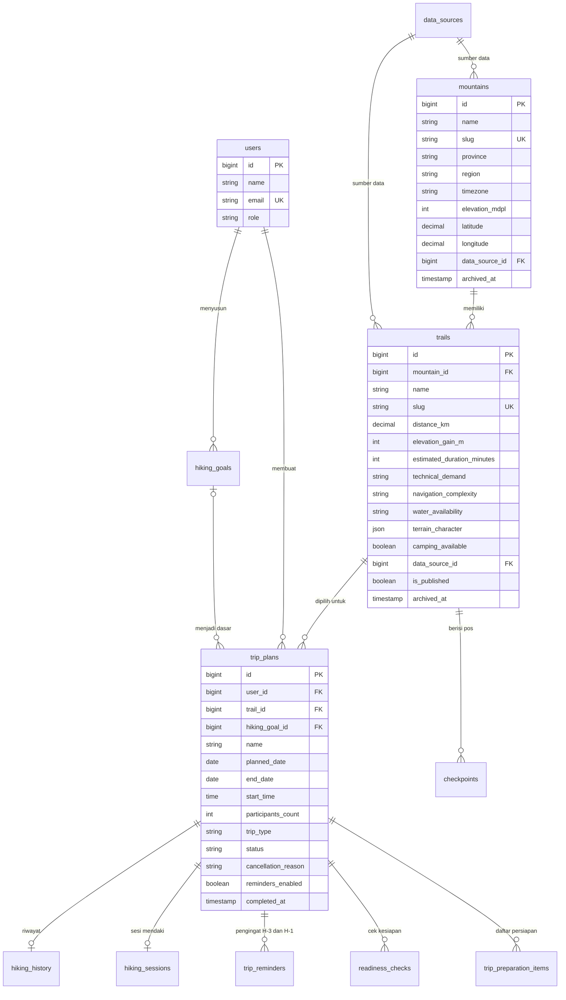
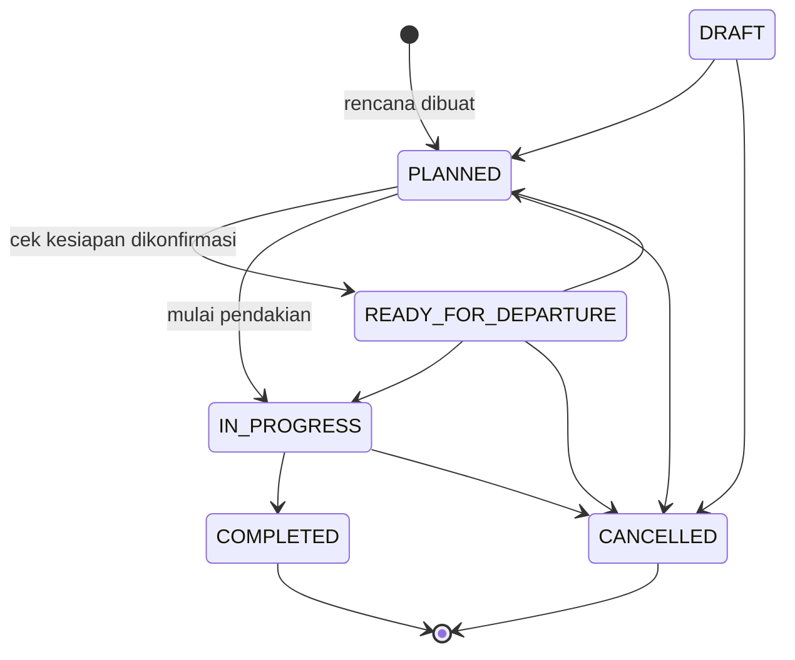

# 01. Data Model MEMOUNT

## 1. Padanan dengan tugas

Templat tugas Pertemuan 05 memakai contoh sistem pemesanan ruangan: entitas **Room** dan
**Booking**. MEMOUNT tidak memesan ruangan, jadi padanannya diambil dari domain pendakian
yang sudah ada di kode:

| Templat | Di MEMOUNT | Tabel | Model |
|---|---|---|---|
| Gedung (induk ruangan) | Gunung | `mountains` | `App\Models\Mountain` |
| Room | Jalur pendakian | `trails` | `App\Models\Trail` |
| Booking | Rencana trip pada satu jalur | `trip_plans` | `App\Models\TripPlan` |
| User pemesan | Pendaki | `users` | `App\Models\User` |

Ada satu perbedaan penting. Booking ruangan biasanya mengecek bentrok jadwal atau kuota.
Rencana trip di MEMOUNT **tidak** memesan apa pun ke pengelola gunung dan tidak mengurangi
kuota. Izin dan kuota tetap diurus di sistem resmi pengelola; MEMOUNT hanya menyebut aturan
dan tautan pemesanannya (`PermitRequirementSeeder`, `PermitService`). Karena itu tidak ada
pengecekan bentrok antar-pengguna pada `trip_plans`.

Gunung dan jalur sengaja dipisah (aturan R-001 dan R-002 di
[`.claude/rules/mountain-core.md`](../../.claude/rules/mountain-core.md)). Satu gunung
punya beberapa jalur dengan jarak, tanjakan, dan tingkat kesulitan yang berbeda. Keputusan
"cocok atau tidak" dibuat per jalur, bukan per gunung.

## 2. Diagram relasi inti

Diagram hanya memuat tabel yang dipakai CRUD Pertemuan 05 dan tabel yang langsung
bergantung padanya. Basis data lengkap berisi 65 berkas migrasi; daftarnya ada di
[`02-migration-model/README.md`](02-migration-model/README.md).

Diagram Mermaid di atas tampil sebagai gambar di GitHub dan di pratinjau Markdown VS Code.
Kolom yang ditampilkan dipilih seperlunya; daftar kolom lengkap per tabel ada di
`02-migration-model/`.

## 3. Relasi dan perilaku saat data induk dihapus

| Relasi | Kardinalitas | Foreign key | Saat induk dihapus | Berkas migrasi |
|---|---|---|---|---|
| Gunung ke jalur | 1 : N | `trails.mountain_id` | jalur ikut terhapus (`cascadeOnDelete`) | `2026_09_19_000220_create_trails_table.php` |
| Jalur ke rencana trip | 1 : N | `trip_plans.trail_id` | rencana ikut terhapus (`cascadeOnDelete`) | `2026_09_19_000410_create_trip_plans_table.php` |
| Pengguna ke rencana trip | 1 : N | `trip_plans.user_id` | rencana ikut terhapus (`cascadeOnDelete`) | `2026_09_19_000410_create_trip_plans_table.php` |
| Tujuan pendakian ke rencana trip | 0..1 : N | `trip_plans.hiking_goal_id` | kolom menjadi `NULL` (`nullOnDelete`) | `2026_09_19_000410_create_trip_plans_table.php` |
| Jalur ke pos | 1 : N | `checkpoints.trail_id` | pos ikut terhapus | `2026_09_19_000240_create_checkpoints_table.php` |
| Rencana trip ke persiapan, cek kesiapan, pengingat | 1 : N | `trip_plan_id` | ikut terhapus | `..._000440_`, `..._000530_`, `2026_09_25_000918_` |
| Rencana trip ke sesi mendaki | 1 : 0..1 | `hiking_sessions.trip_plan_id` (unik) | ikut terhapus | `..._000600_`, `2026_10_07_000100_` |
| Sumber data ke gunung dan jalur | 1 : N | `data_source_id` | kolom menjadi `NULL` | `..._000210_`, `..._000220_` |

Kolom `trip_plans.trail_id` yang cascade adalah alasan **jalur tidak pernah dihapus permanen
dari panel admin**. Menghapus satu jalur akan ikut menghapus rencana trip, daftar persiapan,
dan riwayat pendakian milik pendaki lain. Admin mengarsipkan jalur (`archived_at` diisi),
dan rencana yang sudah ada tetap dapat dibuka. Rincian ada di
[`04-crud-jalur/README.md`](04-crud-jalur/README.md).

## 4. Nilai yang dibatasi (enum)

Kolom bertipe `string` di basis data, tetapi nilainya dibatasi enum PHP lewat `casts()` di
model dan aturan validasi di Form Request.

| Kolom | Enum | Nilai |
|---|---|---|
| `users.role` | `App\Enums\UserRole` | `hiker`, `moderator`, `admin` |
| `trails.technical_demand` | `App\Enums\TechnicalDemand` | `LOW`, `MODERATE`, `HIGH`, `VERY_HIGH` |
| `trails.navigation_complexity` | `App\Enums\NavigationComplexity` | `LOW`, `MODERATE`, `HIGH` |
| `trails.water_availability` | `App\Enums\WaterAvailability` | `ABUNDANT`, `LIMITED`, `SCARCE`, `UNKNOWN` |
| `trip_plans.trip_type` | `App\Enums\TripType` | `TEKTOK`, `CAMPING`, `MULTI_DAY` |
| `trip_plans.status` | `App\Enums\TripStatus` | `DRAFT`, `PLANNED`, `READY_FOR_DEPARTURE`, `IN_PROGRESS`, `COMPLETED`, `CANCELLED` |
| `trip_plans.cancellation_reason` | `App\Enums\CancellationReason` | `WEATHER`, `OFFICIAL_STATUS`, `PHYSICAL_CONDITION`, `LOGISTICS`, `OTHER` |

### Transisi status rencana trip

Status rencana tidak boleh diisi bebas. `TripStatus::allowedTransitions()` menetapkan
perpindahan yang sah; `COMPLETED` dan `CANCELLED` bersifat final.

Rencana baru selalu lahir sebagai `PLANNED` (`TripLifecycle::create()`). Status `DRAFT` ada
di enum dan menjadi nilai bawaan kolom, tetapi alur pembuatan saat ini tidak memakainya.

## 5. Aturan data yang memengaruhi skema

1. **Kosong berarti belum diketahui, bukan nol** (R-006, R-007). Jarak, tanjakan, durasi,
   tanggal selesai, dan jumlah peserta dibuat `nullable` tanpa nilai bawaan. Jalur tanpa
   jarak tidak dianggap jalur pendek; trip tanpa jumlah peserta tidak dianggap nol orang.
   `water_availability` memakai `UNKNOWN`, bukan `SCARCE`, ketika belum ada data.
2. **Gerbang publikasi** (R-008, R-022). Kolom `trails.is_published` bawaannya `false`.
   Model `Trail` menolak penyimpanan jalur terbit yang belum punya sumber data, jarak,
   tanjakan, durasi, minimal satu pos, status resmi, dan geometri
   (`Trail::publishabilityReport()`, dijaga event `saving` di `Trail::booted()`).
3. **Rencana trip hanya untuk jalur terbit.** `StoreTripRequest` memakai aturan
   `exists` yang menyaring `is_published = true` dan `archived_at IS NULL`.
4. **Pemilik dan status ditetapkan server.** `user_id` diambil dari pengguna yang masuk dan
   `status` dari `TripLifecycle`; keduanya tidak ada di aturan validasi sehingga tidak
   pernah ikut dari formulir (perlindungan mass assignment).
5. **Data spasial hanya di PostgreSQL.** `PostGis::addGeography()` menambah kolom
   `mountains.location` (POINT) dan `trails.geometry` (LINESTRING) beserta indeks GiST.
   Pada SQLite helper ini berhenti tanpa menambah kolom, sehingga suite test SQLite tidak
   membuktikan perilaku spasial (R-024).

## 6. Sumber

- Migrasi: `database/migrations/` (65 berkas per 15 Oktober 2026).
- Model: `app/Models/Mountain.php`, `app/Models/Trail.php`, `app/Models/TripPlan.php`.
- Enum: `app/Enums/`.
- Aturan domain: `.claude/rules/mountain-core.md`; skema per domain: `database/README.md`.
